View this email in your browser. **Warning: Flashing Imagery**

Welcome to the latest Python on Microcontrollers newsletter! OK, the controversy. The CircuitPython Pirate language pack was supposed to be turned off, but I found out it wasn't. When CircuitPython just had a few boards, it was funny. Now with so many boards, it loads down the build process. So after I mentioned it, the developers finally turned it off for the upcoming CircuitPython 11. I'll take the heat, mates. 

With software reverse engineering and automated development exploding on the scene, expect many more applications in the coming days. To wit, there are two new MicroPython development environments out this week. I'm now off to walk the plank. - *Anne Barela, Editor*

We're on [Discord](https://discord.gg/HYqvREz), [Twitter/X](https://twitter.com/search?q=circuitpython&src=typed_query&f=live), [BlueSky](https://bsky.app/profile/circuitpython.org) and for past newsletters - [view them all here](https://www.adafruitdaily.com/category/circuitpython/). If you're reading this on the web, please [subscribe here](https://www.adafruitdaily.com/). Here's the news this week:

## Microbe: A New Lightweight IDE for MicroPython

Microbe is a new lightweight IDE for MicroPython by Mikayel Grigoryan. It talks directly to a board, giving a Python language server that knows the machine and network, and flashes firmware. It is built on Tauri instead of Electron, using an operating system's webview, and it has a Rust core - [GitHub](https://github.com/mikayelgr/microbe).

## Thingstudio Programs MicroPython Boards Using Nodes and Wires

[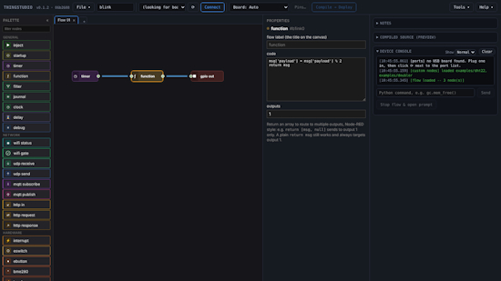](https://github.com/mkarliner/ThingStudio)

Thingstudio is a visual, low-code way to program microcontrollers. You build a flow of nodes and wires in a node-based editor in your browser, in the style of Node-RED. Thingstudio compiles the flow to MicroPython and sends it to your board, where it runs on its own: no server, no cloud, and no editor connected - [GitHub](https://github.com/mkarliner/ThingStudio) and [User guide](https://docs.thingstudio.net/).

## Casio-MicroPython Released

Casio-MicroPython allows one to write MicroPython programs for the Casio fx-CG100 graphing calculator, with tools to check and run them on a laptop. Programs are a single .py file of no more than 300 lines, the limit for one file in the calculator’s Python app. Graphics use Casio’s casioplot module. The `turtle` and `matplotlib.pyplot` modules are also available on the calculator. MIT License - [GitHub](https://github.com/Joe-Heffer/Casio-MicroPython).

## Python 3.15 Goes Global With UTF-8 Support & More

After a week’s delay, the new version of Python, v3.15, was released. With it comes a proper profiler, an experimental just-in-time compiler, and a tightening of dictionary structures. It also offers a time-saving lazy import option for programs to not load modules until needed, the implementation of which ironically halted this release until a few last-minute regressions were sorted.

"But of all these new delicacies spread before the Pythonistas, the data wranglers of the bunch may most appreciate default UTF-8 support across all platforms. And when we say “all platforms,” we’re really just throwing shade at Windows (as usual). Python has defaulted to macOS and Linux Python environments for some time now." - [The Register](https://www.theregister.com/devops/2026/10/14/python-315-goes-global-with-utf-8-support/5302966).

Python 3.15 delivers a native-by-default experience on Windows on Arm - [Windows Developer Blog](https://blogs.windows.com/windowsdeveloper/2026/10/14/python-3-15-delivers-native-by-default-experience-on-windows-arm/).

Python 3.16.0 alpha 1 is now available - [Python Insider](https://blog.python.org/2026/10/python-3160-alpha-1-is-now-available/).

## The Pirate Language Version of CircuitPython Has Been Dropped

Paul Cutler notes on Mastodon that the Pirate language version of CircuitPython was removed in the latest GitHub pull request. Your editor found the language still being built even after other developers had thought it had been removed. With the number of boards now supported, the fun feature of early CircuitPython builds was just crunching extra CPU cycles. Paul says "Was fun while it lasted, matey" while lead developer Scott said "Thank ya matey. It's been a pleasure. 🏴‍☠️" - [Mastodon](https://hachyderm.io/@prcutler/117441555945141271) and [GitHub](https://github.com/adafruit/circuitpython/pull/11595).

## What Happened At EuroPython 2026

[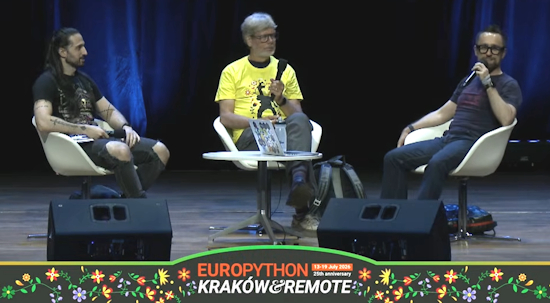](https://www.i-programmer.info/news/216-python/19219-what-happened-at-europython-2026.html)

Nikos Vaggalis provides an overview of EuroPython 2026, the 25th anniversary edition of Europe's longest-running community Python conference - [i-programmer.info](https://www.i-programmer.info/news/216-python/19219-what-happened-at-europython-2026.html) and Keynote: Core.py with Guido van Rossum - [YouTube](https://www.youtube.com/watch?v=9ZuZfG8_jH8).

## This Week's Python Streams

Python on Hardware is all about building a cooperative ecosphere which allows contributions to be valued and to grow knowledge. Below are the streams within the last week focusing on the community.

**CircuitPython Deep Dive Stream**

[Last Friday](https://youtube.com/live/efP7xpNFiuM), Scott streamed work on CircuitPython CSI Camera.

You can see the latest video and past videos on the Adafruit YouTube channel under the Deep Dive playlist - [YouTube](https://www.youtube.com/playlist?list=PLjF7R1fz_OOXBHlu9msoXq2jQN4JpCk8A).

**CircuitPython Parsec**

John Park’s CircuitPython Parsec this week is on STEMMA QT Port GPIO Pins - [Adafruit Blog](https://blog.adafruit.com/2026/10/16/john-parks-circuitpython-parsec-stemma-qt-port-gpio-pins/) and [YouTube](https://youtu.be/JcE2dxzyk9o?si=JZD0e027q5LH3qaV).

Catch all the episodes in the [YouTube playlist](https://www.youtube.com/playlist?list=PLjF7R1fz_OOWFqZfqW9jlvQSIUmwn9lWr).

**Deep Dive with Tim**

[Last week](https://youtube.com/live/vSkq5Mprm_E), Tim streamed work on CircuitPython SSTV Receiver and USB Host Microphone.

You can see the latest video and past videos on the Adafruit YouTube channel under the Deep Dive playlist - [YouTube](https://www.youtube.com/playlist?list=PLjF7R1fz_OOXBHlu9msoXq2jQN4JpCk8A).

**CircuitPython Weekly Meeting**

CircuitPython Weekly Meeting for October 13, 2026 ([notes](https://github.com/adafruit/adafruit-circuitpython-weekly-meeting/blob/main/2026/2026-10-13.md)) [on YouTube](https://youtu.be/z4A12lNypdA).

## Project of the Week: Image Locator Camera

[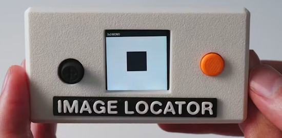](https://www.hackster.io/news/the-camera-that-doesn-t-take-photos-it-finds-them-9cb92f7468ee)

This Raspberry Pi camera doesn't save photos; it calculates where they exist in a theoretical library of every possible image. The hardware is built around a Raspberry Pi Zero W connected to an OV5647 camera module. An Adafruit 1.3-inch Color TFT Bonnet provides a 240×240 pixel display, joystick, and buttons, while a Waveshare UPS HAT supplies portable power - [hackster.io](https://www.hackster.io/news/the-camera-that-doesn-t-take-photos-it-finds-them-9cb92f7468ee) and [YouTube](https://youtu.be/2Kt8SOp8TvM?si=qzEMly7QteB6ASSi).

## Popular Last Week

[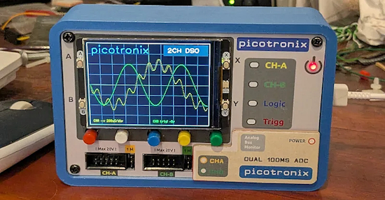](https://picotronix.com/)

What was the most popular, most clicked link, in [last week's newsletter](https://www.adafruitdaily.com/2026/10/12/python-on-microcontrollers-newsletter-python-3-15-released-while-micropython-1-30-is-getting-closer-and-more/)? [Picotronix: an open architecture, MicroPython-programmable modular instrument](https://picotronix.com/).

Did you know you can read past issues of this newsletter in the Adafruit Daily Archive? [Check it out](https://www.adafruitdaily.com/category/circuitpython/).

## Notes from Adafruit Playground

[Adafruit Playground](https://adafruit-playground.com/) is a place for the community to post their projects and other making tips/tricks/techniques. Ad-free, it's an easy way to publish your work in a safe space for free.

[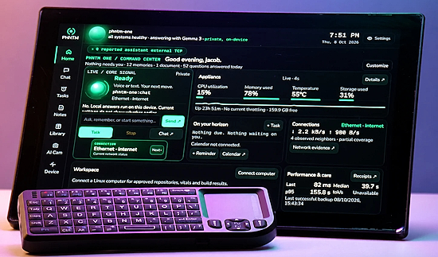](https://adafruit-playground.com/u/Phantomcore/pages/phntm-one-a-local-ai-desk-companion-built-around-raspberry-pi-5)

PHNTM One: a local AI desk companion built around Raspberry Pi 5 - [Adafruit Playground](https://adafruit-playground.com/u/Phantomcore/pages/phntm-one-a-local-ai-desk-companion-built-around-raspberry-pi-5).

## News From Around the Web

Burn Helper: your Claude Code agents as a pixel game on a Pimoroni Tufty 2350 conference badge. A pixel-art character on the badge sleeps, idles, walks, runs or sprints depending on how many Claude Code agents are working across your sessions. Ten hearts (or chocolates, or collar lights, depending on the theme) show how much of your 5-hour usage limit is left, with a countdown to the next reset; a second meter shows the weekly limit. There are three themes: a Zelda-style field, The Running Man game show, and Forrest Gump's run across America. MicroPython under an MIT License - [GitHub](https://github.com/pureyang/burn-helper).

Hell Ride is a 3D carnival dark ride that starts out cheesy and ends in hell. It runs on an Adafruit Fruit Jam (RP2350) and outputs 320×240 to a DVI display at 30 fps. It's programmed in MicroPython - [YouTube](https://www.youtube.com/watch?v=XowodEERlyI).

[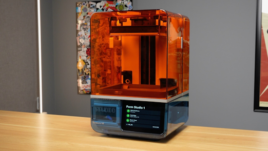](https://www.jeffgeerling.com/blog/2026/formlabs-form-studio-1-resin-printer/)

Formlabs drops the Raspberry Pi on the way to a $699 SLA printer - [Jeff Geerling](https://www.jeffgeerling.com/blog/2026/formlabs-form-studio-1-resin-printer/).

[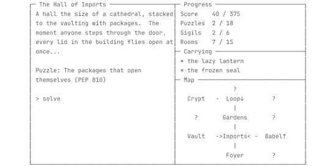](https://gitlab.com/flufl/whatsnewt)

`whatsnewt` is a TUI text adventure through what's new in Python 3.15 - [GitLab](https://gitlab.com/flufl/whatsnewt).

Agent Semaphore is a small traffic light for your desk that shows what your AI coding agent is doing, coded in CircuitPython on a Raspberry Pi Pico - [GitHub](https://github.com/longinusboy/agent-semaphore).

[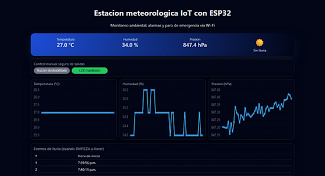](https://github.com/Cracksmity/estacion-meteorologica-esp32)

A desktop-sized weather station: an ESP32 running MicroPython reads temperature, humidity, pressure, and rainfall, and serves a web panel on the local network with live graphs - [GitHub](https://github.com/Cracksmity/estacion-meteorologica-esp32). (Spanish)

[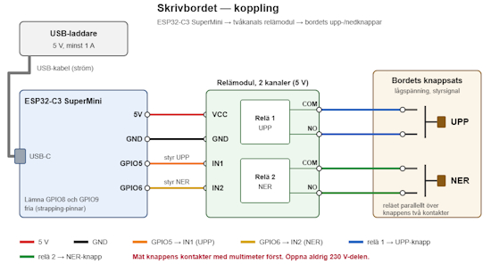](https://github.com/B2elks/skrivbordscontroller/tree/main)

skrivbordscontroller: control a height-adjustable desk via voice, over the phone, with ESP32-C3 and MicroPython - [GitHub](https://github.com/B2elks/skrivbordscontroller/tree/main). (Swedish)

[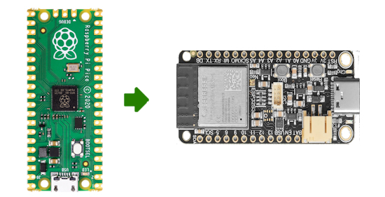](https://mastodon.world/@gallaugher/117425660671298483)

Professor Gallaugher posts "Learnings as I transition from Pico 2W to ESP32-S3s for CircuitPython class. Audio is more complex, but a DAC/AMP combo like the MAX98357 drops setup to 1 bd w/5 wires. The DF Robot's has a JST socket matching lots of inexpensive speakers. 3v audio sounds worse but lowering volume in code fixed it." - [Mastodon](https://mastodon.world/@gallaugher/117425660671298483).

[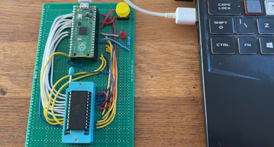](https://www.instructables.com/Pi-Pico-EEPROM-Programmer/)

A Pi Pico EEPROM Programmer using MicroPython and Thonny - [Instructables](https://www.instructables.com/Pi-Pico-EEPROM-Programmer/) and [YouTube](https://www.youtube.com/watch?v=2M-B9EGBS70).

[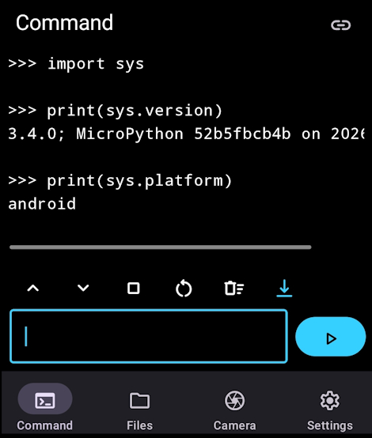](https://github.com/koendv/upy-android)

`upy-android` is MicroPython for Android with an OpenMV-inspired computer-vision API - [GitHub](https://github.com/koendv/upy-android).

[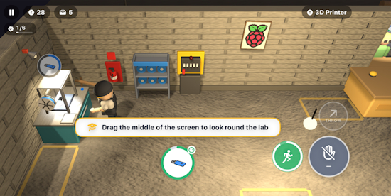](https://www.raspberrypi.com/news/from-garage-tinkerer-to-professional-maker-in-chief-now-as-a-game/)

Toby Roberts has a free Maker Lab game, using Python to synthesize its sounds, and shows how a small local model on a Raspberry Pi 5 can write Pygame games - [Raspberry Pi News](https://www.raspberrypi.com/news/from-garage-tinkerer-to-professional-maker-in-chief-now-as-a-game/).

[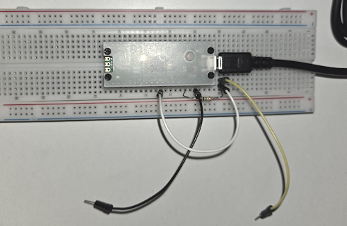](https://github.com/xoel-maestu/TouchSynth)

TouchSynth is a touch instrument for two people. Each player holds one electrode; when they touch skin to skin, a Raspberry Pi Pico 2 measures the conductance of the contact and a Python synthesizer turns it into a continuous ambient pad that responds to how they touch - [GitHub](https://github.com/xoel-maestu/TouchSynth).

[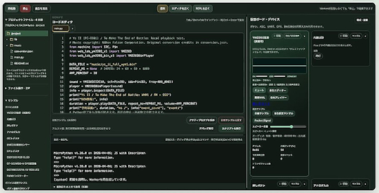](https://x.com/kemusiro/status/2109547120223240467)

@kemusiro on X posts "I've experimentally added a virtual YM2203 module to MicroPython Web Lab. It controls the YM2203 via I2C from MicroPython. The PC-8801 version of Ys II, which uses the YM2203, was playable. With sound. Only the first 20 seconds." - [X](https://x.com/kemusiro/status/2109547120223240467).

[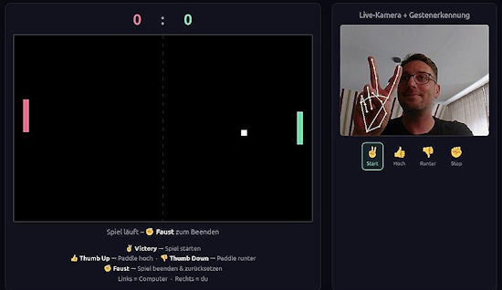](https://x.com/r_schulz_maker/status/2109292016119300121)

Roland Schulz posts "First attempt at my Pong interpretation. I control the player using gesture recognition powered by Arduino Ventuno Q and Arduino App Lab bricks." - [X](https://x.com/r_schulz_maker/status/2109292016119300121).
 
[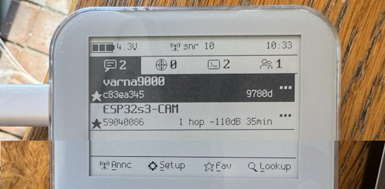](https://x.com/circuit_k/status/2109205601913852123)

Circfruit posts "I've created new UI interface for the Lilygo9 T-deck Pro, running Reticulum over LoRa and WiFi and MicroPython It works with the screen touch sensor very good. Taps are very responsive, but gestures feel a bit laggish. Need to improve it somehow, the code loop is very tight." - [X](https://x.com/circuit_k/status/2109205601913852123). (Image squished)

[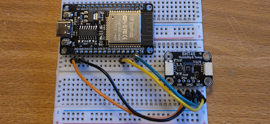](https://github.com/florianerler/aisthetron-aer)

AISTHETRON AER is an experimental environmental sensing project. Its first prototype, AER-C01, measures ambient temperature and relative humidity with an ESP32 and an SHT45 sensor using MicroPython - [GitHub](https://github.com/florianerler/aisthetron-aer).

[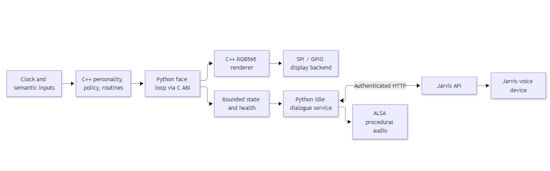](https://github.com/dsorensen228/sherman)

Sherman is a desktop robot project built around a Luckfox Pico Ultra W Linux board. The current implementation is a stationary character: animated eyes, local personality and routine logic, and generated audio exchanges using Python - [GitHub](https://github.com/dsorensen228/sherman).

[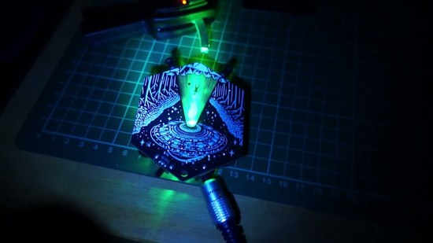](https://www.youtube.com/watch?v=nhHWuNqWY3Y)

EMF Explorer Badge with six extra Adafruit LED Sequins, controlled by a Pi Pico running CircuitPython - [YouTube](https://www.youtube.com/watch?v=nhHWuNqWY3Y).

MITTEN V2 is an MIT-licensed wearable electronic glove that translates hand gestures into spoken audio using MicroPython - [GitHub](https://github.com/erosciceri-ai/mitten-v2). (Spanish)

## New

[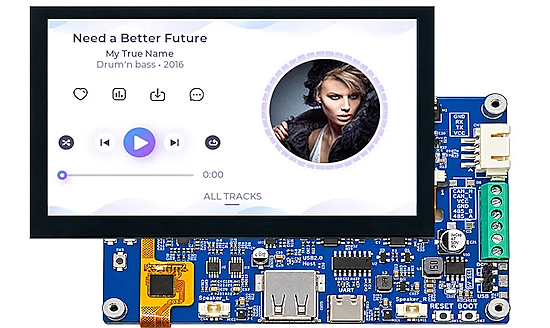](https://www.cnx-software.com/2026/10/14/viewe-4-3-inch-esp32-s31-display-development-board/)

VIEWE has introduced the PLCM-UES31S043H800V480C-U, a 4.3-inch smart display module that appears to be the first third-party development board powered by the new ESP32-S31 MCU. The board includes a 4.3-inch display with 2.4 GHz Wi-Fi 6, Bluetooth 5.4 LE and Classic, and IEEE 802.15.4 for Zigbee and Thread. It also features USB-C and USB-A ports, a microSD card slot, RS485 and CAN interfaces, and a 20-pin GPIO expansion header with UART and I2C - [CNX](https://www.cnx-software.com/2026/10/14/viewe-4-3-inch-esp32-s31-display-development-board/).

[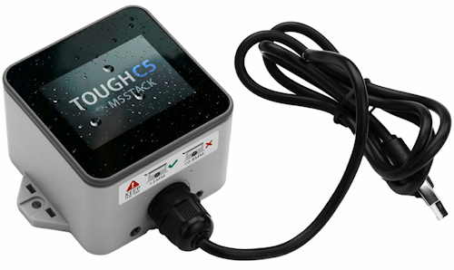](https://www.cnx-software.com/2026/10/10/m5stack-toughc5-weatherproof-esp32-c5-iot-controller-offers-dual-band-wi-fi-6-ble-5-and-zigbee-thread/)

M5Stack has just introduced the ToughC5, a rugged, weatherproof outdoor IoT controller built around the ESP32-C5. The device features a bright 2.0-inch capacitive touch IPS display and RS485 connectivity. The ToughC5 is an upgrade to the ESP32-based M5Stack TOUGH, moving to the more modern ESP32-C5 MCU with dual-band (2.4/5 GHz) Wi-Fi 6, Bluetooth 5 LE, and an IEEE 802.15.4 radio for Zigbee and Thread - [CNX](https://www.cnx-software.com/2026/10/10/m5stack-toughc5-weatherproof-esp32-c5-iot-controller-offers-dual-band-wi-fi-6-ble-5-and-zigbee-thread/).

## New Boards Supported by CircuitPython

The number of supported microcontrollers and Single Board Computers (SBC) grows every week. This section outlines which boards have been included in CircuitPython or added to [CircuitPython.org](https://circuitpython.org/).

This week there was one new board added:

- [Maker Sumo RP2350](https://circuitpython.org/board/cytron_maker_sumo_rp2350/) – Cytron Technologies

*Note: For non-Adafruit boards, please use the support forums of the board manufacturer for assistance, as Adafruit does not have the hardware to assist in troubleshooting.*

Looking to add a new board to CircuitPython? It's highly encouraged! Adafruit has four guides to help you do so:

- [How to Add a New Board to CircuitPython](https://learn.adafruit.com/how-to-add-a-new-board-to-circuitpython/overview)
- [How to add a New Board to the circuitpython.org website](https://learn.adafruit.com/how-to-add-a-new-board-to-the-circuitpython-org-website)
- [Adding a Single Board Computer to PlatformDetect for Blinka](https://learn.adafruit.com/adding-a-single-board-computer-to-platformdetect-for-blinka)
- [Adding a Single Board Computer to Blinka](https://learn.adafruit.com/adding-a-single-board-computer-to-blinka)

## New Adafruit Learning System Guide

The [Adafruit Learning System](https://learn.adafruit.com/) has over 3,200 free guides for learning skills and building projects including using Python.

[Fruit Jam Face Detection](https://learn.adafruit.com/fruit-jam-face-detection) from [Liz Clark](https://learn.adafruit.com/u/BlitzCityDIY)

## CircuitPython Libraries

The CircuitPython library numbers are continually increasing, while existing ones continue to be updated. Here we provide library numbers and updates!

To get the latest Adafruit libraries, download the [Adafruit CircuitPython Library Bundle](https://circuitpython.org/libraries). To get the latest community contributed libraries, download the [CircuitPython Community Bundle](https://circuitpython.org/libraries).

If you'd like to contribute to the CircuitPython project on the Python side of things, the libraries are a great place to start. Check out the [CircuitPython.org Contributing page](https://circuitpython.org/contributing). If you're interested in reviewing, check out Open Pull Requests. If you'd like to contribute code or documentation, check out Open Issues. We have a guide on [contributing to CircuitPython with Git and GitHub](https://learn.adafruit.com/contribute-to-circuitpython-with-git-and-github), and you can find us in the #help-with-circuitpython and #circuitpython-dev channels on the [Adafruit Discord](https://adafru.it/discord).

You can check out this [list of all the Adafruit CircuitPython libraries and drivers available](https://github.com/adafruit/Adafruit_CircuitPython_Bundle/blob/master/circuitpython_library_list.md). 

The current number of CircuitPython libraries is **592**!

**New Libraries**

There are no new libraries this week.

**Updated Libraries**

Here are this week's updated CircuitPython libraries:

* [adafruit/Adafruit_CircuitPython_RFM](https://github.com/adafruit/Adafruit_CircuitPython_RFM)
* [adafruit/Adafruit_CircuitPython_Bitmap_Font](https://github.com/adafruit/Adafruit_CircuitPython_Bitmap_Font)

## What’s the CircuitPython team up to this week?

What is the team up to this week? Let’s check in:

**Dan**

I'm continuing to add features to the Zephyr port. I added `bitbangio` and am now finishing changes to make the board buses be allocated dynamically instead of statically, to match how CircuitPython has done it before. I've also fixed several BLE bugs and improved BLE error reporting.

**Tim**

This week I discovered that there are SSTV images transmitted in HF bands by ham radio operators. I've adapted the ARISS SSTV event code to handle signals from both the ISS and the ones sent by terrestrial hams. I also made the combined version of the project code support either a DVI display or a small OLED automatically based on whichever is connected. The antennas required to receive on the HF bands used by hams are different from the ones needed to pick up frequencies used by the ISS. I built a long wire antenna, and an MLA-30 active loop antenna and have successfully captured SSTV photos on both. Here are a few of the neat photos that have been received and decoded on the Fruit Jam.

**Scott**

This week I've been focused on adding CSI camera support to CircuitPython. I'm starting with the ESP32-P4 but targeting a generic interface. A new `videocore.VideoBuffer` class can be added to a `displayio.Group` to integrate the video with `displayio`. It does have some constraints, however, because the video transfer may be optimized under the hood. I've also started building `displayio` on top of LVGL to take advantage of graphics accelerators in higher end chipsets like the P4.

**Liz**

This week I published the [Fruit Jam Motion Tracking Eyeballs guide](https://learn.adafruit.com/fruit-jam-motion-tracking-eyeballs). This demo uses the new USB host webcam support to track motion. When motion is detected, a pair of monster eyes appears on the DVI display and their gaze points to the coordinates where the motion was detected in the camera's field of view. This project is made possible with two Turbo modules: one to handle drawing the monster eyes and one to compare each camera frame to detect motion and calculate where the eyes should gaze.

## Upcoming Events

The next MicroPython Meetup in Melbourne will be on October 25th - [Luma](https://luma.com/micropython). You can see recordings of previous meetings on [YouTube](https://www.youtube.com/@MicroPythonOfficial). 

**Other Events This Year**

* [Espressif DevCon 2026](https://devcon.espressif.com/) will be November 3-4 in Milan, Italy and online.

If you know of virtual events or upcoming events, please let us know via email to cpnews(at)adafruit(dot)com.

## Latest Releases

CircuitPython's stable release is [10.3.1](https://github.com/adafruit/circuitpython/releases/latest) and its unstable release is [11.0.0-alpha.1](https://github.com/adafruit/circuitpython/releases). New to CircuitPython? Start with our [Welcome to CircuitPython Guide](https://learn.adafruit.com/welcome-to-circuitpython).

[20261016](https://github.com/adafruit/Adafruit_CircuitPython_Bundle/releases/latest) is the latest Adafruit CircuitPython library bundle.

[20261008](https://github.com/adafruit/CircuitPython_Community_Bundle/releases/latest) is the latest CircuitPython Community library bundle.

[v1.29.0](https://micropython.org/download) is the latest MicroPython release. Documentation for it is [here](http://docs.micropython.org/en/latest/pyboard/).

[3.15.0](https://www.python.org/downloads/) is the latest Python release. The latest pre-release version is [3.16.0a1](https://www.python.org/download/pre-releases/).

[4,568 Stars](https://github.com/adafruit/circuitpython/stargazers) Like CircuitPython? [Star it on GitHub!](https://github.com/adafruit/circuitpython)

## Call for Help -- Translating CircuitPython is now easier than ever

[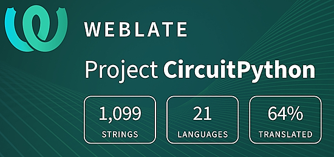](https://hosted.weblate.org/engage/circuitpython/)

One important feature of CircuitPython is translated control and error messages. With the help of fellow open source project [Weblate](https://weblate.org/), we're making it even easier to add or improve translations. 

Sign in with an existing account such as GitHub, Google or Facebook and start contributing through a simple web interface. No forks or pull requests needed! As always, if you run into trouble join us on [Discord](https://adafru.it/discord), we're here to help.

## 38,831 Thanks

The Adafruit Discord community, where we do all our CircuitPython development in the open, reached over 38,831 humans - thank you! Adafruit believes Discord offers a unique way for Python on hardware folks to connect. Join today at [https://adafru.it/discord](https://adafru.it/discord).

## ICYMI - In case you missed it

Python on hardware is the Adafruit Python video-newsletter-podcast! The news comes from the Python community, Discord, Adafruit communities and more and is broadcast on ASK an ENGINEER Wednesdays. The complete Python on Hardware weekly videocast [playlist is here](https://www.youtube.com/playlist?list=PLjF7R1fz_OOXRMjM7Sm0J2Xt6H81TdDev). The video podcast is on [iTunes](https://itunes.apple.com/us/podcast/python-on-hardware/id1451685192?mt=2), [YouTube](http://adafru.it/pohepisodes), [Instagram](https://www.instagram.com/adafruit/channel/), and [XML](https://itunes.apple.com/us/podcast/python-on-hardware/id1451685192?mt=2).

[The weekly community chat on Adafruit Discord server CircuitPython channel - Audio / Podcast edition](https://itunes.apple.com/us/podcast/circuitpython-weekly-meeting/id1451685016) - Audio from the Discord chat space for CircuitPython, meetings are usually Mondays at 2pm ET, this is the audio version on [iTunes](https://itunes.apple.com/us/podcast/circuitpython-weekly-meeting/id1451685016), Pocket Casts, [Spotify](https://adafru.it/spotify), and [XML feed](https://adafruit-podcasts.s3.amazonaws.com/circuitpython_weekly_meeting/audio-podcast.xml).

## Contribute

The CircuitPython Weekly Newsletter is a CircuitPython community-run newsletter emailed every Monday. To contribute your content, please email your news to cpnews (at) adafruit (dot) com with information and link(s) to your content. 

Join the Adafruit [Discord](https://adafru.it/discord) or [post to the forum](https://forums.adafruit.com/viewforum.php?f=60) if you have questions.
