View this email in your browser. **Warning: Moving Imagery**

Welcome to the latest Python on Microcontrollers newsletter! It's been a tough week for many folks, with security issues found in PHP, security certificates and more. The sysadmins have had it quite bad. In looking for news, I report the issues most affecting the Python on hardware world. The certificate store currently in CircuitPython is fine, I'm told. 

The biggest news is the scope of the updates to CircuitPython. 11.0.0-alpha.2 contains a large number of changes, likely the most for a point release. The capabilities are growing at a healthy rate and worth looking at if you would like some speed improvements or fancy new features. Of course there is the cornucopia of other items worth looking at too. I wish all who celebrate a happy Halloween. - *Anne Barela, Editor*

We're on [Discord](https://discord.gg/HYqvREz), [Twitter/X](https://twitter.com/search?q=circuitpython&src=typed_query&f=live), [BlueSky](https://bsky.app/profile/circuitpython.org) and for past newsletters - [view them all here](https://www.adafruitdaily.com/category/circuitpython/). If you're reading this on the web, please [subscribe here](https://www.adafruitdaily.com/). Here's the news this week:

## CircuitPython 11.0.0-alpha.2 is Released

CircuitPython 11.0.0-alpha.2, an alpha release for 11.0.0, has been released. Further features, changes, and bug fixes will be added before the final release of 11.0.0 - [Adafruit Blog](https://blog.adafruit.com/2026/10/21/circuitpython-11-0-0-alpha-2-released/) and release notes [GitHub](https://github.com/adafruit/circuitpython/releases/tag/11.0.0-alpha.2).

**Highlights of changes since 11.0.0-alpha.1**

* `storage.map_file` allows directly reading a file from mapped flash.
* `usb_host_audio.USBIn` to support USB microphones.
* `RGBMatrix` supports ABC row addressing.
* USB Host Bulk IN support.
* Many speedups, especially in `displayio`.
* Many firmware size reductions.
* Espressif ESP32-S31 and ESP32-P4 support.
* Zephyr additions: `analogio`, `bitbangio`, `neopixel_write`, `pwmio`, `rtc`, and `watchdog`. Dynamic allocation of board buses.

## Security Updates Required For Python Utilities

A security incident affecting eMudhra intermediate certificates has required removing the emSign root CA certificate from CA bundles such as “certifi”. It’s important to immediately upgrade the software packages below to at least the versions specified and rebuild container images with layer caching disabled to fetch the latest system certificates. Failure to do so could result in monster-in-the-middle (MITM) attacks against TLS clients, including python.org and pypi.org - [Python Discussion Board](https://discuss.python.org/t/information-for-python-users-regarding-emudhra-emsign-ca-certificate-security-incident/109576) and [Cloudflare Blog](https://blog.cloudflare.com/emudhra-certificate-compromise/).

* `certifi` 2026.10.19
* `pip` 26.2.2
* `uv` 0.13.4
* `sigstore` 4.5.1
* `conda` 26.9.4
* `pixi` 0.82.1

## iCircuit 1.16 Adds Full RP2350 Emulation, booting CircuitPython or MicroPython

The iCircuit 1.16 emulator now offers full RP2350 emulation, PIO included, which boots stock MicroPython, wired into a live analog circuit simulator. Slide a potentiometer and Python reads voltage changes - [iCircuit](https://icircuitapp.com/). Via [X](https://x.com/praeclarum/status/2112183556491608574).

## The GitHub Universe 2026 Badge Runs MicroPython

The GitHub Universe 2026 badge is a custom derivative of Pimoroni's Tufty 2350, part of the Badger, Tufty, and Blinky digital badge crew. It retains Tufty's RP2350B, 320x240 color LCD, 8 MB PSRAM, 16 MB flash, wireless module, battery, case lighting, light sensor, and Qw/ST expansion connector. The GitHub Universe version extends that platform with hardware designed for interactive games and badge-to-badge experiences: an onboard LSM6DS3TR-C accelerometer and gyroscope, IR transmit and receive hardware, eight capacitive touch pads (a directional pad plus Select, Back, Menu, and Home), and five physical front controls that work with the touch pads through the firmware's orientation-aware logical input API - [GitHub](https://github.com/badger/home) and Kyle Daigle's review with video, mirrored from X - [BlueSky](https://bsky.app/profile/kdaigle.xmirror.bot/post/3myi6qsj34626).

## New Book: The Raspberry Pi Guide to Retro Gaming

Raspberry Pi and retro games go hand in hand, with people emulating classic consoles and computers on Raspberry Pi devices since shortly after the release of the original Raspberry Pi. A new book looks to highlight how to build retro gaming hardware and software - [Raspberry Pi Press](https://www.raspberrypi.com/news/introducing-the-raspberry-pi-guide-to-retro-gaming/).

## The Best IDE for Python: 4 Editors, From $0 to $200

The short answer for the best IDE for Python in October 2026: pick VS Code if you want one free tool that handles almost every Python job, PyCharm if you maintain a large Django, data or machine-learning codebase, Cursor if you work through AI agents all day and can live with plans that changed ten days ago, and Zed if raw responsiveness matters more than a deep plugin catalog - [Shattered](https://shattered.io/best-ide-for-python-2026/).

## This Week's Python Streams

Python on Hardware is all about building a cooperative ecosphere which allows contributions to be valued and to grow knowledge. Below are the streams within the last week focusing on the community.

**CircuitPython Deep Dive Stream**

[Last Friday](https://youtube.com/live/NwcZTs3Vf5Y), Tim fills in for Scott, working on SSTV photos from space and a new CircuitPython Map Tiles Library.

You can see the latest video and past videos on the Adafruit YouTube channel under the Deep Dive playlist - [YouTube](https://www.youtube.com/playlist?list=PLjF7R1fz_OOXBHlu9msoXq2jQN4JpCk8A).

**Deep Dive with Tim**

[Last week](https://youtube.com/live/bex3QBFbrUY), Tim streamed work on the CircuitPython audiotap module, FT8 receiver, and Fruit Jam Web Workflow.

You can see the latest video and past videos on the Adafruit YouTube channel under the Deep Dive playlist - [YouTube](https://www.youtube.com/playlist?list=PLjF7R1fz_OOXBHlu9msoXq2jQN4JpCk8A).

**CircuitPython Weekly Meeting**

CircuitPython Weekly Meeting for October 19, 2026 ([notes](https://github.com/adafruit/adafruit-circuitpython-weekly-meeting/blob/main/2026/2026-10-19.md)) [on YouTube](https://youtu.be/la1iIbv9ZfY).

## Project of the Week: A universal game controller firmware for CircuitPython

UniversalGC is a universal game controller firmware for CircuitPython, in the spirit of FreeJoy. Pedals, button boxes, steering wheels, flight sim panels, arcade sticks – what is wired to which pin lives in device.json and is configured in the browser, over a WiFi access point the device opens itself. No compiler, no flashing tool, no PC software. Runs on Raspberry Pi Pico W / Pico 2 W and ESP32-S3 (with Bluetooth LE) - [GitHub](https://github.com/CountZ74/UniversalGC).

## Popular Last Week

[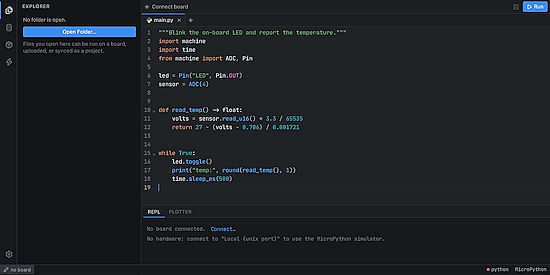](https://github.com/mikayelgr/microbe)

What was the most popular, most clicked link, in [last week's newsletter](https://www.adafruitdaily.com/2026/10/19/new-micropython-dev-environments-pirate-gets-the-boot-and-more/)? [Microbe, a fast, lightweight IDE for MicroPython](https://github.com/mikayelgr/microbe).

Did you know you can read past issues of this newsletter in the Adafruit Daily Archive? [Check it out](https://www.adafruitdaily.com/category/circuitpython/).

## Notes from Adafruit Playground

[Adafruit Playground](https://adafruit-playground.com/) is a place for the community to post their projects and other making tips/tricks/techniques. Ad-free, it's an easy way to publish your work in a safe space for free.

[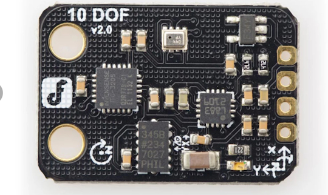](https://adafruit-playground.com/u/kma248/pages/circuitpython-drivers-for-the-dfrobot-sen0140-10-dof-imu)

CircuitPython drivers for the DFRobot SEN0140 10-DOF IMU - [Adafruit Playground](https://adafruit-playground.com/u/kma248/pages/circuitpython-drivers-for-the-dfrobot-sen0140-10-dof-imu).

[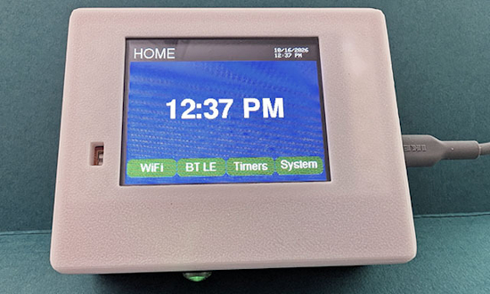](https://adafruit-playground.com/u/danak/pages/from-rabbit-holes-to-catacombs-programming-with-ai)

From Rabbit Holes to Catacombs - Programming with AI - [Adafruit Playground](https://adafruit-playground.com/u/danak/pages/from-rabbit-holes-to-catacombs-programming-with-ai).

## News From Around the Web

picostellar by Vladimír Smitka is a planetarium for CircuitPython 11, showing 8,400 stars, constellations, the Sun, the Moon and the planets for any place and time. It runs on RP2040-class boards and up, made for the PicoPad and the Adafruit Fruit Jam (RP2350), using the `picogame` engine, `turbo` (viper) functions and flash-mapped files - [GitHub](https://github.com/MakerClassCZ/picostellar).

[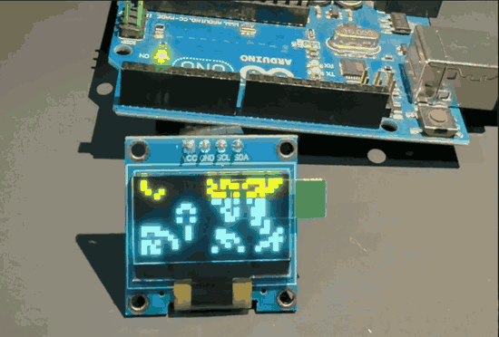](https://docs.pymcu.org/guides/game-of-life-oled/)

PyMCU, which compiles Python into bare-metal firmware with no interpreter or VM, has reached its first beta. Some unmodified Adafruit CircuitPython libraries, installed straight from PyPI, now run on a real Arduino Uno: adafruit_ssd1306, with framebuf and bus_device, drives Conway's Game of Life on a 128x64 OLED - [Guide](https://docs.pymcu.org/guides/game-of-life-oled/) and [PyPI](https://pypi.org/project/pymcu-compiler/).

[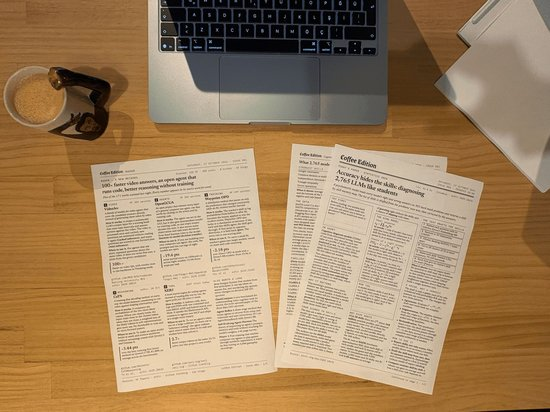](https://github.com/ierolsen/coffee-edition-kit)

Coffee Edition is a two-page newspaper that a Raspberry Pi Pico 2 W prints every morning. A Claude Code routine writes the issue overnight and GitHub Actions checks every page; the Pico, running MicroPython, pulls the job from GitHub over HTTPS, holds it until its print time and streams it to a network printer over IPP. MIT License - [GitHub](https://github.com/ierolsen/coffee-edition-kit) and [write-up](https://erolsen.dev/writing/coffee-edition).

[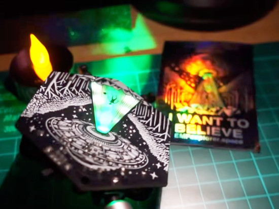](https://www.instructables.com/Emf-Explorer-Badge-Animated-Leds-Sequin-Ghosts)

The [EMF Explorer Badge Soldering Kit](https://emfexplorer.space/) is a fun kit, useful for learning how to solder and exploring the hidden world of electromagnetic fields. This article shows how to add a Raspberry Pi Pico and some Adafruit sequins to animate the lit tractor beam with a CircuitPython program using the [analogbufio library](https://docs.circuitpython.org/en/latest/shared-bindings/analogbufio/index.html) to trigger the animation when a magnetic field is detected - [Instructables](https://www.instructables.com/Emf-Explorer-Badge-Animated-Leds-Sequin-Ghosts).

Python 3.15.1, 3.14.9 and 3.13.17 are out. They all upgrade the bundled pip to version 26.2.2, which includes certifi 2026.10.19 to address the eMudhra / emSign CA certificate security incident - [Python Insider Blog](https://blog.python.org/2026/10/python-3151-3149-31317/).

Wikis: Relaunched! - [PSF News](https://pyfound.blogspot.com/2026/10/wikis-relaunched.html).

Mark your calendars! PSF Board office hours for the year ahead - [PSF News](https://pyfound.blogspot.com/2026/10/mark-your-calendars-psf-board-office.html).

[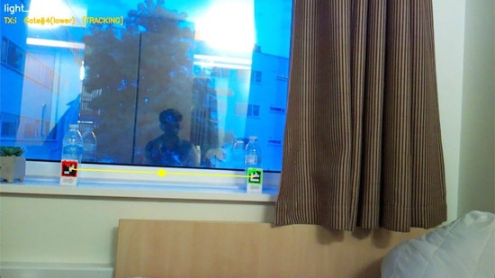](https://github.com/nithun-rajan/ariadne-rover)

Ariadne is a rover built by a four-person University of Southampton team that spots gates made of printed marker cards with a camera, drives through them and counts each one. A Raspberry Pi 4 does the vision in Python with OpenCV, with no neural network, and sends steering letters over UART to a Raspberry Pi Pico (RP2040) running C++ motor firmware - [GitHub](https://github.com/nithun-rajan/ariadne-rover) and [YouTube](https://www.youtube.com/watch?v=BA4ykBaHccs).

[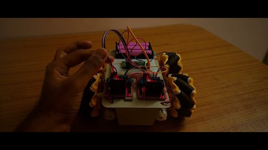](https://www.youtube.com/watch?v=H9jywkJwfZw)

Student Aadhiswar Saravanan built a four-wheel Mecanum robot for IITM School Connect that can drive sideways, diagonally and spin in place without turning its chassis. A Raspberry Pi Pico WH running MicroPython drives the wheels through two L298N motor drivers - [YouTube](https://www.youtube.com/watch?v=H9jywkJwfZw).

Michael Kennedy and a panel of Calvin Hendryx-Parker, Pat Decker, Reuven Lerner and Sydney Runkle compare the Python tools they would still pick in 2026, from editors and terminals to databases and hosting, and how AI has changed those choices - [Talk Python To Me](https://talkpython.fm/episodes/show/566/state-of-the-art-in-python-2026).

John Gallaugher follows up on his October 12 post in last week's issue, where a MAX98357 DAC and amplifier combo board looked like the simplest audio setup for his CircuitPython class on ESP32-S3 boards. After more testing, an Adafruit PCM5102 DAC with a PAM8302 amp on 3.3 V sounded good through a 3 W, 4 ohm speaker, while two MAX98357A boards sounded poor with the same speaker and code, and he is asking for single-board combos that work better - [Mastodon](https://mastodon.world/@gallaugher/117453935917711866) and [last week's post](https://mastodon.world/@gallaugher/117425660671298483).

[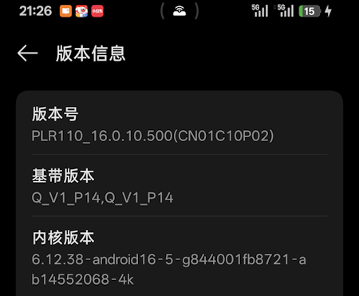](https://github.com/zhongqing725/esp32-phone-agent)

An ESP32-S3 running MicroPython joins an Android phone's hotspot, reads the screen through the Mobilerun Portal app, asks a DeepSeek model what to do, and taps and types on the phone. No PC, no ADB host, no root. The whole agent loop runs on the microcontroller in MicroPython - [GitHub](https://github.com/zhongqing725/esp32-phone-agent).

[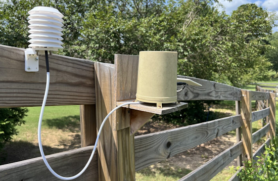](https://github.com/scottlecomte/Local-LoRa-Moisture-Sensor)

A local LoRa moisture sensor with a MicroPython client - [GitHub](https://github.com/scottlecomte/Local-LoRa-Moisture-Sensor).

An e-ink business card can use CircuitPython - [YouTube](https://www.youtube.com/watch?v=ALCCt6S7NG0).

[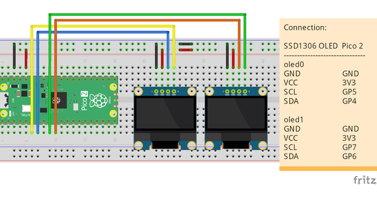](https://coxxect.blogspot.com/2026/10/raspberry-pi-pico-2micropython-to.html)

coXXect drives two 128 x 64 SSD1306 OLED displays from a Raspberry Pi Pico 2 (RP2350) in MicroPython, each on its own I2C bus. The exercises update the displays first one after the other, then at the same time, with one handled in the main thread and the other in a background thread - [coXXect](https://coxxect.blogspot.com/2026/10/raspberry-pi-pico-2micropython-to.html).

[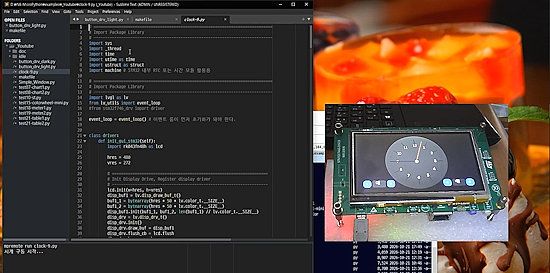](https://www.youtube.com/watch?v=j1TCCvfN5oA)

An STM32F746G-DISCO board using MicroPython and a Korean GUI (LVGL) - [YouTube](https://www.youtube.com/watch?v=j1TCCvfN5oA). (Korean MicroPython과 한글 GUI(LVGL)을 사용한 STM32F746G-DISCO 보드)

A live UK train departure board with Pimoroni Presto and MicroPython - [YouTube](https://www.youtube.com/watch?v=7p9hzEM4UWU).

Anthropic used Claude to review 25 open source projects written in C, C++, Java, PHP and Python, more than five million lines of code, and reported nearly 500 security issues, including code reachable before login, settings that switch security controls off when combined, and one flaw that went unnoticed for 21 years. Anthropic argues that defenders should shrink the code exposed by default rather than chase bugs one at a time - [TechRadar](https://www.techradar.com/pro/security/claude-flags-nearly-500-worrying-open-source-security-issues-c-java-and-python-code-all-at-risk-as-one-flaw-wasnt-spotted-for-21-years).

[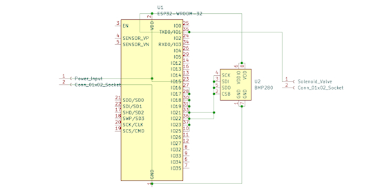](https://www.instructables.com/Autonomous-Deep-Sea-Forensic-Data-Rescue-System/)

Instructables user KarimTamerSalama designs a titanium capsule for recovering data and telemetry from the deep sea, in which an ESP32 running MicroPython watches a pressure sensor and opens a solenoid valve to start the rescue once it passes a set depth. The Instructable shares the schematic, the MicroPython code, a research paper and 3D CAD files for the housing - [Instructables](https://www.instructables.com/Autonomous-Deep-Sea-Forensic-Data-Rescue-System/).

[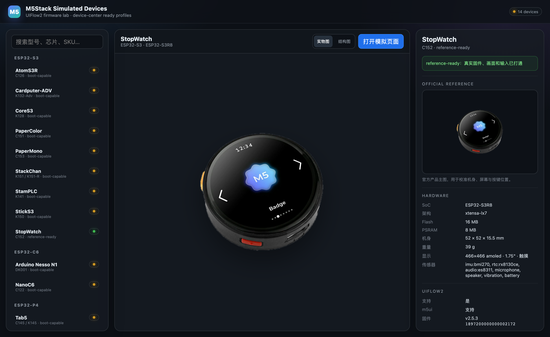](https://github.com/m5agent/m5stack-esp-emulator)

The M5Stack Firmware Simulation and Review Platform runs 14 M5Stack devices, mostly ESP32-S3 models plus ESP32-C6, Core2 and Tab5, in QEMU on a PC, so firmware can be flashed, booted, viewed and tested without the hardware. The simulator is written in Python, and UIFlow2, M5Stack's MicroPython-based firmware, is the best tested, with ESP-IDF, Arduino and other MicroPython images also supported. It is an unofficial project with documentation in Chinese - [GitHub](https://github.com/m5agent/m5stack-esp-emulator).

[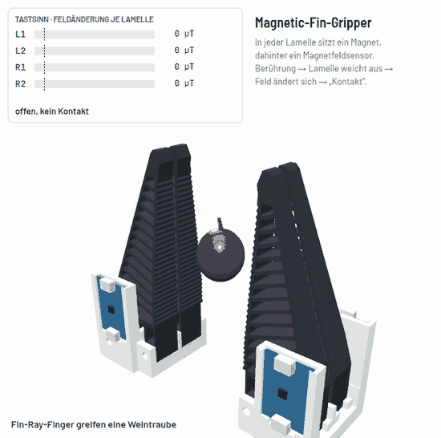](https://github.com/StefanRohringer/Magnetic-Fin-Gripper)

Stefan Rohringer's Magnetic-Fin-Gripper gives Seeed's reBot DevArm soft TPU Fin-Ray fingers with a magnet in each lamella and an Adafruit MLX90393 magnetometer behind it, so the gripper can feel when it touches something, gently enough to hold a grape or a tiny SMD part. A Raspberry Pi Pico (RP2040) running MicroPython reads the four sensors and detects contact, and Python tools on the PC show the readings live - [GitHub](https://github.com/StefanRohringer/Magnetic-Fin-Gripper).

Carlos Tangerino's msgpackc is a MessagePack serializer for MicroPython written in C as a user module, a drop-in replacement for Peter Hinch's pure-Python umsgpack with the same API and the same bytes on the wire. In his benchmarks it packs data 76 to 123 times faster and unpacks 20 to 25 times faster on ESP32 boards while allocating far less memory, and it is tested on the ESP32, S3, C3, C6 and P4 with MicroPython 1.29 - [GitHub](https://github.com/Tangerino/micropython-msgpackc) and [MicroPython discussion](https://github.com/orgs/micropython/discussions/19787).

ROBO STEAM ACADEMY, an EU Erasmus+ education project, posted ready-to-run MicroPython competition programs for its PicoBot, a robot built on the Raspberry Pi Pico W or Pico 2 W. In the line-following event the robot tracks the line with five sensors, counts laps at a marker line and stops after the number of laps the competition server sends it over Wi-Fi. Sibling repositories cover object manipulation, joystick control and robot registration - [GitHub](https://github.com/robosteamdev/competition-line-following) and [Teachers' Toolkit](https://github.com/robosteamdev/robo-steam-academy-teachers-toolkit).

[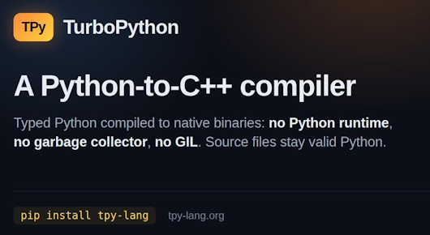](https://tpy-lang.org/)

TurboPython is a high-performance dialect of Python, compiled through C++ to a native binary. It combines Python's syntax with an ownership model that gives memory safety and predictable performance: no garbage collector, no automatic reference counting and no GIL - [tpy-lang.org](https://tpy-lang.org/). Via [X](https://x.com/PythonHub/status/2111310050610270455).

## New

A rotary encoder with a 1.8-inch touch display gets an upgrade to the ESP32-S31 SoC - [CNX](https://www.cnx-software.com/2026/10/22/rotary-encoder-with-1-8-inch-touch-display-gets-upgrade-to-esp32-s31-soc/).

[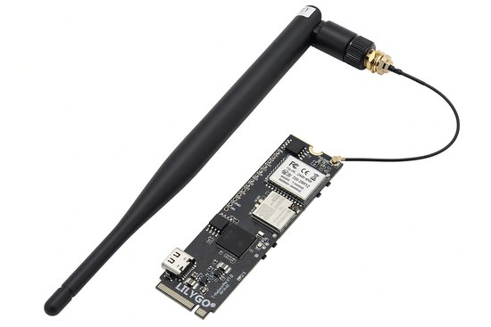](https://www.cnx-software.com/2026/10/23/lilygo-t-halow-p4-a-m-2-2280-board-with-esp32-p4-wifi-halow-and-esp32-c6/)

LILYGO's T-Halow P4 is an 80 x 22 mm M.2 card that pairs an Espressif ESP32-P4 with an ESP32-C6 for Wi-Fi 6 and Bluetooth 5, and a Taixin Wi-Fi HaLow module that reaches up to 1.2 km, plus MIPI camera and display connectors. LILYGO's examples use ESP-IDF; MicroPython has ESP32-P4 builds, but support for this board isn't stated. It sells for $26.57 to $36.98 - [CNX](https://www.cnx-software.com/2026/10/23/lilygo-t-halow-p4-a-m-2-2280-board-with-esp32-p4-wifi-halow-and-esp32-c6/).

## New Boards Supported by CircuitPython

The number of supported microcontrollers and Single Board Computers (SBC) grows every week. This section outlines which boards have been included in CircuitPython or added to [CircuitPython.org](https://circuitpython.org/).

This week there were three new boards added:

- [ESP32-C5 1.47inch Display Development Board](https://circuitpython.org/board/waveshare_esp32_c5_lcd_1_47/) – Waveshare
- [ESP32-S3-Touch-LCD-1.69](https://circuitpython.org/board/waveshare_esp32_s3_touch_lcd_1_69/) – Waveshare
- [Generic ESP32S3 SuperMini](https://circuitpython.org/board/generic_esp32s3_supermini/) – Generic

*Note: For non-Adafruit boards, please use the support forums of the board manufacturer for assistance, as Adafruit does not have the hardware to assist in troubleshooting.*

Looking to add a new board to CircuitPython? It's highly encouraged! Adafruit has four guides to help you do so:

- [How to Add a New Board to CircuitPython](https://learn.adafruit.com/how-to-add-a-new-board-to-circuitpython/overview)
- [How to add a New Board to the circuitpython.org website](https://learn.adafruit.com/how-to-add-a-new-board-to-the-circuitpython-org-website)
- [Adding a Single Board Computer to PlatformDetect for Blinka](https://learn.adafruit.com/adding-a-single-board-computer-to-platformdetect-for-blinka)
- [Adding a Single Board Computer to Blinka](https://learn.adafruit.com/adding-a-single-board-computer-to-blinka)

## New Adafruit Learning System Guides

[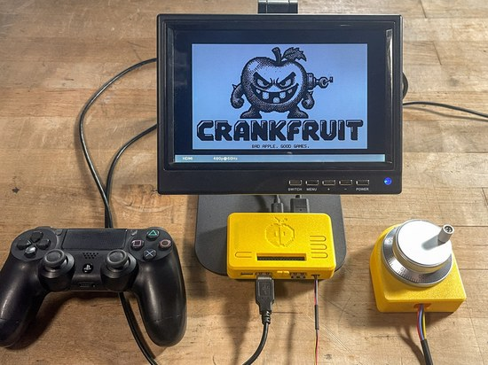](https://learn.adafruit.com/guides/latest)

The [Adafruit Learning System](https://learn.adafruit.com/) has over 3,200 free guides for learning skills and building projects including using Python.

[Crankfruit](https://learn.adafruit.com/crankfruit) from [John Park](https://learn.adafruit.com/u/johnpark)

[Fruit Jam SSTV Receiver](https://learn.adafruit.com/fruit-jam-sstv-reciever) from [Tim C](https://learn.adafruit.com/u/Foamyguy)

[CircuitPython Text to Speech](https://learn.adafruit.com/circuitpython-text-to-speech) from [Mikey Sklar](https://learn.adafruit.com/u/mikeysklar) and [Anne Barela](https://learn.adafruit.com/u/AnneBarela)

[Supernova POV Pixel Poi V2 with Wireless Controller](https://learn.adafruit.com/supernova-pov-pixel-poi-v2) from [Erin St Blaine](https://learn.adafruit.com/u/firepixie)

## CircuitPython Libraries

The CircuitPython library numbers are continually increasing, while existing ones continue to be updated. Here we provide library numbers and updates!

To get the latest Adafruit libraries, download the [Adafruit CircuitPython Library Bundle](https://circuitpython.org/libraries). To get the latest community contributed libraries, download the [CircuitPython Community Bundle](https://circuitpython.org/libraries).

If you'd like to contribute to the CircuitPython project on the Python side of things, the libraries are a great place to start. Check out the [CircuitPython.org Contributing page](https://circuitpython.org/contributing). If you're interested in reviewing, check out Open Pull Requests. If you'd like to contribute code or documentation, check out Open Issues. We have a guide on [contributing to CircuitPython with Git and GitHub](https://learn.adafruit.com/contribute-to-circuitpython-with-git-and-github), and you can find us in the #help-with-circuitpython and #circuitpython-dev channels on the [Adafruit Discord](https://adafru.it/discord).

You can check out this [list of all the Adafruit CircuitPython libraries and drivers available](https://github.com/adafruit/Adafruit_CircuitPython_Bundle/blob/master/circuitpython_library_list.md). 

The current number of CircuitPython libraries is **594**!

**New Libraries**

Here are this week's new CircuitPython libraries:

* [adafruit/Adafruit_CircuitPython_FLAC](https://github.com/adafruit/Adafruit_CircuitPython_FLAC)
* [adafruit/Adafruit_CircuitPython_OGG](https://github.com/adafruit/Adafruit_CircuitPython_OGG)

**Updated Libraries**

Here are this week's updated CircuitPython libraries:

* [adafruit/Adafruit_CircuitPython_USB_Host_Descriptors](https://github.com/adafruit/Adafruit_CircuitPython_USB_Host_Descriptors)
* [adafruit/Adafruit_CircuitPython_FunHouse](https://github.com/adafruit/Adafruit_CircuitPython_FunHouse)

## What’s the CircuitPython team up to this week?

What is the team up to this week? Let’s check in:

**Dan**

I released CircuitPython 11.0.0-alpha.2 last Wednesday. It may be the largest release to date, with around 130 PRs. I added dynamic board bus assignments for Zephyr last week. I also added a Zephyr build for the ItsyBitsy nRF52840, and fixed various bugs.

**Tim**

This week I worked on a new `audiotap.Tap` module in the core. It's an audio FX object that can go into a chain like the others in `audiodelays`, `audiofilters`, etc. It passes clean audio through and buffers a small section of it that can be accessed from Python code. This makes it possible to do things like visual level meters or analysis on live audio while it plays. 

I also started working on a way to add support for web workflow to the Fruit Jam. It is another new core module that handles transport for the ESP32 co-processor communication. Initial testing is going well. Being able to remotely edit files and connect to the serial console is very convenient. I've been using the capability extensively for the past few days with Fruit Jams deployed elsewhere in and outside the house with different antennas attached as I tinker with more SDR ham radio stuff. I have FT8, and APRS decoders working and am looking at ADS-B next.

**Liz**

I published the [Fruit Jam Face Detection guide](https://learn.adafruit.com/fruit-jam-face-detection) this week. This project grew out of the [Fruit Jam Motion Tracking project](https://learn.adafruit.com/fruit-jam-motion-tracking-eyeballs). A pre-compiled frontal face detection model is stored on the Fruit Jam and a Turbo module assists in running it to detect faces in the webcam frame. This means you can have 100% offline face detection in CircuitPython.

I also published a [short video highlighting the USB host webcam support](https://youtube.com/shorts/05CkI7f59Dc) that is now in CircuitPython that this project uses. I also showed [Tim's guide](https://learn.adafruit.com/usb-host-camera-on-fruit-jam) that has demos for running a camera with effects and printing images to a BLE thermal printer.

## Upcoming Events

The next MicroPython Meetup in Melbourne will be on October 28 – [Luma](https://luma.com/micropython). You can see recordings of previous meetings on [YouTube](https://www.youtube.com/@MicroPythonOfficial). 

**Other Events This Year**

- [Espressif DevCon 2026](https://devcon.espressif.com/) will be November 3-4 in Milan, Italy and online.

If you know of virtual events or upcoming events, please let us know via email to cpnews(at)adafruit(dot)com.

## Latest Releases

CircuitPython's stable release is [10.3.1](https://github.com/adafruit/circuitpython/releases/latest) and its unstable release is [11.0.0-alpha.2](https://github.com/adafruit/circuitpython/releases). New to CircuitPython? Start with our [Welcome to CircuitPython Guide](https://learn.adafruit.com/welcome-to-circuitpython).

[20261023](https://github.com/adafruit/Adafruit_CircuitPython_Bundle/releases/latest) is the latest Adafruit CircuitPython library bundle.

[20261008](https://github.com/adafruit/CircuitPython_Community_Bundle/releases/latest) is the latest CircuitPython Community library bundle.

[v1.29.0](https://micropython.org/download) is the latest MicroPython release. Documentation for it is [here](http://docs.micropython.org/en/latest/pyboard/).

[3.15.1](https://www.python.org/downloads/) is the latest Python release. The latest pre-release version is [3.16.0a1](https://www.python.org/download/pre-releases/).

[4,569 Stars](https://github.com/adafruit/circuitpython/stargazers) Like CircuitPython? [Star it on GitHub!](https://github.com/adafruit/circuitpython)

## Call for Help -- Translating CircuitPython is now easier than ever

[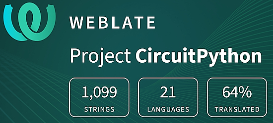](https://hosted.weblate.org/engage/circuitpython/)

One important feature of CircuitPython is translated control and error messages. With the help of fellow open source project [Weblate](https://weblate.org/), we're making it even easier to add or improve translations. 

Sign in with an existing account such as GitHub, Google or Facebook and start contributing through a simple web interface. No forks or pull requests needed! As always, if you run into trouble join us on [Discord](https://adafru.it/discord), we're here to help.

## 38,840 Thanks

The Adafruit Discord community, where we do all our CircuitPython development in the open, reached over 38,840 humans - thank you! Adafruit believes Discord offers a unique way for Python on hardware folks to connect. Join today at [https://adafru.it/discord](https://adafru.it/discord).

## ICYMI - In case you missed it

Python on hardware is the Adafruit Python video-newsletter-podcast! The news comes from the Python community, Discord, Adafruit communities and more and is broadcast on ASK an ENGINEER Wednesdays. The complete Python on Hardware weekly videocast [playlist is here](https://www.youtube.com/playlist?list=PLjF7R1fz_OOXRMjM7Sm0J2Xt6H81TdDev). The video podcast is on [iTunes](https://itunes.apple.com/us/podcast/python-on-hardware/id1451685192?mt=2), [YouTube](http://adafru.it/pohepisodes), [Instagram](https://www.instagram.com/adafruit/channel/), and [XML](https://itunes.apple.com/us/podcast/python-on-hardware/id1451685192?mt=2).

The weekly community chat on Adafruit Discord server CircuitPython channel - Audio / Podcast edition - Audio from the Discord chat space for CircuitPython, meetings are usually Mondays at 2pm ET, this is the audio version on Pocket Casts, [Spotify](https://adafru.it/spotify), and [XML feed](https://adafruit-podcasts.s3.amazonaws.com/circuitpython_weekly_meeting/audio-podcast.xml).

## Contribute

The CircuitPython Weekly Newsletter is a CircuitPython community-run newsletter emailed every Monday. To contribute your content, please email your news to cpnews (at) adafruit (dot) com with information and link(s) to your content. 

Join the Adafruit [Discord](https://adafru.it/discord) or [post to the forum](https://forums.adafruit.com/viewforum.php?f=60) if you have questions.
