- [ ] Library and info updates
- [ ] change date
- [ ] update title
- [ ] Feature story
- [ ] Update  for images
- [ ] Update ICYDNCI
- [ ] All images 550w max only
- [ ] Link "View this email in your browser."

View this email in your browser. **Warning: Flashing Imagery**

Welcome to the latest Python on Microcontrollers newsletter! *insert 2-3 sentences from editor (what's in overview, banter)* - *Anne Barela, Editor*

We're on [Discord](https://discord.gg/HYqvREz), [Twitter/X](https://twitter.com/search?q=circuitpython&f=live), [BlueSky](https://bsky.app/profile/circuitpython.org) and for past newsletters - [view them all here](https://www.adafruitdaily.com/category/circuitpython/). If you're reading this on the web, please [subscribe here](https://www.adafruitdaily.com/). Here's the news this week:

## Headline

text - [site](url).

## The Adafruit Metro ESP32-P4 Hydra

[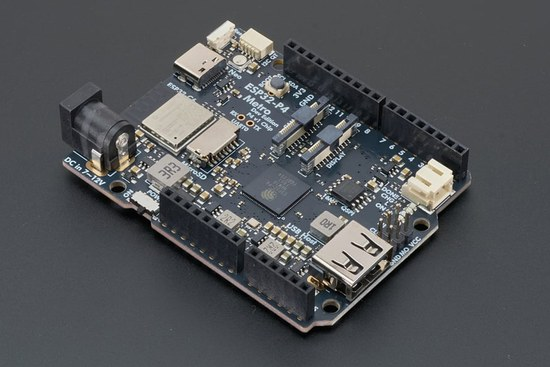](https://www.cnx-software.com/2026/10/26/adafruit-metro-esp32-p4-hydra-an-arduino-uno-shaped-esp32-p4-esp32-c6-board-with-wifi-6-mipi-interfaces/)

Adafruit's Metro ESP32-P4 Hydra puts an Espressif ESP32-P4 with 16 MB of PSRAM and an ESP32-C6 for Wi-Fi 6, Bluetooth 5.3 LE, Thread and Zigbee on an Arduino UNO-shaped board, with Raspberry Pi-compatible MIPI display and camera connectors, a high-speed USB host port, a microSD slot and a STEMMA QT connector. CircuitPython 11.0.0-alpha.2 supports it, and it sells for $34.95 - [CNX](https://www.cnx-software.com/2026/10/26/adafruit-metro-esp32-p4-hydra-an-arduino-uno-shaped-esp32-p4-esp32-c6-board-with-wifi-6-mipi-interfaces/) and [Adafruit](https://www.adafruit.com/product/6536).

## Linux Changes Point to a Raspberry Pi Zero 3 W and Pi 4 Model A

[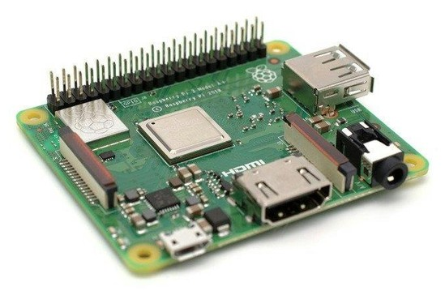](https://www.hackster.io/news/linux-changes-point-to-incoming-raspberry-pi-4-model-a-raspberry-pi-zero-3-w-models-a7fad6c22dae)

New device tree files in a Raspberry Pi Linux kernel tree describe two unannounced boards built on the Pi 4's quad-core Cortex-A72 BCM2711 chip: a Raspberry Pi Zero 3 W with Wi-Fi, Bluetooth and a single HDMI port, and a Raspberry Pi 4 Model A without Ethernet. Raspberry Pi hasn't announced either board, and RAM, clock speeds, price and release date are still unknown - [Hackster](https://www.hackster.io/news/linux-changes-point-to-incoming-raspberry-pi-4-model-a-raspberry-pi-zero-3-w-models-a7fad6c22dae) and [bret.dk](https://bret.dk/raspberry-pi-zero-3-w-pi-4-model-a/).

## CPython's Experimental JIT Compiler is Being Removed

The experimental just-in-time (JIT) compiler in CPython is coming out after its team withdrew PEP 836 on October 19, missing the Steering Council's deadline for a plan to support, measure and maintain it. The council had paused JIT work in June and found its speed gains small, mostly helping long-running tight loops; others can still carry the work on outside mainline CPython - [InfoWorld](https://www.infoworld.com/article/4241003/python-jettisons-the-native-jit-at-least-for-now.html) and [PEP 836](https://peps.python.org/pep-0836/).

## Feature

text - [site](url).

## Feature

text - [site](url).

## This Week's Python Streams

Python on Hardware is all about building a cooperative ecosphere which allows contributions to be valued and to grow knowledge. Below are the streams within the last week focusing on the community.

**CircuitPython Deep Dive Stream**

[Last Friday](), Scott streamed work on .

You can see the latest video and past videos on the Adafruit YouTube channel under the Deep Dive playlist - [YouTube](https://www.youtube.com/playlist?list=PLjF7R1fz_OOXBHlu9msoXq2jQN4JpCk8A).

**CircuitPython Parsec**

John Park’s CircuitPython Parsec this week is on  - [Adafruit Blog]() and [YouTube]().

Catch all the episodes in the [YouTube playlist](https://www.youtube.com/playlist?list=PLjF7R1fz_OOWFqZfqW9jlvQSIUmwn9lWr).

**Deep Dive with Tim**

[Last week](), Tim streamed work on .

You can see the latest video and past videos on the Adafruit YouTube channel under the Deep Dive playlist - [YouTube](https://www.youtube.com/playlist?list=PLjF7R1fz_OOXBHlu9msoXq2jQN4JpCk8A).

**CircuitPython Weekly Meeting**

CircuitPython Weekly Meeting for October 26, 2026 ([notes](https://github.com/adafruit/adafruit-circuitpython-weekly-meeting/blob/main/2026/2026-10-26.md)) [on YouTube](https://youtu.be/xJjCufINwmU).

## Project of the Week: A Game Boy Color Emulator on the GitHub Universe Badge

[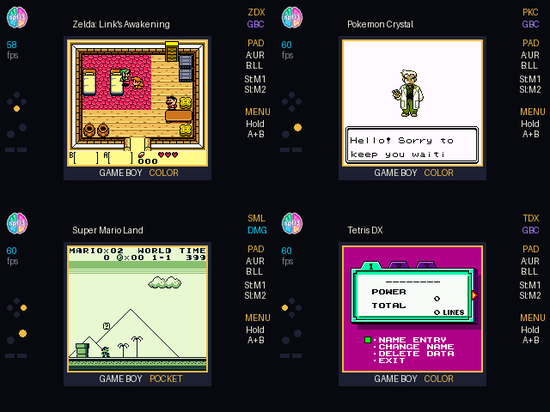](https://spf13.com/p/game-boy-color-on-my-conference-badge/)

Steve Francia wrote a Game Boy and Game Boy Color emulator in MicroPython for the GitHub Universe 2026 badge, an RP2350 board with PSRAM and a 320x240 display. Viper-compiled code keeps each frame within the 60 Hz budget, so games like Link's Awakening DX and Pokémon Crystal play at native size, and the work also sped up his earlier NES emulator for the badge - [spf13.com](https://spf13.com/p/game-boy-color-on-my-conference-badge/) and [GitHub](https://github.com/spf13/universe-2026-badge-hacks).

## Popular Last Week

[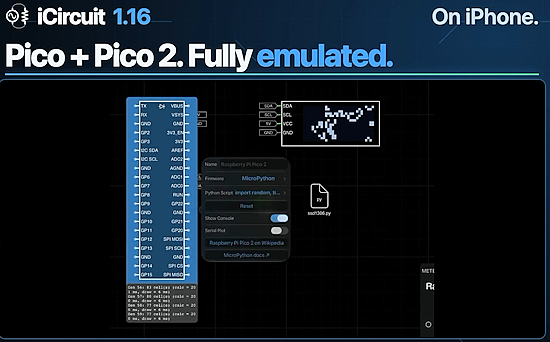](https://icircuitapp.com/)

What was the most popular, most clicked link, in [last week's newsletter](https://www.adafruitdaily.com/2026/10/26/circuitpython-11-0-0-alpha-2-is-a-huge-update-internet-security-issues-abound-and-more/)? [iCircuit](https://icircuitapp.com/).

Did you know you can read past issues of this newsletter in the Adafruit Daily Archive? [Check it out](https://www.adafruitdaily.com/category/circuitpython/).

## Notes from Adafruit Playground

[Adafruit Playground](https://adafruit-playground.com/) is a place for the community to post their projects and other making tips/tricks/techniques. Ad-free, it's an easy way to publish your work in a safe space for free.

text - [Adafruit Playground](url).

text - [Adafruit Playground](url).

text - [Adafruit Playground](url).

## News From Around the Web

[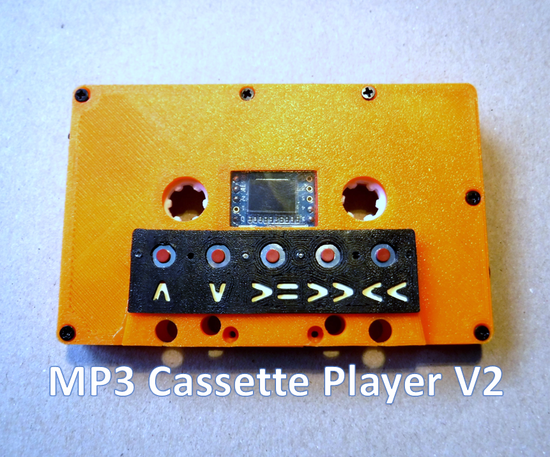](https://www.instructables.com/MP3-Player-Cassette-V2)

Gammawave updates their MP3 player built into a 3D printed cassette shell, now with a flexible PCB to cut down the wiring. An ESP32-C3 mini board with a built-in OLED display runs MicroPython, driving a DFPlayer Mini that feeds the tape head so the cassette plays in a regular tape deck. - [Instructables](https://www.instructables.com/MP3-Player-Cassette-V2).

[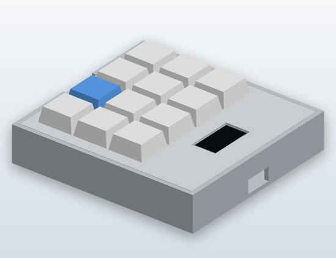](https://github.com/klemens13/esp32s2-macropad)

klemens13 built a 12-key macropad with a 0.96-inch OLED that shows the active layer, a map of pressed keys and a small animated face. It runs CircuitPython and KMK as a USB HID keyboard on an ESP32-S2 Mini, LOLIN S3 Mini or ESP32-S3 Super Mini, with 3D-printable cases for MX or tactile switches. The README is in Indonesian - [GitHub](https://github.com/klemens13/esp32s2-macropad).

[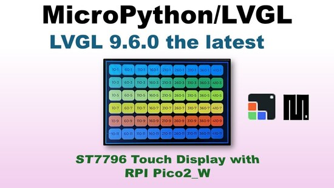](https://www.youtube.com/watch?v=9kJjYoT178o)

Video 113 in a long-running MicroPython and LVGL series looks at the new LVGL 9.6.0 release on a Raspberry Pi Pico 2 W (RP2350) with an ST7796 display, covering its memory and flash needs and running test programs on ST7796, ILI9341 and ST7735 screens - [YouTube](https://www.youtube.com/watch?v=9kJjYoT178o) and [GitHub](https://github.com/kwinter745321/PicoLVGL/tree/main/Videos/video113).

[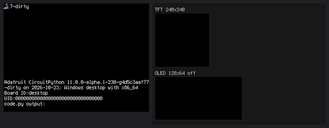](https://github.com/MakerClassCZ/cp-desktop-lab)

Maker Class has an unofficial fork of CircuitPython that adds a desktop port, so CircuitPython code and libraries run as a program on Linux, Windows or macOS. The terminal is the serial console, a window is the display, a folder is the CIRCUITPY drive, and real pins are available through an FT232H or MCP2221A USB adapter or a Raspberry Pi's header - [GitHub](https://github.com/MakerClassCZ/cp-desktop-lab).

Haunted Matrix is a Halloween slideshow for an Adafruit MatrixPortal M4 and a 64x32 RGB LED matrix, written in CircuitPython. It shuffles through 99 bundled illustrations, fading through black between pictures and slowly dimming one color region of each scene during its hold - [GitHub](https://github.com/yogitea/haunted-matrix).

[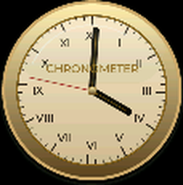](https://github.com/PyDevices/gallery)

PyDevices has a gallery of showcase apps, including a piano, a spectrum analyzer, games, dashboards and a photo viewer, built on its display stack. The same Python code runs on MicroPython and CircuitPython boards, in a desktop window, in a browser tab and on an Android phone, and the apps install on Wi-Fi boards with mip - [GitHub](https://github.com/PyDevices/gallery) and [try it in the browser](https://pydevices.github.io/gallery/).

[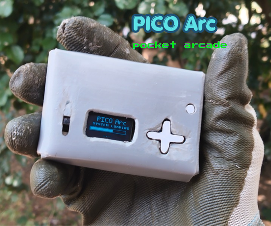](https://www.instructables.com/PICO-Arc-the-Pocket-Sized-Retro-Arcade)

DIYvolt built PICO Arc, a pocket-sized handheld game console on a Raspberry Pi Pico with an SSD1306 OLED, five buttons, a buzzer and a rechargeable battery, all on a small perfboard in a case made from flattened PVC pipe. It plays six retro games, including Snake, Pong and Space Survival, written in MicroPython - [Instructables](https://www.instructables.com/PICO-Arc-the-Pocket-Sized-Retro-Arcade).

[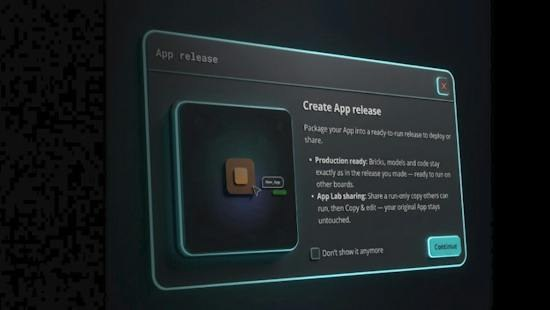](https://www.hackster.io/news/arduino-s-latest-app-lab-update-brings-production-grade-release-bundles-phone-sensor-streaming-a05aa7f919d6)

Arduino released App Lab 0.11.0, the desktop tool for building apps on the UNO Q, where Python runs on the board's Linux side alongside an Arduino sketch on its microcontroller. The update adds versioned app releases, streaming sensor data from a smartphone, pose estimation, and support for several Raspberry Pi HATs on the UNO Q - [Hackster](https://www.hackster.io/news/arduino-s-latest-app-lab-update-brings-production-grade-release-bundles-phone-sensor-streaming-a05aa7f919d6) and [GitHub](https://github.com/arduino/arduino-app-lab/releases/tag/0.11.0).

[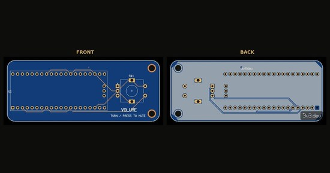](https://blog.3v3.dev/volume-knob-for-your-pc/)

This open hardware board design pairs a Raspberry Pi Pico with an EC11 rotary encoder to make a USB volume knob: turn it to change the PC's volume and press it to mute. The Pico shows up as a media keyboard running CircuitPython, so no driver is needed, though the post notes the board hasn't been built yet - [3v3.dev](https://blog.3v3.dev/volume-knob-for-your-pc/) and [Bluesky](https://bsky.app/profile/3v3.dev/post/3myliaauqbm2m).

[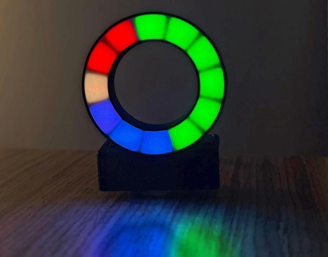](https://www.instructables.com/UK-National-Grid-Display)

A ring of 12 RGB LEDs in a 3D printed case shows Great Britain's live electricity generation mix, fetched every five minutes from the free Carbon Intensity API. It runs MicroPython on a Seeed Studio XIAO ESP32 board, with a touch sensor to switch display modes - [Instructables](https://www.instructables.com/UK-National-Grid-Display).

[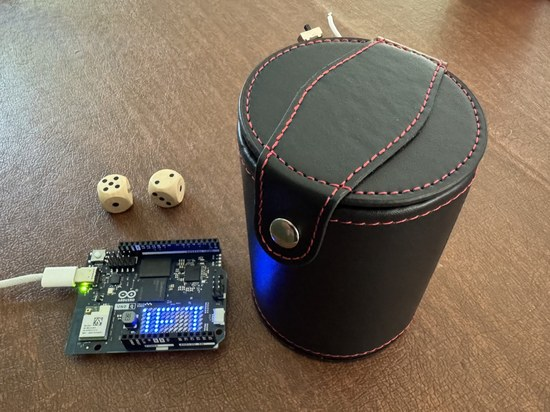](https://www.molecularist.com/2026/09/the-oracle-a-kinetically-augmented-device-for-reflection.html)

The Oracle is a dice cup for reflection: roll the dice, a camera in the base photographs them, the pips are counted, and an LLM writes a short poem that plays from a speaker in the cup. A Seeed XIAO ESP32S3 Sense running CircuitPython captures the image, and an Arduino UNO Q running Python counts the pips and generates the poem - [Molecularist](https://www.molecularist.com/2026/09/the-oracle-a-kinetically-augmented-device-for-reflection.html) and [Hackster](https://www.hackster.io/molecularist/the-oracle-a-kinetically-augmented-device-for-reflection-b593b6).

Pi-Esp Jarvis is a desktop voice assistant: you say "Jarvis" to a Waveshare ESP32-S3 Touch AMOLED 1.8 board, which runs the open-source xiaozhi-esp32 firmware (C++) for the microphone, speaker and animated face, while a Raspberry Pi 5 running standard Python (CPython 3.11) does the work and passes harder questions to Claude. It handles timers, alarms, weather, shopping lists, music and voice notes - [Moth Cloud](https://mothcloud.com/build-your-own-ai-voice-assistant-with-a-raspberry-pi-a-tiny-esp32-screen-and-claude/) and [GitHub](https://github.com/nativebreed/pi-esp-jarvis).

[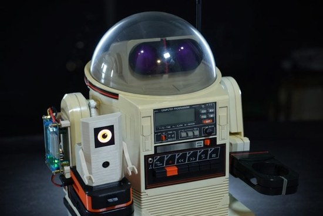](https://circuitdigest.com/news/a-1984-tomy-omnibot-gets-a-raspberry-pi-5-brain-and-an-ai-camera-that-knows-80-objects)

Mario Cruz gave a 1984 Tomy Omnibot a Raspberry Pi 5 brain and a Raspberry Pi AI Camera, which runs YOLO11 object detection on its IMX500 sensor. The Python code drives the robot's original motor board by playing its control tones through a Bluetooth cassette adapter, and adds an animated OLED eye and web dashboards for steering it toward people and objects - [Circuit Digest](https://circuitdigest.com/news/a-1984-tomy-omnibot-gets-a-raspberry-pi-5-brain-and-an-ai-camera-that-knows-80-objects) and [GitHub](https://github.com/MarioCruz/omnibotAi).

[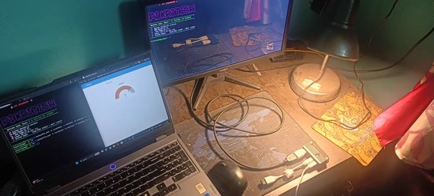](https://x.com/KritishIoT/status/2107818687399145844)

Kritish Mohapatra turned a Raspberry Pi Zero 2 W into a headless IoT gateway running a Mosquitto MQTT broker, Node-RED and a Node-RED dashboard. It collects sensor data from their ESP32 and Raspberry Pi Pico projects, most of which they write in MicroPython - [X](https://x.com/KritishIoT/status/2107818687399145844) and [GitHub](https://github.com/kritishmohapatra/pi-iot-gateway).

text - [site](url).

text - [site](url).

text - [site](url).

text - [site](url).

## Coming Soon / New

[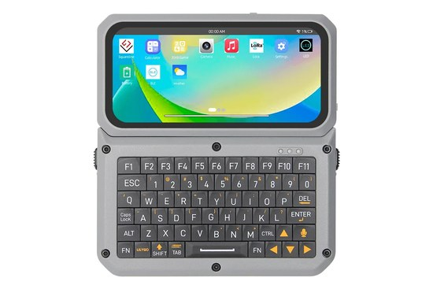](https://www.cnx-software.com/2026/10/28/lilygo-t-display-k230-risc-v-ai-dev-kit-features-amoled-lora-and-an-optional-keyboard/)

LILYGO's T-Display K230 is an AI dev kit built on the Kendryte K230 dual-core RISC-V chip, with a 4.1-inch AMOLED touchscreen, WiFi, LoRa and an optional QWERTY keyboard that can add LTE-M/NB-IoT and GNSS. It ships with Linux and CanMV/RT-Smart firmware; the article doesn't mention Python, but CanMV for the K230 is based on MicroPython - [CNX](https://www.cnx-software.com/2026/10/28/lilygo-t-display-k230-risc-v-ai-dev-kit-features-amoled-lora-and-an-optional-keyboard/).

text - [site](url).

## New Boards Supported by CircuitPython

The number of supported microcontrollers and Single Board Computers (SBC) grows every week. This section outlines which boards have been included in CircuitPython or added to [CircuitPython.org](https://circuitpython.org/).

This week there were (#/no) new boards added:

- [Board name](url)
- [Board name](url)
- [Board name](url)

*Note: For non-Adafruit boards, please use the support forums of the board manufacturer for assistance, as Adafruit does not have the hardware to assist in troubleshooting.*

Looking to add a new board to CircuitPython? It's highly encouraged! Adafruit has four guides to help you do so:

- [How to Add a New Board to CircuitPython](https://learn.adafruit.com/how-to-add-a-new-board-to-circuitpython/overview)
- [How to add a New Board to the circuitpython.org website](https://learn.adafruit.com/how-to-add-a-new-board-to-the-circuitpython-org-website)
- [Adding a Single Board Computer to PlatformDetect for Blinka](https://learn.adafruit.com/adding-a-single-board-computer-to-platformdetect-for-blinka)
- [Adding a Single Board Computer to Blinka](https://learn.adafruit.com/adding-a-single-board-computer-to-blinka)

## New Adafruit Learning System Guides

[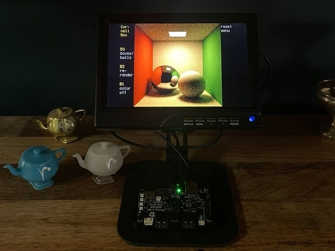](https://learn.adafruit.com/guides/latest)

The [Adafruit Learning System](https://learn.adafruit.com/) has over 3,200 free guides for learning skills and building projects including using Python.

[title](url) from [name](url)

[title](url) from [name](url)

[title](url) from [name](url)

## Updated Learn Guides

[title](url)

## CircuitPython Libraries

The CircuitPython library numbers are continually increasing, while existing ones continue to be updated. Here we provide library numbers and updates!

To get the latest Adafruit libraries, download the [Adafruit CircuitPython Library Bundle](https://circuitpython.org/libraries). To get the latest community contributed libraries, download the [CircuitPython Community Bundle](https://circuitpython.org/libraries).

If you'd like to contribute to the CircuitPython project on the Python side of things, the libraries are a great place to start. Check out the [CircuitPython.org Contributing page](https://circuitpython.org/contributing). If you're interested in reviewing, check out Open Pull Requests. If you'd like to contribute code or documentation, check out Open Issues. We have a guide on [contributing to CircuitPython with Git and GitHub](https://learn.adafruit.com/contribute-to-circuitpython-with-git-and-github), and you can find us in the #help-with-circuitpython and #circuitpython-dev channels on the [Adafruit Discord](https://adafru.it/discord).

You can check out this [list of all the Adafruit CircuitPython libraries and drivers available](https://github.com/adafruit/Adafruit_CircuitPython_Bundle/blob/master/circuitpython_library_list.md). 

The current number of CircuitPython libraries is **###**!

**New Libraries**

Here are this week's new CircuitPython libraries:

* [library](url)

**Updated Libraries**

Here are this week's updated CircuitPython libraries:

* [library](url)

## What’s the CircuitPython team up to this week?

What is the team up to this week? Let’s check in:

**Dan**

text.

**Tim**

Last week was the series 34 ARISS SSTV event. I was prepared with some different antennas for this one and managed to capture some great photos from the ISS as it passed over my area. I even submitted one of the photos to the ARISS gallery and received a virtual certificate, making the Fruit Jam now ARISS certified. I updated the ARISS page in the SSTV guide with a gallery of some photos I captured during the event and details on which antennas worked the best. This week I'm working on an SDR mapping project that includes ADS-B, APRS, and FT8 receiver apps that plot points relevant to the received signals on a map using the new `adafruit_maptiles` library. I got a Metro ESP32-P4 device and have been testing and updating the project code to work with it. The Metro P4's highspeed USB host capability is particularly helpful for the ADS-B receiver, increasing by about 10x the amount of airtime that it can decode packets from.

**Scott**

This week I was on vacation. When I got back I polished up the camera PR and now I'm waiting for a review. Next I'm working on LVGL backed `displayio`.

**Liz**

I worked on adding support in the [Adafruit_DAP library](https://github.com/adafruit/Adafruit_DAP) to use the CH32V203 QT Py as a host. This lets you use it to program and debug a board via SWD. It works with OpenOCD, PyOCD and a web app that I put together.

## Upcoming Events

Espressif DevCon 2026 starts Tuesday and runs November 3-4 in Milan, Italy and online – [Espressif DevCon](https://devcon.espressif.com/).

The 2026 Hackaday Superconference will be November 6-8 in Pasadena, California. It opens with a badge-hacking day, followed by two days of hardware talks and workshops – [Hackaday](https://hackaday.com/2026/09/23/2026-hackaday-supercon-announcing-our-first-round-of-speakers/).

PyCon España (PyConES) 2026 will be November 6-8 in Barcelona, Spain, with a day of workshops followed by two days of talks – [PyConES](https://2026.es.pycon.org/).

Maker Faire Orlando will be November 7-8 at the Central Florida Fairgrounds in Orlando, Florida, with a field trip day for schools on Friday, November 6 – [Maker Faire Orlando](https://www.makerfaireorlando.com/attend/).

The next MicroPython Meetup in Melbourne will be on November 25 – [Luma](https://luma.com/micropython). You can see recordings of previous meetings on [YouTube](https://www.youtube.com/@MicroPythonOfficial).

*There is no MicroPython Meetup planned for December.*

Maker Faire Shenzhen 2026 will be December 12-13 in Nanshan, Shenzhen, China – [Maker Faire Shenzhen](https://www.shenzhenmakerfaire.com/).

If you know of virtual events or upcoming events, please let us know via email to cpnews(at)adafruit(dot)com.

## Latest Releases

CircuitPython's stable release is [#.#.#](https://github.com/adafruit/circuitpython/releases/latest) and its unstable release is [#.#.#-##.#](https://github.com/adafruit/circuitpython/releases). New to CircuitPython? Start with our [Welcome to CircuitPython Guide](https://learn.adafruit.com/welcome-to-circuitpython).

[2026####](https://github.com/adafruit/Adafruit_CircuitPython_Bundle/releases/latest) is the latest Adafruit CircuitPython library bundle.

[2026####](https://github.com/adafruit/CircuitPython_Community_Bundle/releases/latest) is the latest CircuitPython Community library bundle.

[v#.#.#](https://micropython.org/download) is the latest MicroPython release. Documentation for it is [here](https://docs.micropython.org/en/latest/).

[#.#.#](https://www.python.org/downloads/) is the latest Python release. The latest pre-release version is [#.#.#](https://www.python.org/download/pre-releases/).

[#,### Stars](https://github.com/adafruit/circuitpython/stargazers) Like CircuitPython? [Star it on GitHub!](https://github.com/adafruit/circuitpython)

## Call for Help -- Translating CircuitPython is now easier than ever

[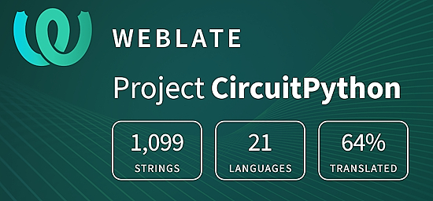](https://hosted.weblate.org/engage/circuitpython/)

One important feature of CircuitPython is translated control and error messages. With the help of fellow open source project [Weblate](https://weblate.org/), we're making it even easier to add or improve translations. 

Sign in with an existing account such as GitHub, Google or Facebook and start contributing through a simple web interface. No forks or pull requests needed! As always, if you run into trouble join us on [Discord](https://adafru.it/discord), we're here to help.

## NUMBER Thanks

The Adafruit Discord community, where we do all our CircuitPython development in the open, reached over NUMBER humans - thank you! Adafruit believes Discord offers a unique way for Python on hardware folks to connect. Join today at [https://adafru.it/discord](https://adafru.it/discord).

## ICYMI - In case you missed it

Python on hardware is the Adafruit Python video-newsletter-podcast! The news comes from the Python community, Discord, Adafruit communities and more and is broadcast on ASK an ENGINEER Wednesdays. The complete Python on Hardware weekly videocast [playlist is here](https://www.youtube.com/playlist?list=PLjF7R1fz_OOXRMjM7Sm0J2Xt6H81TdDev). The video podcast is on [iTunes](https://itunes.apple.com/us/podcast/python-on-hardware/id1451685192?mt=2), [YouTube](http://adafru.it/pohepisodes), [Instagram](https://www.instagram.com/adafruit/channel/), and [XML](https://adafruit-podcasts.s3.amazonaws.com/python_on_hardware/podcast.xml).

The weekly community chat on Adafruit Discord server CircuitPython channel - Audio / Podcast edition - Audio from the Discord chat space for CircuitPython, meetings are usually Mondays at 2pm ET, this is the audio version on Pocket Casts, [Spotify](https://adafru.it/spotify), and [XML feed](https://adafruit-podcasts.s3.amazonaws.com/circuitpython_weekly_meeting/audio-podcast.xml).

## Contribute

The CircuitPython Weekly Newsletter is a CircuitPython community-run newsletter emailed every Monday. To contribute your content, please email your news to cpnews (at) adafruit (dot) com with information and link(s) to your content. 

Join the Adafruit [Discord](https://adafru.it/discord) or [post to the forum](https://forums.adafruit.com/viewforum.php?f=60) if you have questions.
