View this email in your browser. **Warning: Flashing Imagery**

Welcome to the latest Python on Microcontrollers newsletter! I couldn't help myself. I have been seeing all the Pull Requests on GitHub for new and improved CircuitPython features. So I give you a taste with an article this week (with a new official prerelease version expected next week). In Python News, a detailed article on the creator of Python and how, after peaking recently, Python use has been sliding back, although it's still the most used language worldwide.

Prices on high-end Raspberry Pi boards continue to rise due to the RAM shortage. And the Python community came together admirably during the security crises in the last month. All of this and more goodness in this issue. Please let your colleagues & friends know the newsletter is free to subscribe. - *Anne Barela, Editor*

We're on [Discord](https://discord.gg/HYqvREz), [Twitter/X](https://twitter.com/search?q=circuitpython&f=live), [BlueSky](https://bsky.app/profile/circuitpython.org) and for past newsletters - [view them all here](https://www.adafruitdaily.com/category/circuitpython/). If you're reading this on the web, please [subscribe here](https://www.adafruitdaily.com/). Here's the news this week:

## CircuitPython Now Has 600 Libraries

The CircuitPython community has reached another milestone: there are now 600 CircuitPython libraries! That's nearly 100 more since the count passed 500 in October 2024. The CircuitPython Library Bundle and the Community Bundle contain all the current libraries, which add support for sensors, displays, radios and much more to CircuitPython code - [CircuitPython.org](https://circuitpython.org/libraries).

## The Rise and Fall of Python's Benevolent Dictator

Bruce Li tells the story of Guido van Rossum and Python, from its start over a 1989 Christmas break at CWI in Amsterdam through the Python 3 transition, the 2018 walrus operator dispute that ended the Benevolent Dictator For Life role and created the Steering Council, and later work at Microsoft on speeding up Python and removing the GIL - [HackerNoon](https://hackernoon.com/guido-van-rossum-the-rise-and-fall-of-pythons-benevolent-dictator).

## Python Stays on Top of the TIOBE Index as C Closes the Gap

Quartz walks through the top 10 languages in TIOBE's October 2026 index, where Python holds first place at 19.23% despite a 5.23-point drop over the year, the steepest among the 10. C gained the most and cut Python's lead to about half of what it was a year ago, and this month TIOBE began counting Mandarin Chinese search terms alongside English ones - [Quartz](https://qz.com/most-popular-programming-language-ratings-2026).

## What's New in CircuitPython Since 11.0.0-alpha.2

CircuitPython has merged 87 pull requests since 11.0.0-alpha.2 came out on October 21. Highlights include an `async_spi` module so `asyncio` tasks keep running during SPI transfers, ESP32 Digital Signature support for mutual TLS without the private key in RAM, web workflow on the Fruit Jam with a new page that mirrors the board's display in the browser, a camera and video pipeline, hardware JPEG decoding on the ESP32-P4 and ESP32-S31, and PWM audio on the ESP32-S2 and ESP32-S3. Several new boards are supported too, including the Equinox RP2350, ThePiHut Baguette S3 and M5Stack AtomS3R - [GitHub](https://github.com/adafruit/circuitpython/compare/11.0.0-alpha.2...main).

You can go to your board on [circuitpython.org](https://circuitpython.org/) and click the "Browse S3" button under Absolute Newest to try out the latest features that have been merged in. Just select the language you want, get the latest .uf2 file, and update per the usual instructions for that board. Also update or add any new libraries in the 11.x library bundle for your code. This is bleeding edge, so if something isn't quite right, you can use GitHub to leave a detailed note on what went wrong so the developers might consider what's what.

## STMicroelectronics Unifies STM32 Around Arm Cortex-M

STMicroelectronics is unifying its STM32 microcontroller line around the Arm Cortex-M core family, aiming for easier software reuse from one design to the next across industrial, robotics and automotive markets. Alongside the announcement come the STM32A4, STM32A5 and STM32A9 for safety-critical and automotive use, now sampling, and the STM32G5, a 280 MHz Cortex-M33 part for real-time power control that is orderable now. MicroPython's `stm32` port already supports many STM32 families - [Hackster](https://www.hackster.io/news/stmicroelectronics-announces-new-strategic-evolution-to-focus-on-arm-cortex-m-stm32-mcus-2c69cb85ad5a).

## Raspberry Pi Raises Prices on 16GB Products

[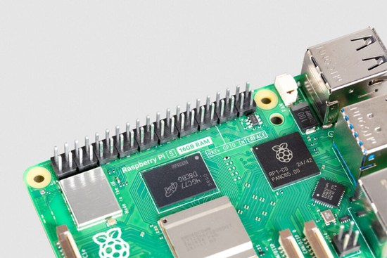](https://www.raspberrypi.com/news/price-rises-for-some-16gb-raspberry-pi-products/)

Raspberry Pi has raised the price of the 16GB Raspberry Pi 5 by $80 to $385 and the 16GB Compute Module 5 variants by $40, citing the rising cost of memory, while holding the price of the Raspberry Pi 500+. The company suggests lower-memory models or memory optimizations as alternatives and says the increases will be rolled back when memory costs fall - [Raspberry Pi News](https://www.raspberrypi.com/news/price-rises-for-some-16gb-raspberry-pi-products/), [Tom's Hardware](https://www.tomshardware.com/raspberry-pi/16gb-raspberry-pi-5-hiked-to-usd385-more-than-triple-its-launch-price-makers-are-already-shifting-to-pico-esp32-for-small-projects-mini-pcs-for-more-ambitious-tasks) and [CNX](https://www.cnx-software.com/2026/11/03/when-will-this-stop-the-raspberry-pi-5-16gb-sbc-now-sells-for-385/).

## How the Python Ecosystem Responded to the eMudhra Certificate Compromise

[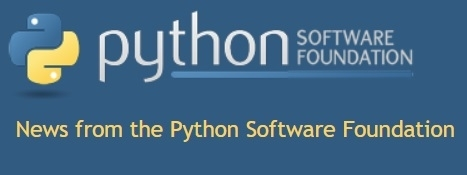](https://pyfound.blogspot.com/2026/11/how-python-ecosystem-responded-to.html)

The Python Software Foundation explains how the Python ecosystem responded within two days to the October 20 compromise of an eMudhra intermediate certificate authority, with fixes in pip, the certifi certificate bundle and Python itself, patched PyPI and python.org services, and a last-resort denylist backported to older Python releases. The post also looks at certificate revocation as a way to handle future incidents without a software update - [Python Software Foundation](https://pyfound.blogspot.com/2026/11/how-python-ecosystem-responded-to.html).

## This Week's Python Streams

Python on Hardware is all about building a cooperative ecosphere which allows contributions to be valued and to grow knowledge. Below are the streams within the last week focusing on the community.

**CircuitPython Deep Dive Stream**

[Last Friday](https://youtube.com/live/X1fubpy14lc), Tim fills Scott's slot (while Scott is at Supercon) and he discusses ESP-SDR custom firmware on the Metro P4's ESP32-C6 coprocessor.

You can see the latest video and past videos on the Adafruit YouTube channel under the Deep Dive playlist - [YouTube](https://www.youtube.com/playlist?list=PLjF7R1fz_OOXBHlu9msoXq2jQN4JpCk8A).

**CircuitPython Parsec**

John Park’s CircuitPython Parsec this week was hit by sunspots or aliens. Still, you can catch all the episodes in the [YouTube playlist](https://www.youtube.com/playlist?list=PLjF7R1fz_OOWFqZfqW9jlvQSIUmwn9lWr).

**Deep Dive with Tim**

[Last week](https://youtube.com/live/un9sObtD88Y), Tim streamed work on Fruit Jam Web Workflow, Display Mirror, and VNC Viewer.

You can see the latest video and past videos on the Adafruit YouTube channel under the Deep Dive playlist - [YouTube](https://www.youtube.com/playlist?list=PLjF7R1fz_OOXBHlu9msoXq2jQN4JpCk8A).

**CircuitPython Weekly Meeting**

CircuitPython Weekly Meeting for November 2, 2026 ([notes](https://github.com/adafruit/adafruit-circuitpython-weekly-meeting/blob/main/2026/2026-11-02.md)) on [YouTube](https://youtu.be/6tghXC2Gnus)

## Project of the Week: A PyPortal GitHub Contributions Dashboard

Donny Kurniawan has built a desk dashboard on an Adafruit PyPortal that shows GitHub contribution counts, the current streak and a contribution heatmap for one or two accounts, refreshed over WiFi. Tapping the screen switches to a breakdown by contribution type and the most-committed repositories. The code is written in CircuitPython - [GitHub](https://github.com/donny/pyportal-github).

## Popular Last Week

[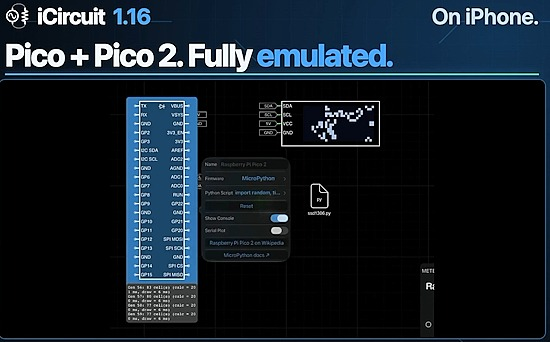](https://icircuitapp.com/)

What was the most popular, most clicked link, in [last week's newsletter](https://www.adafruitdaily.com/2026/11/02/the-python-on-microcontrollers-newsletter-adafruit-metro-p4-hydra-possible-new-raspberry-pi-boards-jit-gone-and-more/)? [iCircuit](https://icircuitapp.com/).

Did you know you can read past issues of this newsletter in the Adafruit Daily Archive? [Check it out](https://www.adafruitdaily.com/category/circuitpython/).

## Adafruit Playground Notes

[Adafruit Playground](https://adafruit-playground.com/) is a place for the community to post their projects and other making tips/tricks/techniques. Ad-free, it's an easy way to publish your work in a safe space for free.

## News From Around the Web

[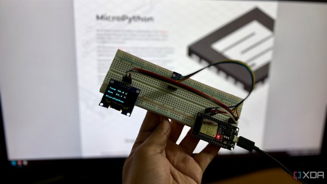](https://www.xda-developers.com/flashed-micropython-4-board-its-easiest-way-into-electronics-ive-found/)

XDA Developers compares MicroPython and Arduino C++ on an inexpensive ESP32 NodeMCU board that reads an AHT10 temperature and humidity sensor and shows the values on a 1.3-inch SH1106 OLED. The MicroPython version took fewer lines of code and ran in about a second after each edit, versus about 37 seconds for the Arduino upload cycle, at the cost of some free memory - [XDA Developers](https://www.xda-developers.com/flashed-micropython-4-board-its-easiest-way-into-electronics-ive-found/).

[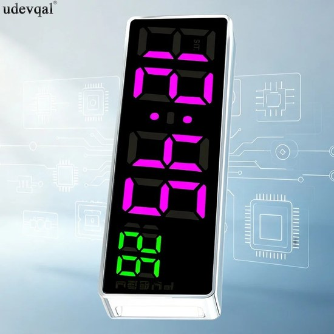](https://github.com/johnlr/mpy-tm1640-clock)

John La Rooy wired an ESP32-S2 Mini running MicroPython to the microcontroller pads of an inexpensive CAI-274-V4.3 clock board, taking over its TM1640 RGB LED display. The clock sets itself over WiFi with NTP, keeps a DS1302 real-time clock as backup and shows weather from Open-Meteo - [GitHub](https://github.com/johnlr/mpy-tm1640-clock) and [Bluesky](https://bsky.app/profile/johnlarooy.bsky.social/post/3mziayehedk2c).

CTP500 Print Server is a self-hosted print server for the CTP500 Bluetooth thermal printer, written in Python and run on a Raspberry Pi 5, with a web app, command line and HTTP API for notes, photos, QR codes and banners. An optional instant-camera app in CircuitPython for the Adafruit MEMENTO (ESP32-S3) prints each photo and adds it to the server's gallery - [GitHub](https://github.com/jamesccupps/CTP500-Print-Server).

[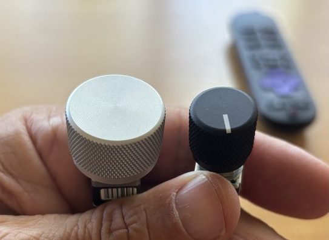](https://github.com/djacobson/clonker-10000)

THE CLONKER 10000 is a home theater remote built from big metal knobs and toggle switches, made to be used by feel in the dark. It runs CircuitPython on a Raspberry Pi Pico 2 W (RP2350), controls a Roku and Denon receivers over WiFi and has a browser-based config editor; the README calls it extreme beta - [GitHub](https://github.com/djacobson/clonker-10000).

[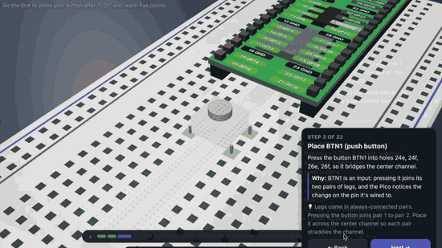](https://github.com/Prestical/BreadPilot)

BreadPilot is a desktop app that turns an idea, such as lighting an LED at the press of a button, into a checked circuit, with wiring steps on a 3D breadboard and MicroPython code for a Raspberry Pi Pico 2 W (RP2350). A local AI model drafts the text and code, and code picks the pins and checks the wiring for shorts and other mistakes. A final click builds a .uf2 file to flash to the board - [GitHub](https://github.com/Prestical/BreadPilot).

OreoOS is a MicroPython-based operating system for the Oreo Badge, an open-hardware conference badge built on an ESP32-S3 with a 2-inch 320 x 240 display, IR and Bluetooth. It ships with 14 apps (Doom among them), an on-device app market and over-the-air updates - [OreoOS](https://oreo.elixpo.com/), [GitHub](https://github.com/elixpo/oreo) and [MicroPython Discussions](https://github.com/orgs/micropython/discussions/19847).

[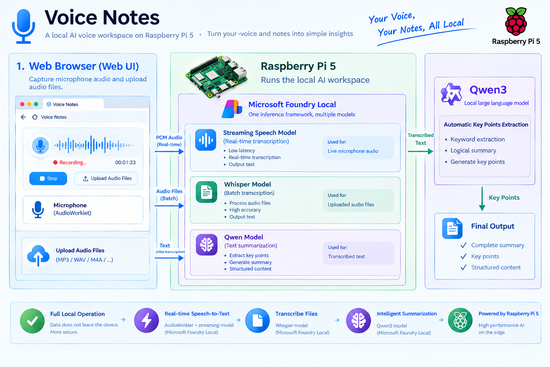](https://techcommunity.microsoft.com/blog/EducatorDeveloperBlog/build-an-offline-ai-voice-notebook-on-raspberry-pi-with-microsoft-foundry-local/4568592)

This tutorial builds a voice notebook on a Raspberry Pi 5 with a USB microphone that transcribes speech and drafts summaries of the notes entirely on the device, with no cloud service. It runs as a Python Flask app using Microsoft's Foundry Local SDK with small speech-recognition and language models - [Microsoft Tech Community](https://techcommunity.microsoft.com/blog/EducatorDeveloperBlog/build-an-offline-ai-voice-notebook-on-raspberry-pi-with-microsoft-foundry-local/4568592).

[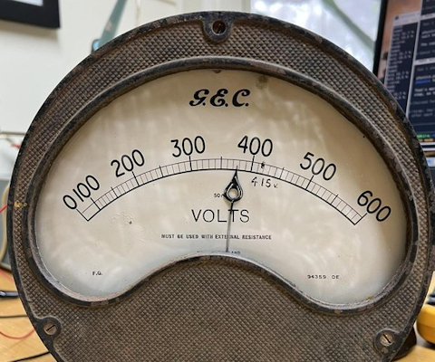](https://www.instructables.com/Wireless-Voltmeter/)

A 1950s G.E.C. switchboard voltmeter gets a second life showing MQTT values over WiFi, its needle driven by an ESP32 running MicroPython through an LM324 current driver and a boost converter. It is currently displaying live solar output, and the write-up covers calibration and how a moving-iron meter works - [Instructables](https://www.instructables.com/Wireless-Voltmeter/) and [GitHub](https://github.com/MarkMakies/Wireless-Voltmeter).

[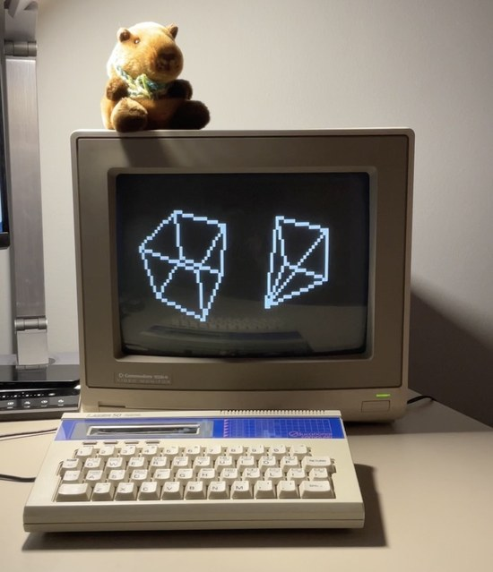](https://bsky.app/profile/daisy.pineconecomputer.com/post/3mzcn4v7i6s2n)

Daisy/1 is a homebrew 8-bit-inspired computer built from an Arduino Due, Mega and Uno. It runs PyCone, a port of MicroPython, on top of its DaisyOS, with modules for the hardware. The Due (SAM3X8E) runs the OS while the other two boards handle NTSC video and audio - [Bluesky](https://bsky.app/profile/daisy.pineconecomputer.com/post/3mzcn4v7i6s2n) and [Pinecone Computer](https://pineconecomputer.com).

An analog-style dial on a CrowPanel 1.28" round display (ESP32-C3), running MicroPython, shows the live speed of a German ICE train from the onboard WiFi portal. A Java bridge on a laptop forwards the data over serial to work around a TLS problem - [draeger-it.blog](https://draeger-it.blog/ice-tacho-esp32-wifionice/). (German)

FluidFM is a 160x120 fluid simulation running at 62 fps alongside a 10-voice FM synthesizer, with picture and sound sent over HDMI from an Adafruit Fruit Jam (RP2350). MicroPython runs the program logic, the inner loops are hand-written Thumb-2 assembly, and the two cores split the work - [YouTube](https://www.youtube.com/watch?v=2PCYq0y6b9I) and [GitHub](https://github.com/Samneggs/FruitJam/tree/main/apps/FluidFM).

KAGURA-9 is an HDMI graphics and sound chip built on a Tang Nano 9K FPGA and controlled by MicroPython on a Raspberry Pi Pico (RP2040). The showcase demo has tile graphics, demo effects, a scrolling shooter and PCM piano - [YouTube](https://www.youtube.com/watch?v=XFdMjWxvViY) and [GitHub](https://github.com/siska-tech/kagura).

[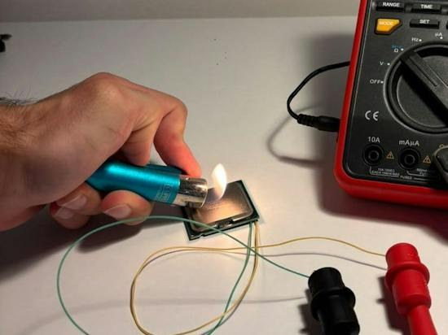](https://www.hackster.io/decogabry/using-an-old-cpu-as-a-thermometer-98c737)

A Raspberry Pi Pico (RP2040) running MicroPython reads the thermal diode of a retired Pentium 4 using its internal pull-up and ADC, calibrated against a DS18B20 sensor - [Hackster](https://www.hackster.io/decogabry/using-an-old-cpu-as-a-thermometer-98c737).

[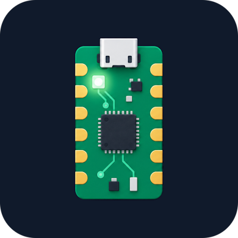](https://play.google.com/store/apps/details?id=cloud.helixscribe.electronicsplayground)

PicoLab is an Android app from HelixScribe.AI that puts a virtual Raspberry Pi Pico on a breadboard with LEDs, buttons, resistors and piezo buzzers, shown in 2D or 3D with voltages, currents and wiring faults. It runs MicroPython code on the phone to drive the simulated Pico's GPIO and PWM, though ADC, I2C and NeoPixel code aren't supported yet - [Google Play](https://play.google.com/store/apps/details?id=cloud.helixscribe.electronicsplayground).

Robo Elite connects a NEO-6M GPS receiver, a TF-Luna LiDAR distance sensor and an MPU6050 accelerometer and gyroscope to a Raspberry Pi Zero 2 W. A Python 3 program reads all three sensors and serves the position, distance and motion readings on a web dashboard that refreshes in a browser on the local network - [YouTube](https://www.youtube.com/watch?v=mOe92hMQXgY).

[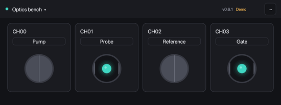](https://github.com/woolen-yarn/kohdalab-shutter)

KohdaLab Shutter controls servo-driven optical shutters for a lab, with MicroPython firmware on a Raspberry Pi Pico W and a desktop app for Windows and macOS. Each PC locks the channels it uses, so several computers can share one Pico, with channel names stored on the Pico. The project includes a setup app that loads and updates Pico firmware without a separate Python install - [GitHub](https://github.com/woolen-yarn/kohdalab-shutter).

[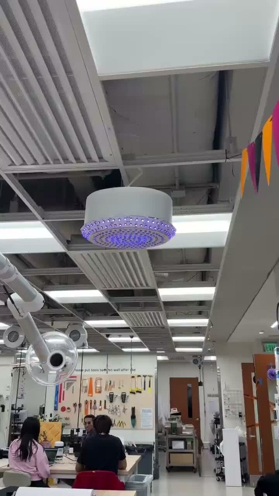](https://bsky.app/profile/gallaugher.bsky.social/post/3mzjpecz5qc2y)

John Gallaugher's Ripples chandelier senses a person standing underneath with a VL53L1X time-of-flight sensor, and a raised hand makes its lights pulse faster and brighter. This first draft runs CircuitPython on an ESP32-S3 - [Bluesky](https://bsky.app/profile/gallaugher.bsky.social/post/3mzjpecz5qc2y) and [Mastodon](https://mastodon.world/@gallaugher/117561241120128488).

[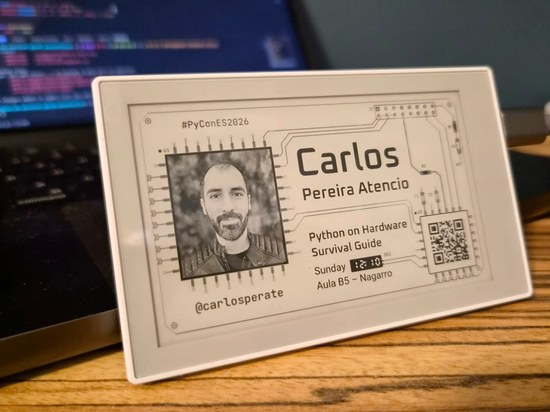](https://bsky.app/profile/carlosperate.bsky.social/post/3mzljmuupjs2q)

Carlos Pereira Atencio is bringing MicroPython to the Seeed Studio reTerminal Sticky, an ESP32-S3 device with a 3.97-inch 800x480 e-paper display, ahead of PyConES 2026. The firmware and libraries cover the board definition, a panel driver with partial refresh and four grays, the battery fuel gauge and BLE UART - [Bluesky](https://bsky.app/profile/carlosperate.bsky.social/post/3mzljmuupjs2q) and [GitHub](https://github.com/carlosperate/micropython-reterminal-sticky).

## Coming Soon / New

[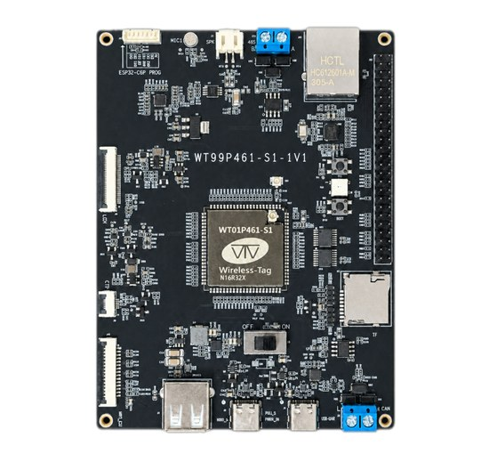](https://www.cnx-software.com/2026/11/04/21-esp32-p4x-and-esp32-c61-full-featured-board-offers-ethernet-wifi-6-rs485-can-bus-mipi-csi-dsi-and-more/)

Wireless-Tag's WT99P461-S1 is a $21 development board pairing an ESP32-P4X with an ESP32-C61 for WiFi 6 and Bluetooth LE, plus 32 MB of PSRAM, Ethernet, RS-485, CAN bus and MIPI DSI and CSI connectors, with a $42.50 kit adding a 7-inch display. The article doesn't mention Python support, but MicroPython and CircuitPython both have builds for the ESP32-P4 - [CNX](https://www.cnx-software.com/2026/11/04/21-esp32-p4x-and-esp32-c61-full-featured-board-offers-ethernet-wifi-6-rs485-can-bus-mipi-csi-dsi-and-more/).

[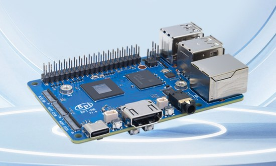](https://www.cnx-software.com/2026/11/02/banana-pi-bpi-m8-an-allwinner-a733-sbc-inspired-by-the-raspberry-pi-5-with-pcie-ffc-connector-ufs-module-socket/)

The Banana Pi BPI-M8 is a single board computer laid out like the Raspberry Pi 5, built on the Allwinner A733 with LPDDR5 memory, a 40-pin header, a PCIe FFC connector and a UFS module socket. It runs Linux, so Python is available, and starts at $69 for the M8B and $103 for the M8A - [CNX](https://www.cnx-software.com/2026/11/02/banana-pi-bpi-m8-an-allwinner-a733-sbc-inspired-by-the-raspberry-pi-5-with-pcie-ffc-connector-ufs-module-socket/) and [Hackster](https://www.hackster.io/news/banana-pi-launches-the-raspberry-pi-5-like-allwinner-733-powered-bpi-m8-starting-at-69-fafd27721e3d).

The AptusDisplay A050EC01 is a 5-inch display development kit built around the dual-core RISC-V ESP32-P4 with 32 MB PSRAM and 16 MB flash, driving a 480x854 IPS panel with 5-point capacitive touch. It has USB Type-C, UART, GPIO and Ethernet in a metal case, and the maker lists Arduino, ESP-IDF and MicroPython support - [YouTube](https://www.youtube.com/watch?v=C7lOy6yOz-g) and [product page](https://www.aptusdisplay.com/products/5-inch-854c397480-esp32-p4-capacitive-touch-lcd-display-development-kit).

## New Boards Supported by CircuitPython

The number of supported microcontrollers and Single Board Computers (SBC) grows every week. This section outlines which boards have been included in CircuitPython or added to [CircuitPython.org](https://circuitpython.org/).

This week there was one new board added:

- [Baguette S3](https://circuitpython.org/board/thepihut_baguette_s3/) – ThePiHut

*Note: For non-Adafruit boards, please use the support forums of the board manufacturer for assistance, as Adafruit does not have the hardware to assist in troubleshooting.*

Looking to add a new board to CircuitPython? It's highly encouraged! Adafruit has four guides to help you do so:

- [How to Add a New Board to CircuitPython](https://learn.adafruit.com/how-to-add-a-new-board-to-circuitpython/overview)
- [How to add a New Board to the circuitpython.org website](https://learn.adafruit.com/how-to-add-a-new-board-to-the-circuitpython-org-website)
- [Adding a Single Board Computer to PlatformDetect for Blinka](https://learn.adafruit.com/adding-a-single-board-computer-to-platformdetect-for-blinka)
- [Adding a Single Board Computer to Blinka](https://learn.adafruit.com/adding-a-single-board-computer-to-blinka)

## New Adafruit Learning System Guide

[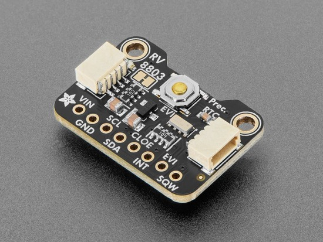](https://learn.adafruit.com/guides/latest)

The [Adafruit Learning System](https://learn.adafruit.com/) has over 3,200 free guides for learning skills and building projects including using Python.

[Adafruit RV-8803 High Accuracy Real Time Clock](https://learn.adafruit.com/adafruit-rv-8803-high-accuracy-real-time-clock) from [Liz Clark](https://learn.adafruit.com/u/BlitzCityDIY)

## CircuitPython Libraries

The CircuitPython library numbers are continually increasing, while existing ones continue to be updated. Here we provide library numbers and updates!

To get the latest Adafruit libraries, download the [Adafruit CircuitPython Library Bundle](https://circuitpython.org/libraries). To get the latest community contributed libraries, download the [CircuitPython Community Bundle](https://circuitpython.org/libraries).

If you'd like to contribute to the CircuitPython project on the Python side of things, the libraries are a great place to start. Check out the [CircuitPython.org Contributing page](https://circuitpython.org/contributing). If you're interested in reviewing, check out Open Pull Requests. If you'd like to contribute code or documentation, check out Open Issues. We have a guide on [contributing to CircuitPython with Git and GitHub](https://learn.adafruit.com/contribute-to-circuitpython-with-git-and-github), and you can find us in the #help-with-circuitpython and #circuitpython-dev channels on the [Adafruit Discord](https://adafru.it/discord).

You can check out this [list of all the Adafruit CircuitPython libraries and drivers available](https://github.com/adafruit/Adafruit_CircuitPython_Bundle/blob/master/circuitpython_library_list.md). 

The current number of CircuitPython libraries is **600**!

**New Libraries**

Here are this week's new CircuitPython libraries:
* [adafruit/Adafruit_CircuitPython_OV5647](https://github.com/adafruit/Adafruit_CircuitPython_OV5647)
* [adafruit/Adafruit_CircuitPython_JamPacked](https://github.com/adafruit/Adafruit_CircuitPython_JamPacked)
* [adafruit/Adafruit_CircuitPython_ILI9881](https://github.com/adafruit/Adafruit_CircuitPython_ILI9881)

**Updated Libraries**

Here are this week's updated CircuitPython libraries:
* [adafruit/Adafruit_CircuitPython_PortalBase](https://github.com/adafruit/Adafruit_CircuitPython_PortalBase)
* [adafruit/Adafruit_CircuitPython_PyBadger](https://github.com/adafruit/Adafruit_CircuitPython_PyBadger)
* [adafruit/Adafruit_CircuitPython_Requests](https://github.com/adafruit/Adafruit_CircuitPython_Requests)
* [adafruit/Adafruit_CircuitPython_Qualia](https://github.com/adafruit/Adafruit_CircuitPython_Qualia)

## What’s the CircuitPython team up to this week?

What is the team up to this week? Let’s check in:

**Dan**

I'm continuing work on Zephyr support for i.MX boards, and have also been tackling the open CircuitPython 11.0.0 issues, together with Mikey from Adafruit. We are making very good progress fixing and closing issues.

**Tim**

This week my SDR mapping projects guide was published. I've done some additional work on the web workflow display mirror and VNC functionality that I started last week. That is merged in to main now. I have some local changes that I'm testing that ease up on the CPU usage of the display mirror. Some in trade for slower FPS refreshing. Some of my recent USB host SDR apps need all the CPU time they can get for processing received data. My next guide is about the ESP-SDR project that uses an undocumented feature on ESP32-C6 chips for raw I/Q capture. This guide will document how to use ESP-SDR on the Metro P4 with a 5" Pi Touch Display.

**Scott**

This week I've been working on LVGL backed `displayio`. I realized it was more important for it to be fast than small in RAM. That idea has influenced my approach to getting it working and I'm still tweaking it. When debugging, I wanted to be able to capture the output, so I also added CP support for the LT8912B which converts DSI to DVI. That was really helpful. I merged in a couple changes to how `mipidsi` works to support that.

**Liz**

This week I published a guide for the [RV-8803 RTC breakout](https://learn.adafruit.com/adafruit-rv-8803-high-accuracy-real-time-clock). This RTC has a lot of extra features beyond just timekeeping. It lets you set alarms, timers and trigger event interrupts. For the CircuitPython driver, I made sure to write up examples for using all of these features.

## Upcoming Events

The next MicroPython Meetup in Melbourne will be on November 25 – [Luma](https://luma.com/micropython). You can see recordings of previous meetings on [YouTube](https://www.youtube.com/@MicroPythonOfficial).

*There is no MicroPython Meetup planned for December.*

Maker Faire Shenzhen 2026 will be December 12-13 in Nanshan, Shenzhen, China – [Maker Faire Shenzhen](https://www.shenzhenmakerfaire.com/).

If you know of virtual events or upcoming events, please let us know via email to cpnews(at)adafruit(dot)com.

## Latest Releases

CircuitPython's stable release is [10.3.1](https://github.com/adafruit/circuitpython/releases/latest) and its unstable release is [11.0.0-alpha.2](https://github.com/adafruit/circuitpython/releases). New to CircuitPython? Start with our [Welcome to CircuitPython Guide](https://learn.adafruit.com/welcome-to-circuitpython).

[20261106](https://github.com/adafruit/Adafruit_CircuitPython_Bundle/releases/latest) is the latest Adafruit CircuitPython library bundle.

[20261008](https://github.com/adafruit/CircuitPython_Community_Bundle/releases/latest) is the latest CircuitPython Community library bundle.

[v1.29.0](https://micropython.org/download) is the latest MicroPython release. Documentation for it is [here](https://docs.micropython.org/en/latest/).

[3.15.2](https://www.python.org/downloads/) is the latest Python release. The latest pre-release version is [3.16.0a1](https://www.python.org/download/pre-releases/).

[4,581 Stars](https://github.com/adafruit/circuitpython/stargazers) Like CircuitPython? [Star it on GitHub!](https://github.com/adafruit/circuitpython)

## Call for Help -- Translating CircuitPython is now easier than ever

[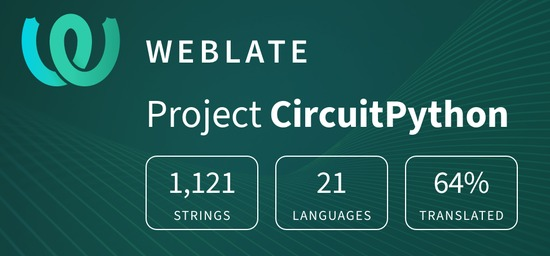](https://hosted.weblate.org/engage/circuitpython/)

One important feature of CircuitPython is translated control and error messages. With the help of fellow open source project [Weblate](https://weblate.org/), we're making it even easier to add or improve translations. 

Sign in with an existing account such as GitHub, Google or Facebook and start contributing through a simple web interface. No forks or pull requests needed! As always, if you run into trouble join us on [Discord](https://adafru.it/discord), we're here to help.

## 38,002 Thanks

The Adafruit Discord community, where we do all our CircuitPython development in the open, reached over 38,002 humans - thank you! Adafruit believes Discord offers a unique way for Python on hardware folks to connect. Join today at [https://adafru.it/discord](https://adafru.it/discord).

## ICYMI - In case you missed it

Python on hardware is the Adafruit Python video-newsletter-podcast! The news comes from the Python community, Discord, Adafruit communities and more and is broadcast on ASK an ENGINEER Wednesdays. The complete Python on Hardware weekly videocast [playlist is here](https://www.youtube.com/playlist?list=PLjF7R1fz_OOXRMjM7Sm0J2Xt6H81TdDev). The video podcast is on [iTunes](https://itunes.apple.com/us/podcast/python-on-hardware/id1451685192?mt=2), [YouTube](http://adafru.it/pohepisodes), [Instagram](https://www.instagram.com/adafruit/channel/), and [XML](https://adafruit-podcasts.s3.amazonaws.com/python_on_hardware/podcast.xml).

The weekly community chat on Adafruit Discord server CircuitPython channel - Audio / Podcast edition - Audio from the Discord chat space for CircuitPython, meetings are usually Mondays at 2pm ET, this is the audio version on Pocket Casts, [Spotify](https://adafru.it/spotify), and [XML feed](https://adafruit-podcasts.s3.amazonaws.com/circuitpython_weekly_meeting/audio-podcast.xml).

## Contribute

The CircuitPython Weekly Newsletter is a CircuitPython community-run newsletter emailed every Monday. To contribute your content, please email your news to cpnews (at) adafruit (dot) com with information and link(s) to your content. 

Join the Adafruit [Discord](https://adafru.it/discord) or [post to the forum](https://forums.adafruit.com/viewforum.php?f=60) if you have questions.
