- [ ] Library and info updates
- [ ] change date
- [ ] update title
- [ ] Feature story
- [ ] Update  for images
- [ ] Update ICYDNCI
- [ ] All images 550w max only
- [ ] Link "View this email in your browser."

News Sources

- [Adafruit Playground](https://adafruit-playground.com/)
- Twitter: [CircuitPython](https://twitter.com/search?q=circuitpython&f=live), [MicroPython](https://twitter.com/search?q=micropython&f=live) and [Python](https://twitter.com/search?q=python)
- [Raspberry Pi News](https://www.raspberrypi.com/news/), [Pi Foundation](https://www.raspberrypi.org/blog/)
- Mastodon [CircuitPython](https://mastodon.social/tags/CircuitPython) and [MicroPython](https://mastodon.social/tags/MicroPython)
- BlueSky [CircuitPython](https://bsky.app/search?q=circuitpython), [MicroPython](https://bsky.app/search?q=micropython), [Raspberry Pi](https://bsky.app/search?q=raspberry+pi)
- [Google News Python](https://news.google.com/topics/CAAqIQgKIhtDQkFTRGdvSUwyMHZNRFY2TVY4U0FtVnVLQUFQAQ?hl=en-US&gl=US&ceid=US%3Aen), [Infoworld](https://www.infoworld.com/python/)
- YouTube: [CircuitPython](https://www.youtube.com/results?search_query=circuitpython&sp=CAISBAgDEAE%253D), [MicroPython](https://www.youtube.com/results?search_query=micropython&sp=CAISBAgDEAE%253D), [Prof Gallaugher](https://www.youtube.com/@BuildWithProfG/videos)
- [maker.io Python](https://www.digikey.com/en/maker/search-results?s=createdDate&t=python)
- [hackster.io CircuitPython](https://www.hackster.io/search?q=circuitpython&i=projects&sort_by=most_recent) and [MicroPython](https://www.hackster.io/search?q=micropython&i=projects&sort_by=most_recent)
- Instructables: [CircuitPython](https://www.instructables.com/search/?q=circuitpython&projects=all&sort=Newest), [MicroPython](https://www.instructables.com/search/?q=micropython&projects=all&sort=Newest), [Raspberry Pi Python](https://www.instructables.com/search/?q=raspberry+pi+python&projects=all&sort=Newest)
- [hackaday CircuitPython](https://hackaday.com/blog/?s=circuitpython) and [MicroPython](https://hackaday.com/blog/?s=micropython)
- [python.org](https://www.python.org/)
- [Python Insider - dev team blog](https://blog.python.org/)
- Individuals: [bret.dk](https://bret.dk/), [Jeff Geerling](https://www.jeffgeerling.com/blog), [Yakroo](https://x.com/Yakroo5077), [coXXect](https://coxxect.blogspot.com/)
- Tom's Hardware: [CircuitPython](https://www.tomshardware.com/search?searchTerm=circuitpython&articleType=all&sortBy=publishedDate) and [MicroPython](https://www.tomshardware.com/search?searchTerm=micropython&articleType=all&sortBy=publishedDate) and [Raspberry Pi](https://www.tomshardware.com/search?searchTerm=raspberry%20pi&articleType=all&sortBy=publishedDate)
- [hackaday.io newest projects MicroPython](https://hackaday.io/projects?tag=micropython&sort=date) and [CircuitPython](https://hackaday.io/projects?tag=circuitpython&sort=date)
- hackaday.io - [CircuitPython](https://hackaday.io/search?term=circuitpython) and [MicroPython](https://hackaday.io/search?term=micropython)
- [MicroPython Meeting](https://luma.com/micropython?k=c)

View this email in your browser. **Warning: Flashing Imagery**

Welcome to the latest Python on Microcontrollers newsletter! *insert 2-3 sentences from editor (what's in overview, banter)* - *Anne Barela, Editor*

We're on [Discord](https://discord.gg/HYqvREz), [Twitter/X](https://twitter.com/search?q=circuitpython&f=live), [BlueSky](https://bsky.app/profile/circuitpython.org) and for past newsletters - [view them all here](https://www.adafruitdaily.com/category/circuitpython/). If you're reading this on the web, please [subscribe here](https://www.adafruitdaily.com/). Here's the news this week:

## Headline

text - [site](url).

## In Memoriam: Tim Peters, 1952-2026

Guido van Rossum announced that Tim Peters, one of Python's earliest and most influential contributors, died on July 15. Tim Peters wrote the Zen of Python (PEP 20) and designed Timsort, the sorting algorithm for Python lists later adopted by Java and Android, and was known on the Python mailing lists as the "Timbot" for careful, patient answers to user questions - [Discussions on Python.org](https://discuss.python.org/t/in-memoriam-tim-peters-1952-2026/110028) and [Adafruit Blog](https://blog.adafruit.com/2026/11/11/tim-peters-python-user-2-and-prolific-contributor-has-died/).

## CircuitPython 10.3.2 is Released

[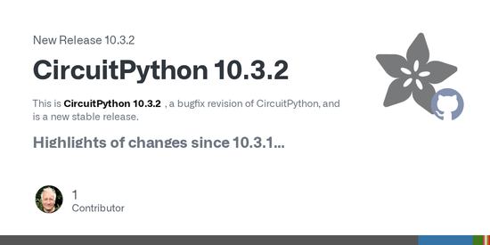](https://github.com/adafruit/circuitpython/releases/tag/10.3.2)

CircuitPython 10.3.2 is a new stable bugfix release. It removes compromised certificates from the root certificate bundle used for secure connections. Firmware for each board is on the circuitpython.org downloads page - [GitHub](https://github.com/adafruit/circuitpython/releases/tag/10.3.2).

## Python 3.16.0 Alpha 2 is Released

The Python release team has released Python 3.16.0a2, the second of seven planned alpha releases. Highlights so far include more expressive regular expressions, faster startup, much faster UUID generation and improved error messages, and the final release is planned for October 5, 2027 - [Python Insider](https://blog.python.org/2026/11/python-3160-alpha-2-is-now-available/).

## Feature

text - [site](url).

## Feature

text - [site](url).

## This Week's Python Streams

Python on Hardware is all about building a cooperative ecosphere which allows contributions to be valued and to grow knowledge. Below are the streams within the last week focusing on the community.

**CircuitPython Deep Dive Stream**

[Last Friday](), Scott streamed work on .

You can see the latest video and past videos on the Adafruit YouTube channel under the Deep Dive playlist - [YouTube](https://www.youtube.com/playlist?list=PLjF7R1fz_OOXBHlu9msoXq2jQN4JpCk8A).

**CircuitPython Parsec**

John Park’s CircuitPython Parsec this week is on  - [Adafruit Blog]() and [YouTube]().

Catch all the episodes in the [YouTube playlist](https://www.youtube.com/playlist?list=PLjF7R1fz_OOWFqZfqW9jlvQSIUmwn9lWr).

**Deep Dive with Tim**

[Last week](), Tim streamed work on .

You can see the latest video and past videos on the Adafruit YouTube channel under the Deep Dive playlist - [YouTube](https://www.youtube.com/playlist?list=PLjF7R1fz_OOXBHlu9msoXq2jQN4JpCk8A).

**CircuitPython Weekly Meeting**

CircuitPython Weekly Meeting for November 9th, 2026 ([notes](https://github.com/adafruit/adafruit-circuitpython-weekly-meeting/blob/main/2026/2026-11-09.md)) [on YouTube](https://youtu.be/UgW6OsBiWjg).

## Project of the Week: An Ambient Daylight Clock

[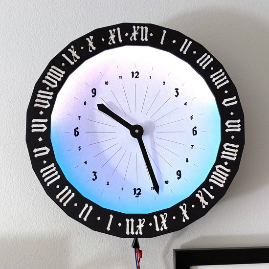](https://hannahilea.com/blog/daylight-clock/)

Hannah Ilea built a 24-hour analog clock whose ring of 48 NeoPixels lights the span of daylight for a chosen place, plus a control box with a knob, a slider and toggles for changing the date, latitude and longitude. An Adafruit Feather RP2040 runs it in CircuitPython with `asyncio` - [hannahilea.com](https://hannahilea.com/blog/daylight-clock/) and [GitHub](https://github.com/hannahilea/notebook-playground/tree/main/daylight-clock).

## Popular Last Week

What was the most popular, most clicked link, in [last week's newsletter](https://www.adafruitdaily.com/2026/11/09/the-python-on-microcontrollers-newsletter-600-circuitpython-libraries-upcoming-features-and-much-more/)? [Guido van Rossum: The Rise and Fall of Python's Benevolent Dictator](https://hackernoon.com/guido-van-rossum-the-rise-and-fall-of-pythons-benevolent-dictator).

Did you know you can read past issues of this newsletter in the Adafruit Daily Archive? [Check it out](https://www.adafruitdaily.com/category/circuitpython/).

## Notes from Adafruit Playground

[Adafruit Playground](https://adafruit-playground.com/) is a place for the community to post their projects and other making tips/tricks/techniques. Ad-free, it's an easy way to publish your work in a safe space for free.

text - [Adafruit Playground](url).

text - [Adafruit Playground](url).

text - [Adafruit Playground](url).

## News From Around the Web

[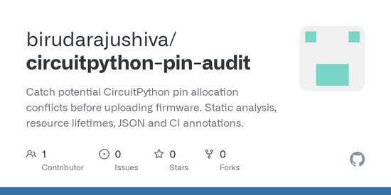](https://github.com/birudarajushiva/circuitpython-pin-audit)

CircuitPython Pin Audit is a static checker that reads CircuitPython setup code and flags pins two hardware objects may both claim, such as an I2C bus and a key matrix, before the code goes onto a board. It runs in Python 3.10 or newer on the computer, needs no hardware, and has a companion GitHub Action - [GitHub](https://github.com/birudarajushiva/circuitpython-pin-audit).

[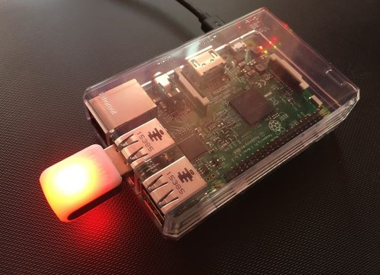](https://www.elektronik-kompendium.de/news/raspberry-pi-als-mikrocontroller/)

Elektronik-Kompendium points to guides on using a Raspberry Pi like a microcontroller, either with bare-metal CircuitPython or with Python in the Thonny IDE, locally or headless over SSH (German) - [Elektronik-Kompendium](https://www.elektronik-kompendium.de/news/raspberry-pi-als-mikrocontroller/).

[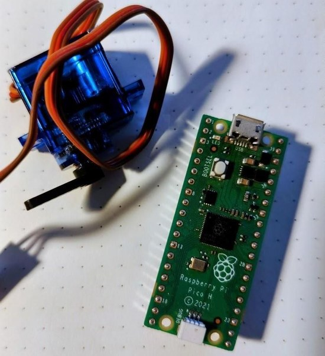](https://www.instructables.com/Raspberry-Pi-Pico-Control-a-Servo-Motor-With-Micro/)

A beginner tutorial covers wiring a hobby servo motor to a Raspberry Pi Pico and controlling it in MicroPython from the Thonny editor, using the micropython-servo package - [Instructables](https://www.instructables.com/Raspberry-Pi-Pico-Control-a-Servo-Motor-With-Micro/).

[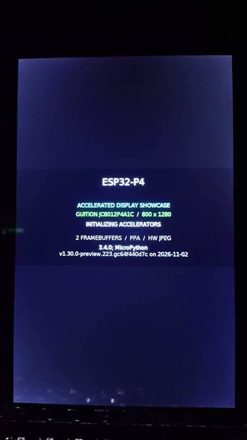](https://bsky.app/profile/johnlarooy.bsky.social/post/3mzutwrddq22x)

John La Rooy shows graphics demos on a 10.1 inch 800x1280 display driven by an Espressif ESP32-P4, using the chip's accelerated graphics features from MicroPython. The final scene gets help from a native module - [Bluesky](https://bsky.app/profile/johnlarooy.bsky.social/post/3mzutwrddq22x).

[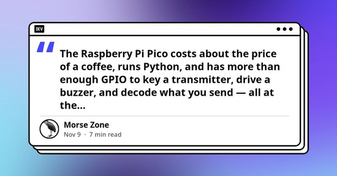](https://dev.to/morsezone/morse-code-on-a-raspberry-pi-pico-build-a-hardware-keyer-with-micropython-ga2)

Build a Morse code practice keyer on a Raspberry Pi Pico with a push button or straight key, a buzzer and the onboard LED. The MicroPython program sounds a sidetone, times each dit and dah, and decodes the characters to the serial console - [DEV](https://dev.to/morsezone/morse-code-on-a-raspberry-pi-pico-build-a-hardware-keyer-with-micropython-ga2).

[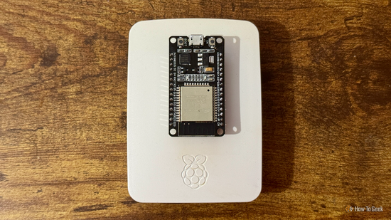](https://www.howtogeek.com/why-combining-a-raspberry-pi-and-esp32-gives-you-the-best-of-both-worlds/)

How-To Geek explains why pairing a Raspberry Pi with an ESP32 works well: the Pi runs Linux, Python scripts, databases and dashboards, and the ESP32 handles sensors, timing, PWM and motor control, with MQTT linking the two. Examples include a weather station and a robot - [How-To Geek](https://www.howtogeek.com/why-combining-a-raspberry-pi-and-esp32-gives-you-the-best-of-both-worlds/).

[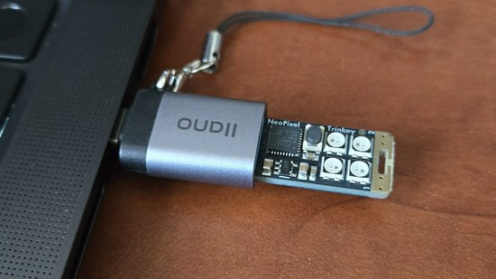](https://github.com/gopikori/neopulse)

NeoPulse is a USB status light that shows whether Claude Code or Codex sessions are working, need attention, are blocked or are done. It runs CircuitPython on an Adafruit Neo Trinkey (SAMD21) with four NeoPixels and two touch pads, or on other CircuitPython boards with NeoPixels, with a Python program on the computer sending it each session's state - [GitHub](https://github.com/gopikori/neopulse).

Candy Trader is a 3D-printed jack-o'-lantern that takes candy down its stem and rolls out a small toy or healthier treat in return. A Raspberry Pi runs it in Python, reading an ultrasonic sensor in the candy chute, turning the prize wheel motor and serving a web app that phones use to trade candy for points - [Instructables](https://www.instructables.com/Candy-Trader-a-3D-Printed-Jack-o-Lantern-That-Trad/).

Benjamin Conklin turned a Wii Nunchuk into a USB gamepad for the flight game Superflight, mapping the Nunchuk's tilt and joystick to gamepad axes. It runs CircuitPython on an Adafruit Trinket M0 - [YouTube](https://www.youtube.com/watch?v=6aPm2ggC7vA).

CircuitPython_RV565 plays RV565 video files, whose frames are already stored in the display's pixel format, on CircuitPython displays. The library decodes them in pure Python with the built-in zlib and shows them through displayio or sends them straight to an ST7789, and it has been tested on a Raspberry Pi Pico 2 - [GitHub](https://github.com/elixpo/CircuitPython_RV565).

[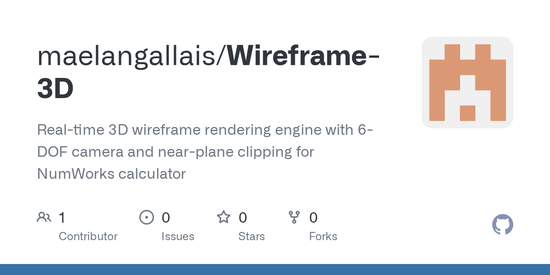](https://github.com/maelangallais/Wireframe-3D)

Wireframe-3D is a real-time 3D wireframe renderer for the NumWorks N0110 and N0120 graphing calculators, written in MicroPython. A free-flying camera moves and looks around the scene from the calculator's keys, with clipping so geometry behind the viewer doesn't draw - [GitHub](https://github.com/maelangallais/Wireframe-3D).

[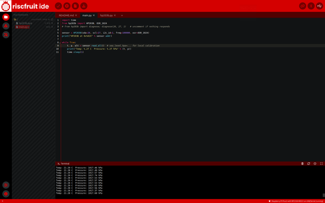](https://mastodon.social/@riscfruit/117597137744193538)

Riscfruit Laboratory is working on Riscfruit IDE, a browser-based IDE for MicroPython and CircuitPython, forked from ViperIDE, that runs on a computer or phone with nothing to install. It will work with the company's devices, such as the upcoming FramePico2 Expansion Card, and Pico C/C++ SDK builds on the server side are planned - [Mastodon](https://mastodon.social/@riscfruit/117597137744193538).

Google open sourced XSE, the XLA Serving Engine, which runs machine learning models written in Python with JAX as compiled native code, with no Python interpreter in the serving path. In Google's tests on short requests, XSE gave two to five times the throughput of its best Python server using a quarter of the memory - [The Register](https://www.theregister.com/devops/2026/11/11/google-gooses-python-ai-performance-by-removing-python/5308995) and [Google Open Source Blog](https://opensource.googleblog.com/2026/11/supercharging-xla-inference-xla-serving-engine.html).

[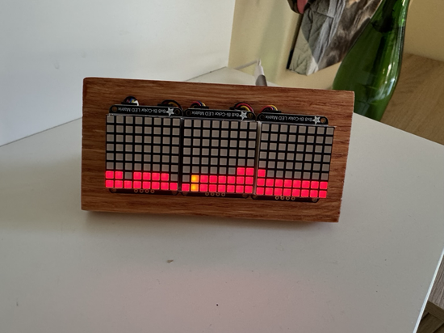](https://hachyderm.io/@MigsterTech/117600943071325130)

Following up on a tide clock built for a friend, Miguel Corteguera made a new display that cycles between the chance of rain and the temperature. It runs CircuitPython on an ESP32 - [Mastodon](https://hachyderm.io/@MigsterTech/117600943071325130) and [Bluesky](https://bsky.app/profile/migstertech.bsky.social/post/3n23dqquegk2b).

A video review, in Ukrainian, of ESP IDE, a browser-based environment for programming ESP32, ESP8266, RP2040 and RP2350 boards with no local compiler or drivers to install. It covers Blockly block coding and MicroPython over WebUSB and WebSerial, and compares the platform with the Arduino IDE and MakeCode - [YouTube](https://www.youtube.com/watch?v=xbjgWM_1O5k).

[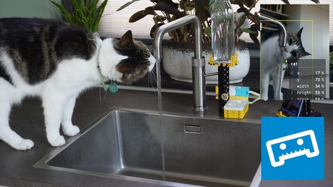](https://fosstodon.org/@laurensvalk/117594118438657813)

Laurens Valk built a LEGO machine that turns on the kitchen tap when Newton the cat comes for a drink, using a phone as the sensor. It's programmed with Pybricks, MicroPython firmware for LEGO hubs, and the full video is a Pybricks tutorial on adding vision to LEGO creations - [Mastodon](https://fosstodon.org/@laurensvalk/117594118438657813) and [YouTube](https://www.youtube.com/watch?v=XWZoklddZrE).

StrawMan is a Halloween scarecrow that watches the sidewalk with a camera and radar, turns its head toward visitors, comments on them using an AI model and answers when they talk back. A Raspberry Pi 5 runs the Python code, driving three servos for the head and jaw through a PCA9685 board, and a web dashboard lets you puppeteer it from a phone - [Instructables](https://www.instructables.com/StrawMan-an-AI-Scarecrow-That-Sees-Talks-and-Talks/) and [GitHub](https://github.com/0xJoeMartin/StrawMan).

text - [site](url).

## Coming Soon / New

[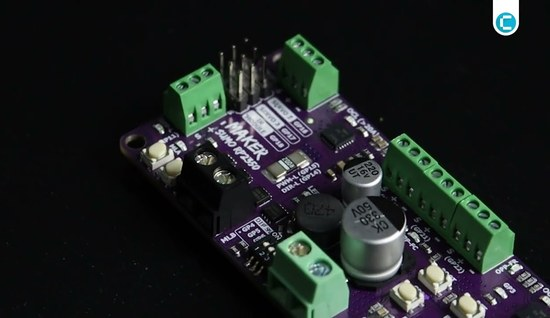](https://www.youtube.com/watch?v=NmL8_cWsBv0)

Cytron's Maker Sumo RP2350 is a controller for 1 kg sumo robots, built on the Raspberry Pi RP2350 with a dual-channel DC motor driver, inputs for five opponent sensors, two edge sensors and an IR start module, plus two servo outputs and a buzzer. It runs CircuitPython, with a board page on circuitpython.org - [YouTube](https://www.youtube.com/watch?v=NmL8_cWsBv0) and [Cytron](https://my.cytron.io/p-maker-sumo-rp2350-controller).

[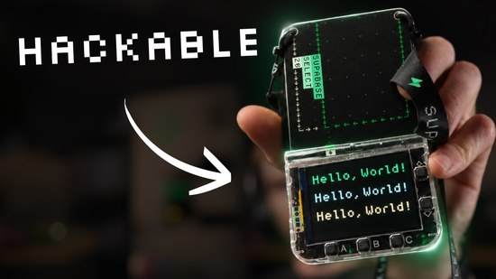](https://www.youtube.com/watch?v=LU0H4FnfL68)

Supabase gave out a programmable badge at its Supabase Select developer conference, built on the same hardware as the Raspberry Pi Pico 2 W and programmed in MicroPython. The video shows a real-time dashboard, an offline LLM, an Apple II demo and a robot car, using Supabase's experimental MicroPython client library. There's a virtual badge to try, and the Pimoroni Tufty 2350 is the same hardware for a real one - [YouTube](https://www.youtube.com/watch?v=LU0H4FnfL68) and [GitHub](https://github.com/supabase/supabase-micro).

## New Boards Supported by CircuitPython

The number of supported microcontrollers and Single Board Computers (SBC) grows every week. This section outlines which boards have been included in CircuitPython or added to [CircuitPython.org](https://circuitpython.org/).

This week there were (#/no) new boards added:

- [Board name](url)
- [Board name](url)
- [Board name](url)

*Note: For non-Adafruit boards, please use the support forums of the board manufacturer for assistance, as Adafruit does not have the hardware to assist in troubleshooting.*

Looking to add a new board to CircuitPython? It's highly encouraged! Adafruit has four guides to help you do so:

- [How to Add a New Board to CircuitPython](https://learn.adafruit.com/how-to-add-a-new-board-to-circuitpython/overview)
- [How to add a New Board to the circuitpython.org website](https://learn.adafruit.com/how-to-add-a-new-board-to-the-circuitpython-org-website)
- [Adding a Single Board Computer to PlatformDetect for Blinka](https://learn.adafruit.com/adding-a-single-board-computer-to-platformdetect-for-blinka)
- [Adding a Single Board Computer to Blinka](https://learn.adafruit.com/adding-a-single-board-computer-to-blinka)

## New Adafruit Learning System Guides

[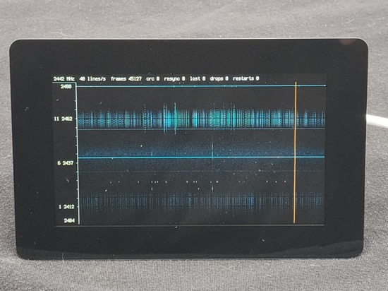](https://learn.adafruit.com/guides/latest)

The [Adafruit Learning System](https://learn.adafruit.com/) has over 3,200 free guides for learning skills and building projects including using Python.

[ESP-SDR on Metro ESP32-P4](https://learn.adafruit.com/esp-sdr-on-metro-esp32-p4) from [Tim C](https://learn.adafruit.com/u/Foamyguy)

[SDR Map Projects: ADS-B, APRS, and FT8](https://learn.adafruit.com/sdr-map-projects-adsb-aprs-and-ft8) from [Tim C](https://learn.adafruit.com/u/Foamyguy)

## CircuitPython Libraries

The CircuitPython library numbers are continually increasing, while existing ones continue to be updated. Here we provide library numbers and updates!

To get the latest Adafruit libraries, download the [Adafruit CircuitPython Library Bundle](https://circuitpython.org/libraries). To get the latest community contributed libraries, download the [CircuitPython Community Bundle](https://circuitpython.org/libraries).

If you'd like to contribute to the CircuitPython project on the Python side of things, the libraries are a great place to start. Check out the [CircuitPython.org Contributing page](https://circuitpython.org/contributing). If you're interested in reviewing, check out Open Pull Requests. If you'd like to contribute code or documentation, check out Open Issues. We have a guide on [contributing to CircuitPython with Git and GitHub](https://learn.adafruit.com/contribute-to-circuitpython-with-git-and-github), and you can find us in the #help-with-circuitpython and #circuitpython-dev channels on the [Adafruit Discord](https://adafru.it/discord).

You can check out this [list of all the Adafruit CircuitPython libraries and drivers available](https://github.com/adafruit/Adafruit_CircuitPython_Bundle/blob/master/circuitpython_library_list.md). 

The current number of CircuitPython libraries is **###**!

**New Libraries**

Here are this week's new CircuitPython libraries:

* [library](url)

**Updated Libraries**

Here are this week's updated CircuitPython libraries:

* [library](url)

## What’s the CircuitPython team up to this week?

What is the team up to this week? Let’s check in:

**Dan**

text.

**Tim**

My [ESP-SDR guide for the Metro P4](https://learn.adafruit.com/esp-sdr-on-metro-esp32-p4) was published this week. Now I'm working on USB host microphone capabilities. The core support for them has been in place for a few weeks, so I'm getting it documented in a guide. The project for this guide will be a touch screen recorder app for the Metro P4 + 5" Pi touch display 2. Outside of work I've also set back up the [Fruit Jams and antennas](https://learn.adafruit.com/fruit-jam-sstv-reciever/ariss-sstv) for the next [ARISS SSTV event](https://www.ariss.org/upcoming-sstv-events.html): Expedition 75 Series 35 "Space Memories". Here are a few of the cleanest photos I've captured during the event so far.

**Scott**

This weekend was Hackaday Supercon and I had a great time talking to everyone. I got CircuitPython running on the badge with a large epaper display that has two drivers. I also talked with a bunch of different makers about what they are working on and if CircuitPython could fit into it. I'm excited to see how we better CircuitPython going forwards.

Right now I'm working to build `displayio` on top of LVGL so that it is faster. Chips like the ESP32-P4 have a hardware accelerator that will help us compute pixels faster. I've got it mostly working but discovered a few bugs with the P4 along the way that needed fixing.

**Liz**

This week I updated the [Si5351 Clock Generator Breakouts guide](https://learn.adafruit.com/adafruit-si5351-clock-generator-breakout) for the new SI5351C 8-Channel Clock Generator Breakout. There is a new [pinouts page](https://learn.adafruit.com/adafruit-si5351-clock-generator-breakout/si5351c-8-channel-pinouts) that details how the breakout works. The Arduino and CircuitPython libraries were also updated for the new breakout.

## Upcoming Events

The next MicroPython Meetup in Melbourne will be on November 25 – [Luma](https://luma.com/micropython). You can see recordings of previous meetings on [YouTube](https://www.youtube.com/@MicroPythonOfficial).

*There is no MicroPython Meetup planned for December.*

Maker Faire Shenzhen 2026 will be December 12-13 in Nanshan, Shenzhen, China – [Maker Faire Shenzhen](https://www.shenzhenmakerfaire.com/).

FOSDEM 2027 will be January 30-31 in Brussels, Belgium – [FOSDEM](https://fosdem.org/2027/).

[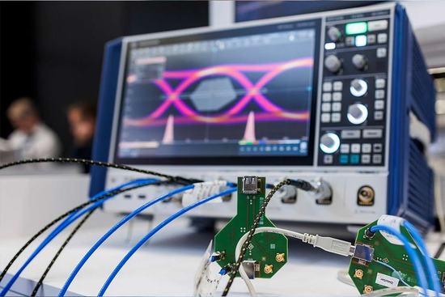](https://www.embedded-world.de/en)

The embedded world 2027 exhibition and conference will be March 16-18 in Nuremberg, Germany – [embedded world](https://www.embedded-world.de/en).

PyCascades 2027, a regional PyCon organized by the Vancouver, Seattle and Portland Python user groups, will be March 20-21 in Seattle, Washington – [PyCascades](https://2027.pycascades.com/).

If you know of virtual events or upcoming events, please let us know via email to cpnews(at)adafruit(dot)com.

## Latest Releases

CircuitPython's stable release is [#.#.#](https://github.com/adafruit/circuitpython/releases/latest) and its unstable release is [#.#.#-##.#](https://github.com/adafruit/circuitpython/releases). New to CircuitPython? Start with our [Welcome to CircuitPython Guide](https://learn.adafruit.com/welcome-to-circuitpython).

[2026####](https://github.com/adafruit/Adafruit_CircuitPython_Bundle/releases/latest) is the latest Adafruit CircuitPython library bundle.

[2026####](https://github.com/adafruit/CircuitPython_Community_Bundle/releases/latest) is the latest CircuitPython Community library bundle.

[v#.#.#](https://micropython.org/download) is the latest MicroPython release. Documentation for it is [here](https://docs.micropython.org/en/latest/).

[#.#.#](https://www.python.org/downloads/) is the latest Python release. The latest pre-release version is [#.#.#](https://www.python.org/download/pre-releases/).

[#,### Stars](https://github.com/adafruit/circuitpython/stargazers) Like CircuitPython? [Star it on GitHub!](https://github.com/adafruit/circuitpython)

## Call for Help -- Translating CircuitPython is now easier than ever

[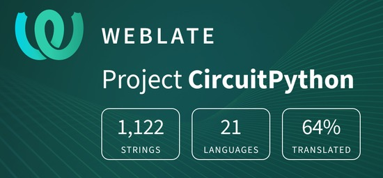](https://hosted.weblate.org/engage/circuitpython/)

One important feature of CircuitPython is translated control and error messages. With the help of fellow open source project [Weblate](https://weblate.org/), we're making it even easier to add or improve translations. 

Sign in with an existing account such as GitHub, Google or Facebook and start contributing through a simple web interface. No forks or pull requests needed! As always, if you run into trouble join us on [Discord](https://adafru.it/discord), we're here to help.

## 37,992 Thanks

The Adafruit Discord community, where we do all our CircuitPython development in the open, reached over 37,992 humans - thank you! Adafruit believes Discord offers a unique way for Python on hardware folks to connect. Join today at [https://adafru.it/discord](https://adafru.it/discord).

## ICYMI - In case you missed it

Python on hardware is the Adafruit Python video-newsletter-podcast! The news comes from the Python community, Discord, Adafruit communities and more and is broadcast on ASK an ENGINEER Wednesdays. The complete Python on Hardware weekly videocast [playlist is here](https://www.youtube.com/playlist?list=PLjF7R1fz_OOXRMjM7Sm0J2Xt6H81TdDev). The video podcast is on [iTunes](https://itunes.apple.com/us/podcast/python-on-hardware/id1451685192?mt=2), [YouTube](http://adafru.it/pohepisodes), [Instagram](https://www.instagram.com/adafruit/channel/), and [XML](https://adafruit-podcasts.s3.amazonaws.com/python_on_hardware/podcast.xml).

The weekly community chat on Adafruit Discord server CircuitPython channel - Audio / Podcast edition - Audio from the Discord chat space for CircuitPython, meetings are usually Mondays at 2pm ET, this is the audio version on Pocket Casts, [Spotify](https://adafru.it/spotify), and [XML feed](https://adafruit-podcasts.s3.amazonaws.com/circuitpython_weekly_meeting/audio-podcast.xml).

## Contribute

The CircuitPython Weekly Newsletter is a CircuitPython community-run newsletter emailed every Monday. To contribute your content, please email your news to cpnews (at) adafruit (dot) com with information and link(s) to your content. 

Join the Adafruit [Discord](https://adafru.it/discord) or [post to the forum](https://forums.adafruit.com/viewforum.php?f=60) if you have questions.
