- [ ] Library and info updates
- [ ] change date
- [ ] update title
- [ ] Feature story
- [ ] Update  for images
- [ ] Update ICYDNCI
- [ ] All images 550w max only
- [ ] Link "View this email in your browser."

News Sources

- [Adafruit Playground](https://adafruit-playground.com/)
- Twitter: [CircuitPython](https://twitter.com/search?q=circuitpython&f=live), [MicroPython](https://twitter.com/search?q=micropython&f=live) and [Python](https://twitter.com/search?q=python)
- [Raspberry Pi News](https://www.raspberrypi.com/news/), [Pi Foundation](https://www.raspberrypi.org/blog/)
- Mastodon [CircuitPython](https://mastodon.social/tags/CircuitPython) and [MicroPython](https://mastodon.social/tags/MicroPython)
- BlueSky [CircuitPython](https://bsky.app/search?q=circuitpython), [MicroPython](https://bsky.app/search?q=micropython), [Raspberry Pi](https://bsky.app/search?q=raspberry+pi)
- [Google News Python](https://news.google.com/topics/CAAqIQgKIhtDQkFTRGdvSUwyMHZNRFY2TVY4U0FtVnVLQUFQAQ?hl=en-US&gl=US&ceid=US%3Aen), [Infoworld](https://www.infoworld.com/python/)
- YouTube: [CircuitPython](https://www.youtube.com/results?search_query=circuitpython&sp=CAISBAgDEAE%253D), [MicroPython](https://www.youtube.com/results?search_query=micropython&sp=CAISBAgDEAE%253D), [Prof Gallaugher](https://www.youtube.com/@BuildWithProfG/videos)
- [maker.io Python](https://www.digikey.com/en/maker/search-results?s=createdDate&t=python)
- [hackster.io CircuitPython](https://www.hackster.io/search?q=circuitpython&i=projects&sort_by=most_recent) and [MicroPython](https://www.hackster.io/search?q=micropython&i=projects&sort_by=most_recent)
- Instructables: [CircuitPython](https://www.instructables.com/search/?q=circuitpython&projects=all&sort=Newest), [MicroPython](https://www.instructables.com/search/?q=micropython&projects=all&sort=Newest), [Raspberry Pi Python](https://www.instructables.com/search/?q=raspberry+pi+python&projects=all&sort=Newest)
- [hackaday CircuitPython](https://hackaday.com/blog/?s=circuitpython) and [MicroPython](https://hackaday.com/blog/?s=micropython)
- [python.org](https://www.python.org/)
- [Python Insider - dev team blog](https://blog.python.org/)
- Individuals: [bret.dk](https://bret.dk/), [Jeff Geerling](https://www.jeffgeerling.com/blog), [Yakroo](https://x.com/Yakroo5077), [coXXect](https://coxxect.blogspot.com/)
- Tom's Hardware: [CircuitPython](https://www.tomshardware.com/search?searchTerm=circuitpython&articleType=all&sortBy=publishedDate) and [MicroPython](https://www.tomshardware.com/search?searchTerm=micropython&articleType=all&sortBy=publishedDate) and [Raspberry Pi](https://www.tomshardware.com/search?searchTerm=raspberry%20pi&articleType=all&sortBy=publishedDate)
- [hackaday.io newest projects MicroPython](https://hackaday.io/projects?tag=micropython&sort=date) and [CircuitPython](https://hackaday.io/projects?tag=circuitpython&sort=date)
- hackaday.io - [CircuitPython](https://hackaday.io/search?term=circuitpython) and [MicroPython](https://hackaday.io/search?term=micropython)
- [MicroPython Meeting](https://luma.com/micropython?k=c)

View this email in your browser. **Warning: Flashing Imagery**

Welcome to the latest Python on Microcontrollers newsletter! *insert 2-3 sentences from editor (what's in overview, banter)* - *Anne Barela, Editor*

We're on [Discord](https://discord.gg/HYqvREz), [Twitter/X](https://twitter.com/search?q=circuitpython&f=live), [BlueSky](https://bsky.app/profile/circuitpython.org) and for past newsletters - [view them all here](https://www.adafruitdaily.com/category/circuitpython/). If you're reading this on the web, please [subscribe here](https://www.adafruitdaily.com/). Here's the news this week:

## Headline

text - [site](url).

## The de:volt Breadboard Simulator Runs MicroPython in the Browser

[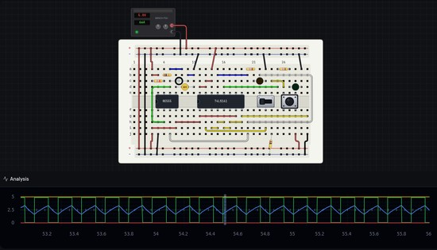](https://www.cnx-software.com/2026/11/18/web-based-breadboard-simulator-lets-you-build-circuits-fix-errors-and-monitor-designs-with-a-built-in-oscilloscope/)

de:volt is a breadboard simulator that runs in a web browser, with 105 parts, a built-in four-channel oscilloscope and warnings for mistakes such as an LED with no resistor. Arduino, BBC micro:bit and RP2040 boards are available, and the Code panel runs MicroPython, tested in the article on a simulated Raspberry Pi Pico. A free version is online, with an AI assistant and more analysis tools in a paid Premium tier - [CNX](https://www.cnx-software.com/2026/11/18/web-based-breadboard-simulator-lets-you-build-circuits-fix-errors-and-monitor-designs-with-a-built-in-oscilloscope/) and [simulator](https://sim.devoltapp.com).

## CircuitPython `displayio` Now Runs on LVGL In Latest Alpha Versions On Select Chips

CircuitPython's `displayio` now runs on the LVGL graphics library on ESP32-P4 and ESP32-S31 boards, in the Absolute Newest builds on circuitpython.org. Existing code works as is: Groups, TileGrids, Bitmaps, Palettes and `vectorio` shapes use the same API, with LVGL composing the screen. The new version is built for speed, and its internal formats are ready for the graphics accelerators in chips like the ESP32-P4. Audio keeps playing smoothly during screen redraws, and `vectorio` can now draw rounded rectangles, which need far less memory than bitmaps for dashboard-style widgets - [GitHub](https://github.com/adafruit/circuitpython/pull/11887).

The speed costs RAM, so code that ran slowly before may now run out of memory, and a new safe mode says so when it happens. E-paper displays aren't supported on LVGL builds yet. Other boards keep the original `displayio` - [GitHub](https://github.com/adafruit/circuitpython/pulls?q=is%3Apr+lvgl).

## Pimoroni's Art Matrix Runs MicroPython

[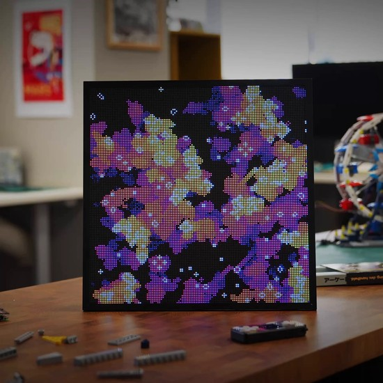](https://x.com/pimoroni/status/2122726268340961736)

Pimoroni's Art Matrix is a 128 x 128 RGB LED panel (16,384 pixels) in a black aluminum frame, driven by an RP2350B with WiFi and Bluetooth from a Raspberry Pi RM2 module. It ships with 45 plugins for algorithmic art, retro screensavers and live info, controlled from a browser on a phone, and the firmware and plugins are all MicroPython. - [X](https://x.com/pimoroni/status/2122726268340961736), [Pimoroni](https://shop.pimoroni.com/products/artmatrix) and [GitHub](https://github.com/pimoroni/artmatrix).

## Feature

text - [site](url).

## Feature

text - [site](url).

## This Week's Python Streams

Python on Hardware is all about building a cooperative ecosphere which allows contributions to be valued and to grow knowledge. Below are the streams within the last week focusing on the community.

**CircuitPython Deep Dive Stream**

[Last Friday](), Scott streamed work on .

You can see the latest video and past videos on the Adafruit YouTube channel under the Deep Dive playlist - [YouTube](https://www.youtube.com/playlist?list=PLjF7R1fz_OOXBHlu9msoXq2jQN4JpCk8A).

**CircuitPython Parsec**

John Park’s CircuitPython Parsec this week is on  - [Adafruit Blog]() and [YouTube]().

Catch all the episodes in the [YouTube playlist](https://www.youtube.com/playlist?list=PLjF7R1fz_OOWFqZfqW9jlvQSIUmwn9lWr).

**Deep Dive with Tim**

[Last week](https://youtube.com/live/UeWwqKOp5Tw), Tim streamed work on Porting TeensyChess to Metro ESP32-P4.

You can see the latest video and past videos on the Adafruit YouTube channel under the Deep Dive playlist - [YouTube](https://www.youtube.com/playlist?list=PLjF7R1fz_OOXBHlu9msoXq2jQN4JpCk8A).

**CircuitPython Weekly Meeting**

CircuitPython Weekly Meeting for November 16, 2026 ([notes](https://github.com/adafruit/adafruit-circuitpython-weekly-meeting/blob/main/2026/2026-11-16.md)) [on YouTube](https://youtu.be/v1LjViI9lcc).

## Project of the Week: NoVas, a Keychain Companion With Pixel Eyes

[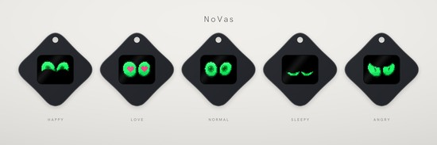](https://github.com/Yarielito06/NoVas)

NoVas is a keychain-sized companion with animated pixel eyes that blink, look around and change mood when tapped, stroked, held or shaken, plus clock and battery pages and a 3D-printable case whose generator code is included. It runs MicroPython on a Waveshare ESP32-S3-Touch-LCD-1.69, using the board's touch screen, motion sensor, clock chip and buzzer - [GitHub](https://github.com/Yarielito06/NoVas).

## Popular Last Week

[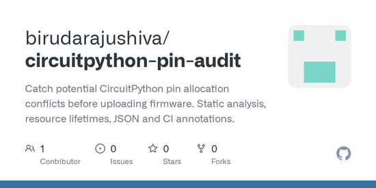](https://www.instructables.com/Raspberry-Pi-Pico-Control-a-Servo-Motor-With-Micro/)

What was the most popular, most clicked link, in [last week's newsletter](https://www.adafruitdaily.com/2026/11/16/the-python-on-microcontrollers-newsletter-circuitpython-11-0-0-alpha-3-released-remembering-tim-peters-python-3-16-alpha-2-and-more/)? [Raspberry Pi Pico Control a Servo Motor With MicroPython (Beginner's Guide)](https://www.instructables.com/Raspberry-Pi-Pico-Control-a-Servo-Motor-With-Micro/).

Did you know you can read past issues of this newsletter in the Adafruit Daily Archive? [Check it out](https://www.adafruitdaily.com/category/circuitpython/).

## Notes from Adafruit Playground

[Adafruit Playground](https://adafruit-playground.com/) is a place for the community to post their projects and other making tips/tricks/techniques. Ad-free, it's an easy way to publish your work in a safe space for free.

DrAldrin - Orbital Rendevous - [Adafruit Playground](https://adafruit-playground.com/u/mrklingon/pages/draldrin-orbital-rendevous).

## News From Around the Web

[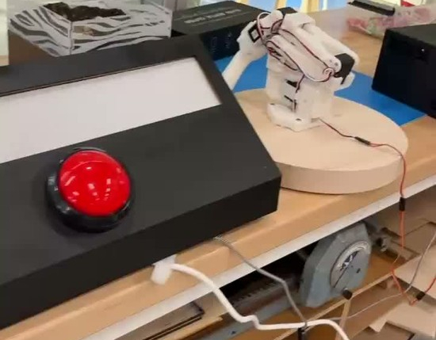](https://bsky.app/profile/gallaugher.bsky.social/post/3n2n4xtljmc2r)

John Gallaugher shows the LeRobot leader and follower arms at The Hatchery Makerspaces at Boston College, now coded to prevent burnout of the follower arm when it is left on too long. A Raspberry Pi 5 runs the arms and a Raspberry Pi Pico running CircuitPython handles the on/off control and a status display - [Bluesky](https://bsky.app/profile/gallaugher.bsky.social/post/3n2n4xtljmc2r) and [Mastodon](https://mastodon.world/@gallaugher/117641516999333796).

[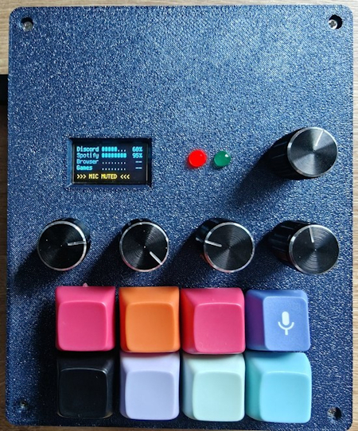](https://github.com/JackVermaak/pico-mixpad)

Pico Mixpad is a USB desk controller for Windows audio with a master volume knob, four per-app volume knobs, eight keys, an OLED and a mic-mute LED. CircuitPython on a Raspberry Pi Pico 2 (RP2350) reads the controls, and a Python host app on Windows sets per-app volume and serves a local settings page - [GitHub](https://github.com/JackVermaak/pico-mixpad) and [project page](https://jackvermaak.com/projects/mixpad.html).

Gezegen Terazisi (Planet Scale) is a children's exhibit that turns a cheap bathroom scale into a planet scale: a child steps on and a tablet shows the weight on the Moon, Mars or Jupiter. A Raspberry Pi Pico 2 W running MicroPython reads the scale's load cells through an HX711 and serves the page over its own WiFi network, so no internet is needed. The README is in Turkish - [GitHub](https://github.com/Xaena53/gezegen-terazisi) and [browser demo](https://xaena53.github.io/gezegen-terazisi/web/).

[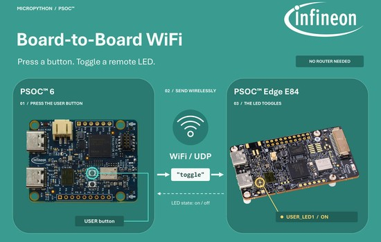](https://www.hackster.io/Infineon_Team/board-to-board-wifi-communication-with-micropython-on-psoc-044bc4)

An Infineon tutorial turns a PSOC 6 AI Kit into a WiFi remote control for a PSOC Edge E84 AI Kit, with no router needed. The Edge board opens its own access point, and the PSOC 6 sends short text commands over UDP to toggle an LED, mirroring the remote LED's state on its own. Both boards run MicroPython, deployed with Thonny - [Hackster](https://www.hackster.io/Infineon_Team/board-to-board-wifi-communication-with-micropython-on-psoc-044bc4).

Issue 31 of Hello World, the free magazine for computing educators from the Raspberry Pi Foundation, focuses on physical computing and robotics in the classroom. Articles cover machine learning through movement, environmental data science, cyberdecks and making makerspaces accessible - [Raspberry Pi](https://www.raspberrypi.org/blog/hello-world-31-out-now-physical-computing-and-robotics/).

[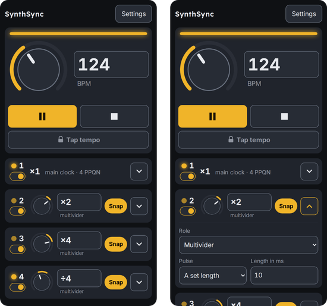](https://github.com/simonholliday/SynthSync)

SynthSync is a breadboard master clock for modular synths with up to eight trigger outputs, each set to its own multiple or division of the main clock. It runs MicroPython on a Raspberry Pi Pico 2 W (RP2350), with the chip's PIO hardware timing each pulse, and is set from a phone or computer over WiFi - [GitHub](https://github.com/simonholliday/SynthSync).

Curt Timmerman's image-extract packs many pictures into one raw image file on a computer with Python and pulls single images back out for display on small screens with MicroPython. It was tested on an ESP32 Cheap Yellow Display with an ILI9341 screen - [GitHub](https://github.com/ctimmer/image-extract) and [Show and tell](https://github.com/orgs/micropython/discussions/19971).

Wes Bos turned a GitHub Universe badge, a Pimoroni Tufty 2350 with an RP2350, into a pocket photo booth by adding an ESP32 camera, two LEDs as a flash and a Bluetooth thermal printer. A MicroPython app on the badge's Badgeware firmware shows a live preview, takes a photo on a button press, dithers it to black and white and prints it - [Hackster](https://www.hackster.io/news/this-conference-badge-is-now-a-tiny-photo-booth-bcbb945ab028) and [Circuit Rocks](https://blog.circuit.rocks/hack-a-github-universe-badge-into-a-thermal-printing-photo-booth).

[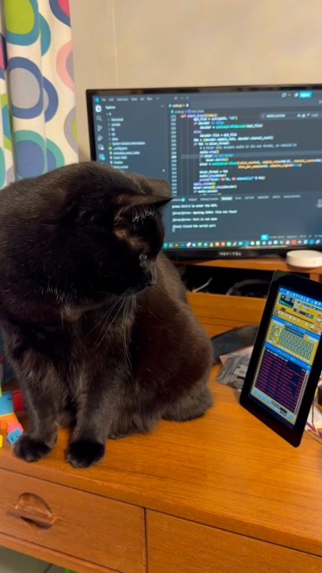](https://mastodon.social/@blitzcitydiy/117628260626381497)

Liz Clark (BlitzCityDIY) posted a short video of Winnie with a favorite Winamp skin running in CircuitPython, a nod to the classic desktop music player. - [Mastodon](https://mastodon.social/@blitzcitydiy/117628260626381497).

[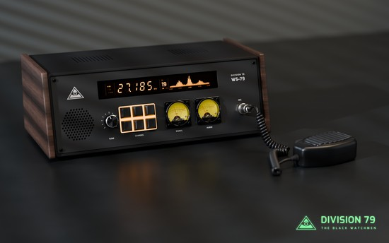](https://github.com/Anashel-RPG/ws79-radio)

The WS-79 is a desk prop of the field radio from the game The Black Watchmen, playing in-game transmissions as sound for a phone app to decode. Python programs run the radio and its bar screen on a Raspberry Pi 4, and the repo includes a card-setup utility, parts list, wiring and 3D printed case files. - [GitHub](https://github.com/Anashel-RPG/ws79-radio).

[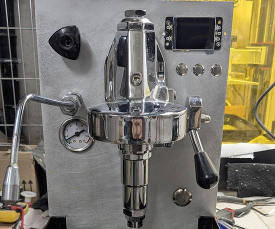](https://www.instructables.com/A-Raspberry-PI-Espresso-Machine/)

An old VBM Junior espresso machine gets PID temperature control, button-driven machine states and pump control from a Raspberry Pi running Python. The build involves mains wiring. - [Instructables](https://www.instructables.com/A-Raspberry-PI-Espresso-Machine/).

[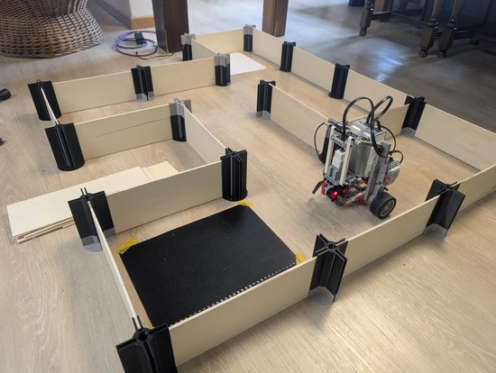](https://github.com/Saivy-fpv/roboterradar-ev3)

A LEGO Mindstorms EV3 robot maps an unknown maze with one ultrasonic sensor on a swiveling head, finds the goal, then drives back and speed-runs the shortest path. It runs MicroPython with Pybricks on ev3dev. - [GitHub](https://github.com/Saivy-fpv/roboterradar-ev3) and [write-up](https://krahenbuhl.net/projects/roboterradar/).

[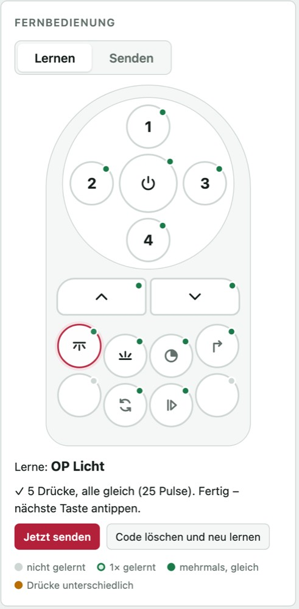](https://github.com/exercise69/ir-remote-lab)

ir-remote-lab captures the signals of an infrared remote control, measures the carrier frequency, compares repeated key presses and sends learned signals back through an IR LED, all controlled from a web page with a virtual remote. It runs CircuitPython on an ESP32-S3 and was tested with the remote of an older kitchen hood - [GitHub](https://github.com/exercise69/ir-remote-lab).

[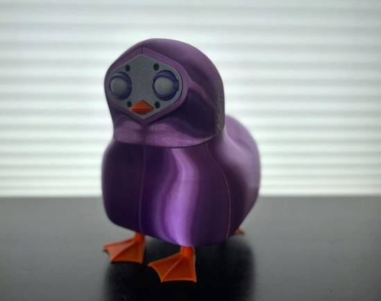](https://www.instructables.com/Mosey-the-Furby-Inspired-Robot-Creature/)

Mosey is a Furby-inspired robot with a 3D printed shell, designed in Onshape, that moves its eyes, beak, tail and feet with four servos and plays sounds through a speaker. A sibling team built it, and it runs CircuitPython on a Raspberry Pi Pico in a robotics board - [Instructables](https://www.instructables.com/Mosey-the-Furby-Inspired-Robot-Creature/).

[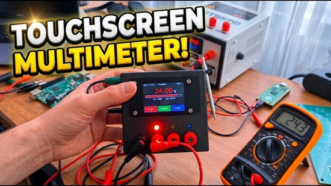](https://www.youtube.com/watch?v=Syfso0dOcHU)

PicoMeter Touch is a handheld multimeter and component tester built on a Raspberry Pi Pico with a 2.8 inch color touchscreen, measuring voltage with an ADS1115 ADC, current with an ACS712 sensor, plus resistance, LEDs and continuity. It is written in MicroPython and runs from 18650 batteries in a 3D printed case - [YouTube](https://www.youtube.com/watch?v=Syfso0dOcHU) and [GitHub](https://github.com/MakerIO-Hub/Smart-Touchscreen-Multimeter-Component-Tester).

[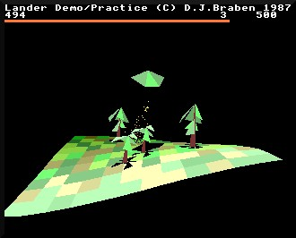](https://github.com/gbenson/micropython-lander)

Gary Benson ported Lander, David Braben's game for the Acorn Archimedes, to MicroPython. It runs on the Pimoroni Presto and on the Badgeware badges such as the RP2350-based Tufty 2350 - [GitHub](https://github.com/gbenson/micropython-lander).

[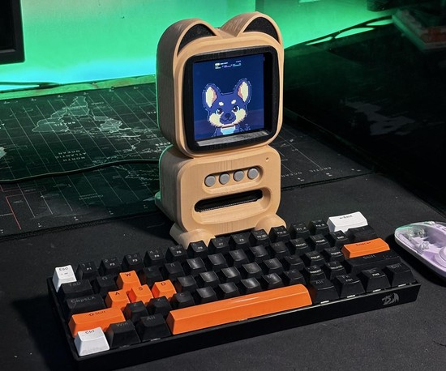](https://www.instructables.com/Momo-Cute-Desk-Companion-That-Barks-in-AI-Plays-Re/)

Momo is a 3D printed desk companion modeled on a German Shepherd that answers questions with dog sounds and plays retro games. A Raspberry Pi 5 runs the Python backend with a Waveshare touch display, a USB microphone, four buttons and a MAX98357A I2S amplifier - [Instructables](https://www.instructables.com/Momo-Cute-Desk-Companion-That-Barks-in-AI-Plays-Re/).

Reddit user epsmanifold built a baby diaper change tracker on an Adafruit MagTag, the ESP32-S2 e-ink display board, which syncs each logged change to a Google Sheet. - [Reddit](https://www.reddit.com/r/adafruit/comments/1xu0q7y/used_a_magtag_to_setup_a_baby_diaper_change/).

## New

Pimoroni's Art Matrix is a framed 128×128 RGB LED wall display built from two 128×64 panels and run by a Raspberry Pi RP2350B with 16 MB flash, 8 MB PSRAM and an RM2 module for WiFi and Bluetooth. It ships with MicroPython firmware and 45 plugins, from a drawing program to a weather dashboard, set up from a phone or browser, and it is fully programmable in MicroPython. It has a microSD slot and two STEMMA QT ports and sells for $178 - [Hackster](https://www.hackster.io/news/pimoroni-s-micropython-powered-art-matrix-puts-an-rp2350-in-control-of-16-384-leds-4f4c3130b33e) and [Pimoroni](https://shop.pimoroni.com/products/artmatrix).

[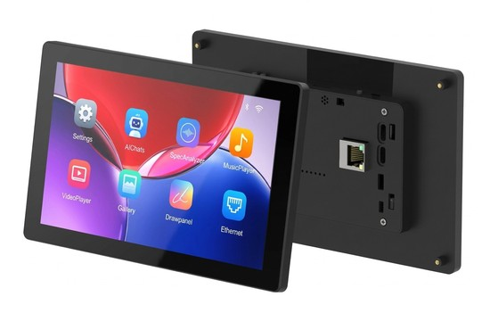](url)

text - [site](url).

## New Boards Supported by CircuitPython

The number of supported microcontrollers and Single Board Computers (SBC) grows every week. This section outlines which boards have been included in CircuitPython or added to [CircuitPython.org](https://circuitpython.org/).

This week there were (#/no) new boards added:

- [Board name](url)
- [Board name](url)
- [Board name](url)

*Note: For non-Adafruit boards, please use the support forums of the board manufacturer for assistance, as Adafruit does not have the hardware to assist in troubleshooting.*

Looking to add a new board to CircuitPython? It's highly encouraged! Adafruit has four guides to help you do so:

- [How to Add a New Board to CircuitPython](https://learn.adafruit.com/how-to-add-a-new-board-to-circuitpython/overview)
- [How to add a New Board to the circuitpython.org website](https://learn.adafruit.com/how-to-add-a-new-board-to-the-circuitpython-org-website)
- [Adding a Single Board Computer to PlatformDetect for Blinka](https://learn.adafruit.com/adding-a-single-board-computer-to-platformdetect-for-blinka)
- [Adding a Single Board Computer to Blinka](https://learn.adafruit.com/adding-a-single-board-computer-to-blinka)

## New Adafruit Learning System Guides

[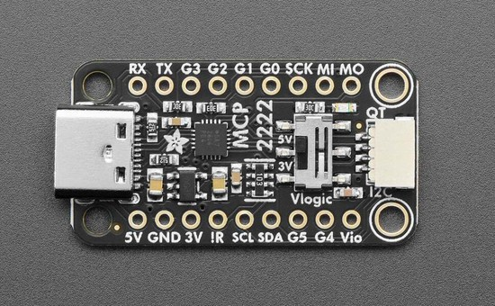](https://learn.adafruit.com/guides/latest)

The [Adafruit Learning System](https://learn.adafruit.com/) has over 3,200 free guides for learning skills and building projects including using Python.

[title](url) from [name](url)

[title](url) from [name](url)

[title](url) from [name](url)

## Updated Learn Guides

[title](url)

## CircuitPython Libraries

The CircuitPython library numbers are continually increasing, while existing ones continue to be updated. Here we provide library numbers and updates!

To get the latest Adafruit libraries, download the [Adafruit CircuitPython Library Bundle](https://circuitpython.org/libraries). To get the latest community contributed libraries, download the [CircuitPython Community Bundle](https://circuitpython.org/libraries).

If you'd like to contribute to the CircuitPython project on the Python side of things, the libraries are a great place to start. Check out the [CircuitPython.org Contributing page](https://circuitpython.org/contributing). If you're interested in reviewing, check out Open Pull Requests. If you'd like to contribute code or documentation, check out Open Issues. We have a guide on [contributing to CircuitPython with Git and GitHub](https://learn.adafruit.com/contribute-to-circuitpython-with-git-and-github), and you can find us in the #help-with-circuitpython and #circuitpython-dev channels on the [Adafruit Discord](https://adafru.it/discord).

You can check out this [list of all the Adafruit CircuitPython libraries and drivers available](https://github.com/adafruit/Adafruit_CircuitPython_Bundle/blob/master/circuitpython_library_list.md). 

The current number of CircuitPython libraries is **###**!

**New Libraries**

Here are this week's new CircuitPython libraries:

* [library](url)

**Updated Libraries**

Here are this week's updated CircuitPython libraries:

* [library](url)

## What’s the CircuitPython team up to this week?

What is the team up to this week? Let’s check in:

**Dan**

This past week I continued making changes and fixes for the 11.0.0 release. I finished the last changes that make incompatible changes in the Python API. I am working on the remaining bugs along with Mikey. We have about 20 issues left as of this writing, and are addressing several per day.

This week I added `deinit()` to displays, fixed an ESP-IDF bug that caused hangs on the Matrix Portal and submitted the fix upstream, fixed and submitted an I2C upstream bug on Nordic, changed what `os.uname()` returns, sped up the RP2xxx builds, and fixed other more minor bugs. I also worked on running only necessary GitHub jobs and speeding up the documentation builds.

**Tim**

This week I wrapped up work on the USB host microphone guide. It's in review and will get published after that is complete. The next project I'm working on is a port of TeensyChess that runs on the Metro ESP32-P4 with Pi Touch display, or 2.8" TFT shield. It allows a player to player against the stock fish chess engine. I've added two multiplayer modes: one local taking turns on the touch display, and one remote that communicates game state via Adafruit IO and uses two devices, one for each player. `displayio` built on top of LVGL was merged into main this week so I've been testing out the chess app on that and have submitted a few fixes to issues I found in the core and `lvgl` submodule. I'm also working on some fixes to get the recently add web/VNC display mirror working on the LVGL based builds.

**Scott**

This week we merged in `displayio` built on top of LVGL. The `displayio` API stays the same but the underlying implementation is geared for speed instead of memory efficiency. LVGL also gives us a standard API that may be accelerated by graphics accelerators within the MCU. Now that it is merged, I'm continuing to fix issues that have come up. For example, we have a complex dashboard project that uses rounded rectangles for different widgets. In LVGL, this causes us to run out of memory. So, I'm adding native rounded rectangle support to reduce the memory footprint needed for them.

**Liz**

This week I documented the [LT8912B DSI to DVI converter breakout](https://learn.adafruit.com/adafruit-lt8912b-dsi-to-dvi-converter). This board lets you connect a DSI output to a DVI or HDMI monitor. There's example code in both Arduino and CircuitPython for the Metro ESP32-P4 and a device tree overlay for Raspberry Pi. The dtoverlay lets you use it as an additional desktop monitor.

**Mikey**

## Upcoming Events

The next MicroPython Meetup in Melbourne will be on November 25 – [Luma](https://luma.com/micropython). You can see recordings of previous meetings on [YouTube](https://www.youtube.com/@MicroPythonOfficial).

*There is no MicroPython Meetup planned for December.*

Maker Faire Shenzhen 2026 will be December 12-13 in Nanshan, Shenzhen, China – [Maker Faire Shenzhen](https://www.shenzhenmakerfaire.com/).

FOSDEM 2027 will be January 30-31 in Brussels, Belgium – [FOSDEM](https://fosdem.org/2027/).

[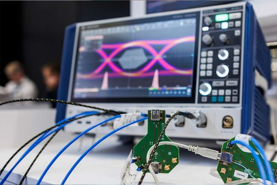](https://www.embedded-world.de/en)

The embedded world 2027 exhibition and conference will be March 16-18 in Nuremberg, Germany – [embedded world](https://www.embedded-world.de/en).

PyCascades 2027, a regional PyCon organized by the Vancouver, Seattle and Portland Python user groups, will be March 20-21 in Seattle, Washington – [PyCascades](https://2027.pycascades.com/).

If you know of virtual events or upcoming events, please let us know via email to cpnews(at)adafruit(dot)com.

## Latest Releases

CircuitPython's stable release is [#.#.#](https://github.com/adafruit/circuitpython/releases/latest) and its unstable release is [#.#.#-##.#](https://github.com/adafruit/circuitpython/releases). New to CircuitPython? Start with our [Welcome to CircuitPython Guide](https://learn.adafruit.com/welcome-to-circuitpython).

[2026####](https://github.com/adafruit/Adafruit_CircuitPython_Bundle/releases/latest) is the latest Adafruit CircuitPython library bundle.

[2026####](https://github.com/adafruit/CircuitPython_Community_Bundle/releases/latest) is the latest CircuitPython Community library bundle.

[v#.#.#](https://micropython.org/download) is the latest MicroPython release. Documentation for it is [here](https://docs.micropython.org/en/latest/).

[#.#.#](https://www.python.org/downloads/) is the latest Python release. The latest pre-release version is [#.#.#](https://www.python.org/download/pre-releases/).

[#,### Stars](https://github.com/adafruit/circuitpython/stargazers) Like CircuitPython? [Star it on GitHub!](https://github.com/adafruit/circuitpython)

## Call for Help -- Translating CircuitPython is now easier than ever

[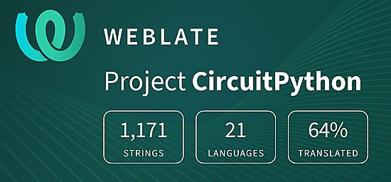](https://hosted.weblate.org/engage/circuitpython/)

One important feature of CircuitPython is translated control and error messages. With the help of fellow open source project [Weblate](https://weblate.org/), we're making it even easier to add or improve translations. 

Sign in with an existing account such as GitHub, Google or Facebook and start contributing through a simple web interface. No forks or pull requests needed! As always, if you run into trouble join us on [Discord](https://adafru.it/discord), we're here to help.

## 37,983 Thanks

The Adafruit Discord community, where we do all our CircuitPython development in the open, reached over 37,983 humans - thank you! Adafruit believes Discord offers a unique way for Python on hardware folks to connect. Join today at [https://adafru.it/discord](https://adafru.it/discord).

## ICYMI - In case you missed it

Python on hardware is the Adafruit Python video-newsletter-podcast! The news comes from the Python community, Discord, Adafruit communities and more and is broadcast on ASK an ENGINEER Wednesdays. The complete Python on Hardware weekly videocast [playlist is here](https://www.youtube.com/playlist?list=PLjF7R1fz_OOXRMjM7Sm0J2Xt6H81TdDev). The video podcast is on [iTunes](https://itunes.apple.com/us/podcast/python-on-hardware/id1451685192?mt=2), [YouTube](http://adafru.it/pohepisodes), [Instagram](https://www.instagram.com/adafruit/channel/), and [XML](https://adafruit-podcasts.s3.amazonaws.com/python_on_hardware/podcast.xml).

The weekly community chat on Adafruit Discord server CircuitPython channel - Audio / Podcast edition - Audio from the Discord chat space for CircuitPython, meetings are usually Mondays at 2pm ET, this is the audio version on Pocket Casts, [Spotify](https://adafru.it/spotify), and [XML feed](https://adafruit-podcasts.s3.amazonaws.com/circuitpython_weekly_meeting/audio-podcast.xml).

## Contribute

The CircuitPython Weekly Newsletter is a CircuitPython community-run newsletter emailed every Monday. To contribute your content, please email your news to cpnews (at) adafruit (dot) com with information and link(s) to your content. 

Join the Adafruit [Discord](https://adafru.it/discord) or [post to the forum](https://forums.adafruit.com/viewforum.php?f=60) if you have questions.
