View this email in your browser. 

Welcome to the latest Python on Microcontrollers newsletter! I was ready to tell you all this issue is abbreviated due to the US Thanksgiving holiday. As it turns out, there is a full suite of articles for your Monday morning. The hard work being done by the CircuitPython team has resulted in CircuitPython 11.0.0-beta.0. There are so many additions! And the number of boards that are circuitPython compatible has risen to 700! A new online editor for MicroPython is out that looks really good. Speaking of editors, it appears that use of Microsoft's VS Code is falling off dramatically. It may be reborn as an AI assistance tool. While Adafruit had initial CircuitPython on the upcoming Dabao chip, a full core has been developed by a user. Nice. All this and much more for your Monday reading. - *Anne Barela, Editor*

We're on [Discord](https://discord.gg/HYqvREz), [Twitter/X](https://twitter.com/search?q=circuitpython&f=live), [BlueSky](https://bsky.app/profile/circuitpython.org) and for past newsletters - [view them all here](https://www.adafruitdaily.com/category/circuitpython/). If you're reading this on the web, please [subscribe here](https://www.adafruitdaily.com/). Here's the news this week:

## CircuitPython 11 Enters Beta

The first beta of CircuitPython 11 adds a new `displayio` built on the LVGL graphics library, for now on the ESP32-P4 and ESP32-S31. Compiled .mpy files now load in place from the CIRCUITPY drive, which saves RAM. E-paper displays can play GIF animations and update faster, and `vectorio` adds rounded rectangles. Displays now have their own `deinit()` method, and `displayio.release_displays()` is deprecated. Libraries from the 10.x bundles still work with 11.0.0 builds, but check the release notes for incompatible changes before upgrading - [Adafruit Blog](https://blog.adafruit.com/2026/11/24/circuitpython-1100-beta-0-released/) and [release notes](https://github.com/adafruit/circuitpython/releases/tag/11.0.0-beta.0).

## Satya Nadella Says IDEs Faded After Claude Code

[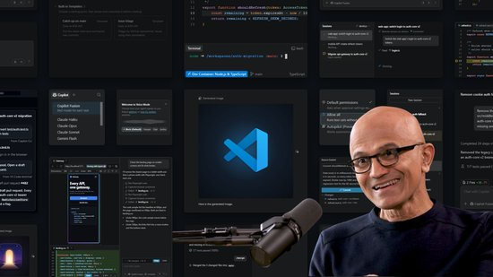](https://www.windowslatest.com/2026/11/23/the-thing-that-hit-us-satya-nadella-admits-vs-code-faded-in-six-months-after-a-decade-on-top-because-of-claude-code-and-some-developers-say-theyve-stopped-opening-it/)

Microsoft CEO Satya Nadella told Gergely Orosz of The Pragmatic Engineer that after Anthropic released Claude Code, IDEs “kind of faded away” in about six months. In Stack Overflow's 2026 Developer Survey, 70.9% of respondents used VS Code, down from 75.9% in 2025, and Claude Code topped the coding agents category at 65.5%. Nadella thinks there could be a rebirth of the IDE, built around specs and markdown as input Recent VS Code releases added an agent inbox, model comparisons and model routers that pick a model for each task - [Windows Latest](https://www.windowslatest.com/2026/11/23/the-thing-that-hit-us-satya-nadella-admits-vs-code-faded-in-six-months-after-a-decade-on-top-because-of-claude-code-and-some-developers-say-theyve-stopped-opening-it/).

## There Are Now 700 CircuitPython Compatible Boards

[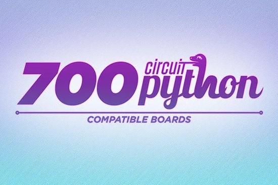](https://blog.adafruit.com/2026/11/24/there-are-now-700-circuitpython-compatible-microcontroller-boards-circuitpython-python-adafruit/)

There are now 700 microcontroller boards that can run CircuitPython. Find yours on [circuitpython.org](https://circuitpython.org/downloads) - [Adafruit Blog](https://blog.adafruit.com/2026/11/24/there-are-now-700-circuitpython-compatible-microcontroller-boards-circuitpython-python-adafruit/).

## The PSF Grants Program Reopens with Two Funding Rounds a Year

The Python Software Foundation is reopening its Grants Program with two funding rounds each year. The next round has a budget of $125,000. Applications are open December 14 to January 4 for conferences and workshops held from May 1 to September 30, 2027 - [PSF Blog](https://pyfound.blogspot.com/2026/11/reopening-psf-grants-program-with-twice.html).

## Pico Pipette, a MicroPython Editor in the Browser

[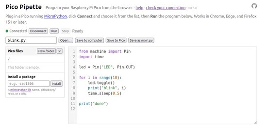](https://romilly.github.io/pico-pipette/)

Romilly Cocking has made Pico Pipette, a web-based MicroPython editor for the Raspberry Pi Pico and Pico 2, with nothing to install. It runs and stops code, marks the failing line when a program goes wrong, shows the variables left behind, manages the board's files and installs packages without WiFi. Course authors can add a “Run on your Pico” editor to their own lesson pages with one script tag. It works in Chrome, Edge, or Firefox 151 and later, and is MIT licensed - [GitHub](https://github.com/romilly/pico-pipette) and [web page](https://romilly.github.io/pico-pipette/). Via [X](https://x.com/rareblog/status/2124471834233971012).

## A CircuitPython Port for the Dabao

Armstrong Subero has ported CircuitPython to the Dabao board and its Baochip-1x RISC-V chip. The port is in beta, built on CircuitPython 11.0.0 alpha 3 and tested on Dabao hardware. The REPL and the CIRCUITPY drive run over the board's own USB port, the header pins work with the standard CircuitPython modules, and the chip's crypto hardware handles SHA, HMAC and AES. A Windows installer is in the releases - [GitHub](https://github.com/ArmstrongSubero/baochip-circuitpython).

## This Week's Python Streams

Python on Hardware is all about building a cooperative ecosphere which allows contributions to be valued and to grow knowledge. Below are the streams within the last week focusing on the community.

**CircuitPython Parsec**

Catch all the episodes of CircuitPython Parsec in the [YouTube playlist](https://www.youtube.com/playlist?list=PLjF7R1fz_OOWFqZfqW9jlvQSIUmwn9lWr).

**Deep Dive with Tim**

[Last week](https://youtube.com/live/9M3DkVAxtb0), Tim streamed work on CircuitPython Z80 Emulator & Cassette Storage.

You can see the latest video and past videos on the Adafruit YouTube channel under the Deep Dive playlist - [YouTube](https://www.youtube.com/playlist?list=PLjF7R1fz_OOXBHlu9msoXq2jQN4JpCk8A).

**CircuitPython Weekly Meeting**

CircuitPython Weekly Meeting for November 23, 2026 ([notes](https://github.com/adafruit/adafruit-circuitpython-weekly-meeting/blob/main/2026/2026-11-23.md)) [on YouTube](https://youtu.be/6a3LBMadLbY).

## Project of the Week: A Pirate Time Radio Station on a Pico

Jeff Geerling has built a small WWVB time station to set radio-controlled "atomic" clocks indoors, where the signal from Colorado doesn't reach. A Raspberry Pi Pico 2 W gets the time over WiFi and uses PIO to send a 60 kHz signal through a loop antenna next to the clock. The MicroPython code is a fork of the Longwave Pico project - [YouTube](https://www.youtube.com/watch?v=-Sn8J6k3ng0) and [GitHub](https://github.com/geerlingguy/Pico-WWVB).

## Popular Last Week

What was the most popular, most clicked link, in [last week's newsletter](https://www.adafruitdaily.com/2026/11/23/python-on-microcontrollers-newsletter-circuitpython-displayio-on-lvgl-micropython-v1-30-nears-breadboard-simulator-and-more/)? [Web-based breadboard simulator lets you build circuits, fix errors, and monitor designs with a built-in oscilloscope](https://www.cnx-software.com/2026/11/18/web-based-breadboard-simulator-lets-you-build-circuits-fix-errors-and-monitor-designs-with-a-built-in-oscilloscope/).

Did you know you can read past issues of this newsletter in the Adafruit Daily Archive? [Check it out](https://www.adafruitdaily.com/category/circuitpython/).

## Adafruit Playground Notes

[Adafruit Playground](https://adafruit-playground.com/) is a place for the community to post their projects and other making tips/tricks/techniques. Ad-free, it's an easy way to publish your work in a safe space for free.

## News From Around the Web

Raspberry Pi's RP2350 Hacking Challenge 2 has been cracked - [Bluesky](https://bsky.app/profile/eshard.bsky.social/post/3n32lb2whxk2i) and [paper](https://arxiv.org/abs/2611.25479).

A step-by-step build of an LED matrix flight tracker, made with CircuitPython on an Adafruit Matrix Portal M4 - [YouTube](https://www.youtube.com/watch?v=kVi_WDxkdxA) and [GitHub](https://github.com/schroz/ESP32-LED-Matrix-Flight-Tracker).

An outdoor Raspberry Pi LED matrix Advent calendar, now with a Python and Flask web interface and animations drawn in Aseprite - [YouTube](https://www.youtube.com/watch?v=qFzA5EbkY3I) and [project page](https://www.penguintutor.com/projects/pi-matrix-advent).

A work-in-progress 3D printed rosary for the first 41 decimals of pi, with a practice app made in MicroPython on an M5StickS3 - [Molecularist](https://www.molecularist.com/2026/11/wip-irrational-rosary.html).

[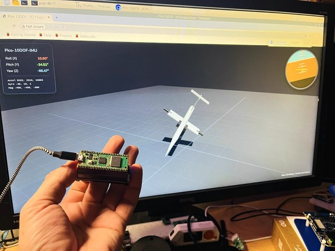](https://x.com/r_schulz_maker/status/2125297633807757643)

Roland Schulz uses a Waveshare IMU sensor and a Raspberry Pi Pico W running MicroPython to control an F-104 Starfighter jet through a web server, with an artificial horizon display - [X](https://x.com/r_schulz_maker/status/2125297633807757643).

[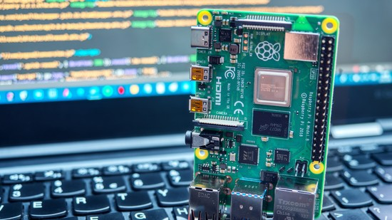](https://www.engadget.com/2319090/free-raspberry-pi-tool-access-remotely/)

The free Raspberry Pi tool you should be using to access it remotely - [Engadget](https://www.engadget.com/2319090/free-raspberry-pi-tool-access-remotely/).

[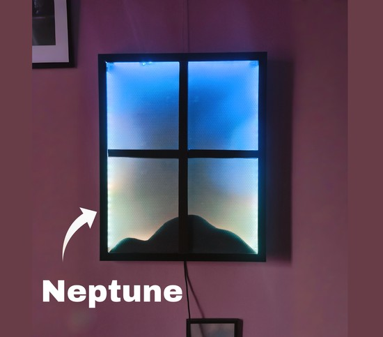](https://www.instructables.com/DIY-False-Window-That-Teleports-Your-Room-to-Any-P/)

A false window that shows the live sky color of another planet, made with a Raspberry Pi Zero 2 W running Python and an LED strip driven by WLED - [Instructables](https://www.instructables.com/DIY-False-Window-That-Teleports-Your-Room-to-Any-P/).

[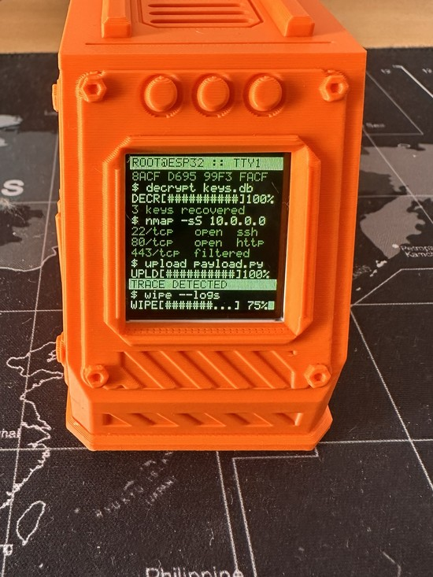](https://github.com/lamaro/esp32-sci-fi-retro)

A 3D-printed retro sci-fi desk console with an ESP32 and a small color screen, running animated screen modes in MicroPython - [GitHub](https://github.com/lamaro/esp32-sci-fi-retro).

[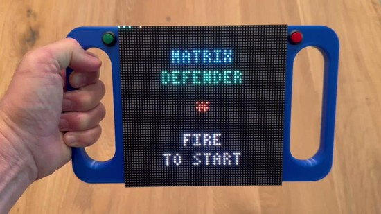](https://github.com/migster/MatrixDefender)

Matrix Defender, a tilt-controlled alien defense game in CircuitPython for an Adafruit MatrixPortal S3 and a 64x64 RGB LED panel - [GitHub](https://github.com/migster/MatrixDefender) and [Bluesky](https://bsky.app/profile/migstertech.bsky.social/post/3n2wi2e2eqs2l).

A moon clock and weather and tide display for an Adafruit Matrix Portal M4 and a 64x32 RGB LED panel, made with CircuitPython - [GitHub](https://github.com/vcampos2017/matrix-node).

[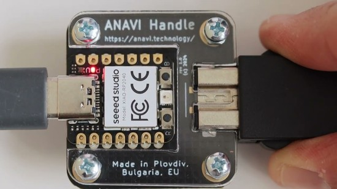](https://www.youtube.com/watch?v=CLefcC1FJ0I)

ANAVI Handle, an open source hardware adapter that turns a Wii Nunchuk controller into a USB device with a XIAO RP2040 and CircuitPython - [YouTube](https://www.youtube.com/watch?v=CLefcC1FJ0I) and [GitHub](https://github.com/AnaviTechnology/anavi-handle-sw).

[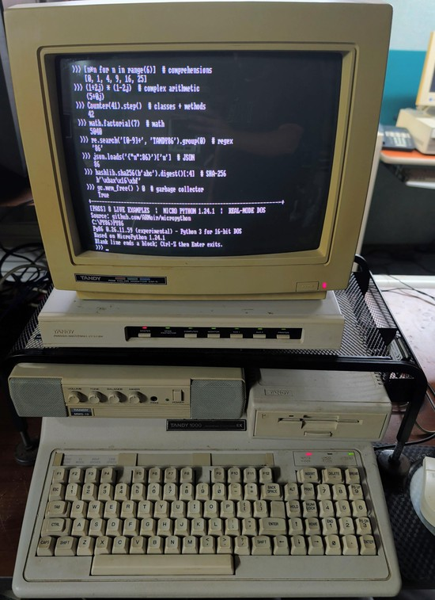](https://github.com/ARMoir/PY86)

Py86 is a port of MicroPython 1.29.0 to real-mode 16-bit MS-DOS on 8086, 8088 and NEC V20 PCs, tested on a 7 MHz Tandy 1000 EX - [GitHub](https://github.com/ARMoir/PY86). Via [MicroPython Discussions](https://github.com/orgs/micropython/discussions/19992).

[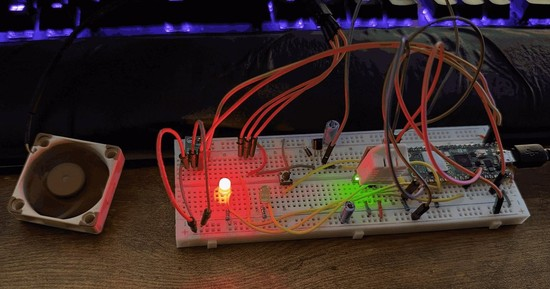](https://phbeks.com/blog/smartfan-launch.html)

I built a bathroom fan that knows when to stop, a Raspberry Pi Pico 2 W fan controller running MicroPython - [phbeks](https://phbeks.com/blog/smartfan-launch.html) and [GitHub](https://github.com/deokman420/smartfan).

[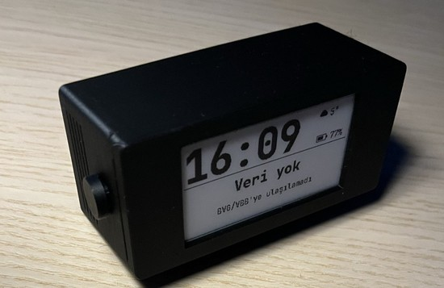](https://github.com/mskasal/showerboard)

Showerboard, a battery e-paper clock on a Raspberry Pi Pico W that shows the weather and live Berlin transit departures, written in MicroPython - [GitHub](https://github.com/mskasal/showerboard).

[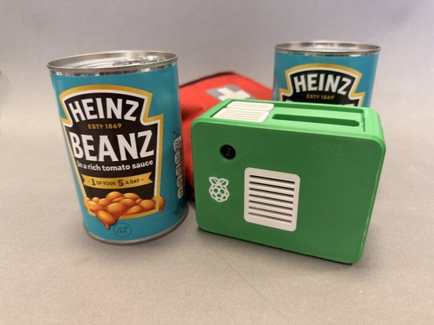](https://www.raspberrypi.com/news/keep-calm-and-carry-raspberry-pi-the-computer-in-my-three-day-kit/)

Keep calm and carry Raspberry Pi: the computer in my three-day kit - [Raspberry Pi](https://www.raspberrypi.com/news/keep-calm-and-carry-raspberry-pi-the-computer-in-my-three-day-kit/).

mp-agents, a set of AI coding agent plugins for MicroPython work in GitHub Copilot and Claude Code, by Jos Verlinde - [GitHub](https://github.com/Josverl/mp-agents).

RED runner: six one-button games for a tiny ESP32-C3 board with a 0.42 inch OLED, written in MicroPython - [GitHub](https://github.com/szabadkai/red-runner).

buildy-face, a small ESP32-C6 screen running MicroPython that shows which AI bot on a team is working and how it feels about it - [GitHub](https://github.com/jonzobrist/buildy-face).

## New

The Waveshare RP2350-Touch-AMOLED-1.8 is an RP2350A board with a 1.8 inch AMOLED touch display. Examples come in MicroPython, C and Arduino - [GitHub](https://github.com/waveshareteam/RP2350-Touch-AMOLED-1.8) and [product page](https://www.waveshare.com/product/rp2350-touch-amoled-1.8.htm).

Testing a DIY Pico Oscilloscope with my Dad. Geerling Engineering tries out Picotronix, a modular oscilloscope and logic analyzer built on two Raspberry Pi Pico 2 boards and programmable in MicroPython. It is a Kickstarter project - [YouTube](https://www.youtube.com/watch?v=YwL7KXExocg) and [CNX](https://cnx-software.com/2026/10/28/picotronix-modular-oscilloscope-and-logic-analyzer-features-two-raspberry-pi-pico-2-boards).

## New Boards Supported by CircuitPython

The number of supported microcontrollers and Single Board Computers (SBC) grows every week. This section outlines which boards have been included in CircuitPython or added to [CircuitPython.org](https://circuitpython.org/).

This week there were no new boards added.

*Note: For non-Adafruit boards, please use the support forums of the board manufacturer for assistance, as Adafruit does not have the hardware to assist in troubleshooting.*

Looking to add a new board to CircuitPython? It's highly encouraged! Adafruit has four guides to help you do so:

- [How to Add a New Board to CircuitPython](https://learn.adafruit.com/how-to-add-a-new-board-to-circuitpython/overview)
- [How to add a New Board to the circuitpython.org website](https://learn.adafruit.com/how-to-add-a-new-board-to-the-circuitpython-org-website)
- [Adding a Single Board Computer to PlatformDetect for Blinka](https://learn.adafruit.com/adding-a-single-board-computer-to-platformdetect-for-blinka)
- [Adding a Single Board Computer to Blinka](https://learn.adafruit.com/adding-a-single-board-computer-to-blinka)

## New Adafruit Learning System Guides

[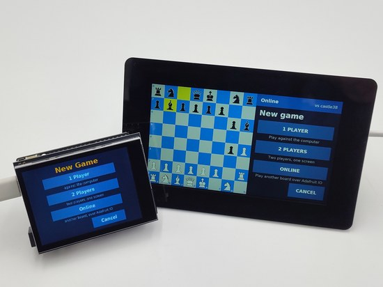](https://learn.adafruit.com/guides/latest)

The [Adafruit Learning System](https://learn.adafruit.com/) has over 3,200 free guides for learning skills and building projects including using Python.

[USB Microphone Recorder on Metro ESP32-P4](https://learn.adafruit.com/usb-microphone-recorder-on-metro-esp32-p4) from [Tim C](https://learn.adafruit.com/u/Foamyguy)

[Control WLED with an Xbox Controller](https://learn.adafruit.com/control-wled-with-an-xbox-controller) from [Erin St Blaine](https://learn.adafruit.com/u/firepixie)

[CircuitPython Chess on Metro ESP32-P4](https://learn.adafruit.com/circuitpython-chess-on-metro-esp32-p4) from [Tim C](https://learn.adafruit.com/u/Foamyguy)

[Adafruit Metro ESP32-P4 Hydra](https://learn.adafruit.com/adafruit-metro-esp32-p4-hydra) from [Liz Clark](https://learn.adafruit.com/u/BlitzCityDIY)

[FM-1 Firmware Flasher](https://learn.adafruit.com/fm-1-firmware-flasher) from [John Park](https://learn.adafruit.com/u/johnpark)

[Adafruit VL53L5CX Time-of-Flight Distance 8x8 Pixel Camera](https://learn.adafruit.com/adafruit-vl53l5cx-time-of-flight-distance-8x8-pixel-camera) from [Liz Clark](https://learn.adafruit.com/u/BlitzCityDIY)

## CircuitPython Libraries

The CircuitPython library numbers are continually increasing, while existing ones continue to be updated. Here we provide library numbers and updates!

To get the latest Adafruit libraries, download the [Adafruit CircuitPython Library Bundle](https://circuitpython.org/libraries). To get the latest community contributed libraries, download the [CircuitPython Community Bundle](https://circuitpython.org/libraries).

If you'd like to contribute to the CircuitPython project on the Python side of things, the libraries are a great place to start. Check out the [CircuitPython.org Contributing page](https://circuitpython.org/contributing). If you're interested in reviewing, check out Open Pull Requests. If you'd like to contribute code or documentation, check out Open Issues. We have a guide on [contributing to CircuitPython with Git and GitHub](https://learn.adafruit.com/contribute-to-circuitpython-with-git-and-github), and you can find us in the #help-with-circuitpython and #circuitpython-dev channels on the [Adafruit Discord](https://adafru.it/discord).

You can check out this [list of all the Adafruit CircuitPython libraries and drivers available](https://github.com/adafruit/Adafruit_CircuitPython_Bundle/blob/master/circuitpython_library_list.md). 

The current number of CircuitPython libraries is **605**!

**New Libraries**

Here is this week's new CircuitPython library:
* [adafruit/Adafruit_CircuitPython_VL53L5CX](https://github.com/adafruit/Adafruit_CircuitPython_VL53L5CX)

**Updated Libraries**

Here are this week's updated CircuitPython libraries:
* [adafruit/Adafruit_CircuitPython_NTP](https://github.com/adafruit/Adafruit_CircuitPython_NTP)
* [adafruit/Adafruit_CircuitPython_PyBadger](https://github.com/adafruit/Adafruit_CircuitPython_PyBadger)
* [elixpo/CircuitPython_RV565](https://github.com/elixpo/CircuitPython_RV565)

## What’s the CircuitPython team up to this week?

What is the team up to this week? Let’s check in:

**Dan**

I released CircuitPython 11.0.0-beta.0 last week. We finished nearly all the issues we wanted to address for 11.0.0 final. There are a few left and we'll probably have another beta or perhaps go directly to rc.0.

**Tim**

I finished up the CircuitPython Chess guide this week. I've worked on a few changes in the core, one that buffers isochronous USB data on `espressif` port so that recording to a file from USB microphone can run un-interrupted. Another limits the speed at which the web display mirror is sent data. The latter change helps run the SSTV project with the display mirror loaded and not drop packets from the SDR. My next project is a Z80/ZX Spectrum emulator with cassette tape storage system for the Fruit Jam. It's coming along nicely, here is a screenshot of it running Nohz Dyve, an game created for an easter egg in the Netflix film Bandersnatch.

**Scott**

Last week I wrapped up some `displayio` optimizations for two upcoming projects. Now I've decided to remove the limit on the number of displays CircuitPython can drive at once. This is a complicated internal task but the user API is almost the same. The one change is deprecating `displayio.release_displays()` in favor of accessing the primary display via `supervisor.runtime.display`. All other displays will be `deinit` at the end of the VM so `release_displays()` won't be needed for those. This will allow us to make projects with multiple displays!

**Mikey**

Changing one pixel on a 720x720 screen shouldn't redraw all half a million of them. On the Qualia ESP32-S3, `displayio` on LVGL now redraws only what changed, so a one-pixel update went from about 177 ms to under 2 ms. The Zephyr port moved up to current Zephyr main (~13k commits) with CircuitPython 11.0.0-beta.0 last week. All 40 Zephyr boards still build. The upcoming Metro CH32V407 and CH32V467 now give real random numbers from os.urandom(), and Pico W boards can join WPA3-only WiFi networks.

## Upcoming Events

Maker Faire Shenzhen 2026 will be December 12-13 in Nanshan, Shenzhen, China – [Maker Faire Shenzhen](https://www.shenzhenmakerfaire.com/).

The next MicroPython Meetup in Melbourne will be in January – [Luma](https://luma.com/micropython). You can see recordings of previous meetings on [YouTube](https://www.youtube.com/@MicroPythonOfficial).

FOSDEM 2027 will be January 30-31 in Brussels, Belgium – [FOSDEM](https://fosdem.org/2027/).

[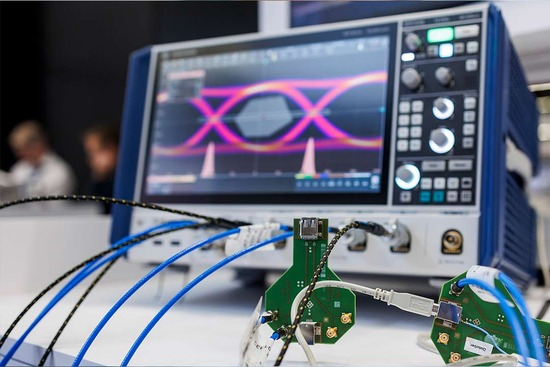](https://www.embedded-world.de/en)

The embedded world 2027 exhibition and conference will be March 16-18 in Nuremberg, Germany – [embedded world](https://www.embedded-world.de/en).

PyCascades 2027, a regional PyCon organized by the Vancouver, Seattle and Portland Python user groups, will be March 20-21 in Seattle, Washington – [PyCascades](https://2027.pycascades.com/).

If you know of virtual events or upcoming events, please let us know via email to cpnews(at)adafruit(dot)com.

## Latest Releases

CircuitPython's stable release is [10.3.2](https://github.com/adafruit/circuitpython/releases/latest) and its unstable release is [11.0.0-beta.0](https://github.com/adafruit/circuitpython/releases). New to CircuitPython? Start with our [Welcome to CircuitPython Guide](https://learn.adafruit.com/welcome-to-circuitpython).

[20261121](https://github.com/adafruit/Adafruit_CircuitPython_Bundle/releases/latest) is the latest Adafruit CircuitPython library bundle.

[20261121](https://github.com/adafruit/CircuitPython_Community_Bundle/releases/latest) is the latest CircuitPython Community library bundle.

[v1.29.0](https://micropython.org/download) is the latest MicroPython release. Documentation for it is [here](https://docs.micropython.org/en/latest/).

[3.15.2](https://www.python.org/downloads/) is the latest Python release. The latest pre-release version is [3.16.0a2](https://www.python.org/download/pre-releases/).

[4,599 Stars](https://github.com/adafruit/circuitpython/stargazers) Like CircuitPython? [Star it on GitHub!](https://github.com/adafruit/circuitpython)

## Call for Help -- Translating CircuitPython is now easier than ever

One important feature of CircuitPython is translated control and error messages. With the help of fellow open source project [Weblate](https://weblate.org/), we're making it even easier to add or improve translations. 

Sign in with an existing account such as GitHub, Google or Facebook and start contributing through a simple web interface. No forks or pull requests needed! As always, if you run into trouble join us on [Discord](https://adafru.it/discord), we're here to help.

## 37,983 Thanks

The Adafruit Discord community, where we do all our CircuitPython development in the open, reached over 37,983 humans - thank you! Adafruit believes Discord offers a unique way for Python on hardware folks to connect. Join today at [https://adafru.it/discord](https://adafru.it/discord).

## ICYMI - In case you missed it

Python on hardware is the Adafruit Python video-newsletter-podcast! The news comes from the Python community, Discord, Adafruit communities and more and is broadcast on ASK an ENGINEER Wednesdays. The complete Python on Hardware weekly videocast [playlist is here](https://www.youtube.com/playlist?list=PLjF7R1fz_OOXRMjM7Sm0J2Xt6H81TdDev). The video podcast is on [iTunes](https://itunes.apple.com/us/podcast/python-on-hardware/id1451685192?mt=2), [YouTube](http://adafru.it/pohepisodes), [Instagram](https://www.instagram.com/adafruit/channel/), and [XML](https://adafruit-podcasts.s3.amazonaws.com/python_on_hardware/podcast.xml).

The weekly community chat on Adafruit Discord server CircuitPython channel - Audio / Podcast edition - Audio from the Discord chat space for CircuitPython, meetings are usually Mondays at 2pm ET, this is the audio version on Pocket Casts, [Spotify](https://adafru.it/spotify), and [XML feed](https://adafruit-podcasts.s3.amazonaws.com/circuitpython_weekly_meeting/audio-podcast.xml).

## Contribute

The CircuitPython Weekly Newsletter is a CircuitPython community-run newsletter emailed every Monday. To contribute your content, please email your news to cpnews (at) adafruit (dot) com with information and link(s) to your content. 

Join the Adafruit [Discord](https://adafru.it/discord) or [post to the forum](https://forums.adafruit.com/viewforum.php?f=60) if you have questions.
